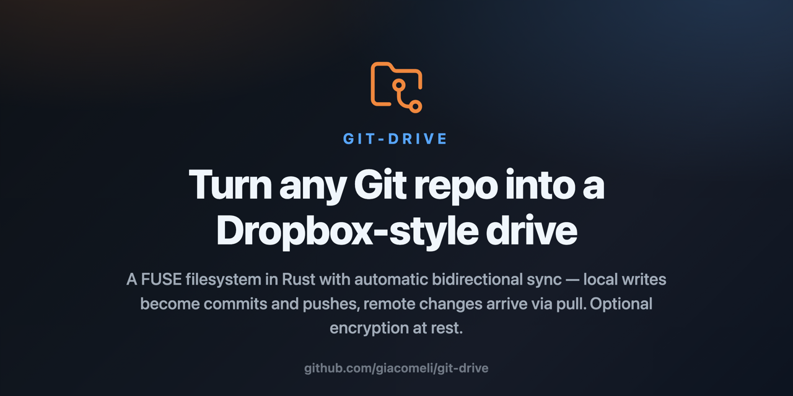

# git-drive — mount a Git repository as a Dropbox-style drive

[](https://github.com/giacomeli/git-drive/actions/workflows/ci.yml)
[](./LICENSE)
[](#requirements)
[](#requirements)

<p align="center">
  
</p>

A FUSE filesystem in Rust that mounts a Git repository as a virtual filesystem, with automatic
bidirectional synchronization. Local writes become commits + pushes, remote changes arrive via
periodic pull. It works like a Dropbox-style drive whose remote is a Git repository (including
GitHub repositories) — with optional encryption at rest that lets you use even a **public repo as
a private drive**.

> [!WARNING]
> **git-drive is experimental software — use at your own risk.** It is a young project under
> active development, and it sits between your files and a filesystem kernel interface: bugs here
> can mean lost or corrupted data. Always keep an independent backup of anything you place on the
> drive, and try it on a disposable repository first. The author assumes no responsibility for
> lost data; the software is provided "as is", without warranty of any kind (see the
> [MIT license](./LICENSE)).

git-drive is **open source** under the [MIT license](./LICENSE). It was created to explore a
simple idea: what happens when Git's own building blocks — commits, branches, history, remotes —
become the engine of an ordinary filesystem? Everything you drop on the mounted drive is
versioned Git data underneath, and it syncs with any Git server, including GitHub.

## Features

- Bidirectional sync with a causal queue (kernel ordering preserved), 3-way merge with
  conflicted copies, and automatic retry of rejected pushes. Commits made offline are published
  as soon as the remote is reachable again.
- Fetch and push through your system `git`, so the drive authenticates exactly like `git fetch`
  in a terminal (SSH config, agent, macOS Keychain, credential helpers).
- Crash-safe queue: pending operations are journaled before they are acknowledged and replayed
  at the next boot.
- Large files split into content-addressed chunks below GitHub's 100 MB per-file limit
  (`.chunks/` + manifest), transparent on the drive.
- Optional encryption at rest (XChaCha20-Poly1305): content and names encrypted in the repo,
  everything plaintext on the mount; toggled in the config with automatic migration.
- Symlinks, mtime derived from history, ignored files as visible local-only entries, native
  Finder Trash, menu bar tray, desktop notifications, and a login service (LaunchAgent on macOS,
  systemd user units on Linux).

## Requirements

- Rust 1.85+ (checked in CI)
- macOS with [macFUSE](https://osxfuse.github.io/) installed (`brew install macfuse`), or Linux
  with fuse3 (runtime validated on Arch Linux; still experimental)
- Git 2.31+ on PATH (used for fetch/push; set `"git_transport": "libgit2"` to do without it)
- A local Git repository (with a checked-out branch) to mount
- Optional: `origin` configured for remote synchronization

## Installation

```bash
cargo build
cargo test                    # full suite (unit + integration)
cargo run -- -r <repo_path> -m <mount_path>
cargo run -- status           # daemon state
cargo run -- tray             # status icon in the menu bar
cargo run -- key generate     # encryption-at-rest key
```

To mount automatically at login (LaunchAgent on macOS, systemd user units on Linux):

```bash
cargo run --release -- install -r <repo_path> -m <mount_path> --with-tray
cargo run -- uninstall        # stops the daemon and removes the service
```

`install` copies the binary to `~/.local/bin/git-drive` and points the service there. On Linux,
run `loginctl enable-linger $USER` if the drive should keep running after logout.

SIGTERM/eject perform a clean stop: the pending queue is committed and pushed before exiting.
Merge conflicts, failed pushes and blocked pulls trigger a desktop notification. The Finder Trash
works natively (items remain recoverable until emptied or remounted).

Example:

```bash
mkdir -p /tmp/gitmount
cargo run -- -r ~/Projects/my-repo -m /tmp/gitmount
ls /tmp/gitmount    # files from HEAD show up here
touch /tmp/gitmount/hello.txt   # after the debounce, automatic commit + push
```

The mount directory must exist before running.

## Configuration

Optional. `~/.config/git-drive/config.json` (a `./config.json` in the current directory takes
precedence in the dev flow):

```json
{
  "write_debounce_secs": 5,
  "pull_interval_secs": 60,
  "read_cache_mb": 64,
  "large_file_threshold_mb": 64,
  "chunk_threshold_mb": 95,
  "chunk_size_mb": 80,
  "encryption_enabled": false,
  "encryption_key_file": null,
  "user_name": "Your Name",
  "user_email": "you@example.com",
  "remote_token": null,
  "git_transport": "auto"
}
```

| Field | Default | Description |
| --- | --- | --- |
| `write_debounce_secs` | `5` | Seconds of idleness before applying writes, committing and pushing. |
| `pull_interval_secs` | `60` | Interval of the periodic pull from the `origin` remote. `0` disables it. |
| `read_cache_mb` | `64` | Budget of the LRU read blob cache (MiB). `0` disables it. |
| `large_file_threshold_mb` | `64` | Above this, write buffers go to an on-disk spool (bounded RAM). `0` disables it. |
| `chunk_threshold_mb` | `95` | Above this, the file becomes a manifest + chunks in `.chunks/` (GitHub's 100 MB limit). `0` disables it. |
| `chunk_size_mb` | `80` | Maximum size of each chunk. |
| `encryption_enabled` | `false` | Encryption at rest: opaque repo (content + names), plaintext drive. Changing the value migrates automatically. |
| `encryption_key_file` | `null` | Key file (default `~/.config/git-drive/drive.key`). Generate it with `git-drive key generate`. **Lost key = lost data.** |
| `user_name` | `null` | Commit identity. If absent, commits are skipped. |
| `user_email` | `null` | Same as above. |
| `remote_token` | `null` | HTTPS token (e.g. a GitHub PAT). If absent, uses your normal git/ssh credentials. **Plain text.** |
| `git_transport` | `"auto"` | `auto` (system `git` when available), `cli` or `libgit2` for fetch/push. |

If the file is missing, defaults are applied with a warning. If it exists but is invalid, the
daemon refuses to start.

> **Security:** `config.json` may contain a plain-text `remote_token` and the encryption key
> lives right next to it — keep `~/.config/git-drive/` out of any repo and back up the key in a
> safe place. When enabling encryption on a pre-existing repo, the previous Git history remains
> readable on the remote; for a public repo, start from a fresh repo.

## Synchronization

- **Local write → remote**: each batch of operations (grouped by the debounce) becomes a commit
  followed by `git push`. A push refused because another client pushed first triggers
  reconciliation (fetch + 3-way merge + retry, up to 3 rounds).
- **Remote → local**: shortly after boot and then every `pull_interval_secs`, `git fetch` + merge
  — fast-forward when possible, otherwise a 3-way merge. When both sides changed a file, the local
  version is preserved as `<file>.conflict-<host>-<timestamp>` and the remote one becomes
  canonical; when one side edited and the other deleted, the edit wins. Local commits the remote
  does not have yet (e.g. written offline) are pushed in the same cycle.
- **Branch**: detects the active branch at boot and operates on it until unmount. A detached
  HEAD aborts.

## Tests

```bash
cargo test                   # ~315 tests (unit + integration)
cargo test --test sync_flow  # watcher -> commit -> push -> pull flow
```

The CI (GitHub Actions) runs the full suite on macOS and Linux, clippy with the project's bar,
the forbidden-pattern greps and the MSRV check — mirroring the local commands exactly.
End-to-end tests that mount through the FUSE kernel are **manual** — the architecture uses pure
`apply_*` methods that allow testing all the logic without depending on the kernel.

## Documentation

- [docs/usage.md](./docs/usage.md) — **step-by-step usage guide** (prerequisites, credentials,
  `config.json`, mounting, day-to-day, encryption, large files, troubleshooting)
- [AGENTS.md](./AGENTS.md) — guide for agents/contributors (invariants, pitfalls, modules)
- [docs/architecture.md](./docs/architecture.md) — overview, layers and data structures
- [docs/sync-flow.md](./docs/sync-flow.md) — debounce and pull watchers, chunking, encryption
  and migrations in the drain
- [docs/fuse-filesystem.md](./docs/fuse-filesystem.md) — hierarchical inode mapping and FUSE
  operations
- [docs/large-file-reads.md](./docs/large-file-reads.md) — range reads of large files,
  verification, measured performance on macOS and Linux

Portuguese versions of all docs live under [docs/pt-br/](./docs/pt-br/).

## Contributing

Contributions of any size are welcome — bug reports, docs, tests, features. The short version:

1. Read [AGENTS.md](./AGENTS.md) first — the invariants there encode real incidents (data
   corruption, silent data loss), and PRs that violate one will not be merged.
2. For anything non-trivial, open an issue to discuss the approach first — an early
   conversation avoids wasted work.
3. Make sure `cargo test` and `cargo clippy --all-targets` pass — the CI mirrors exactly the
   local verification commands.
4. Open a PR with a concise, imperative description. Every behavioral change ships with tests
   that fail without it.

AI-assisted contributions are accepted: you remain the author, commits stay concise, and no AI
attribution goes into commits or PRs. The full guide — including good first contributions and
how to report security issues privately — is in [CONTRIBUTING.md](./CONTRIBUTING.md).

## License

[MIT](./LICENSE)
