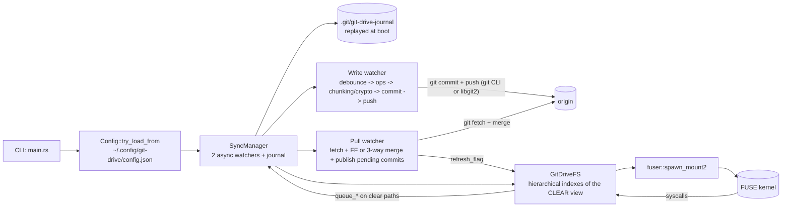
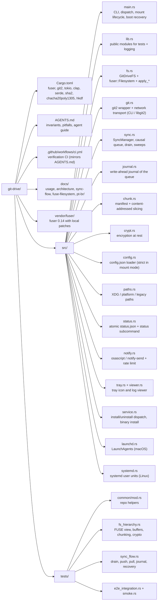

# Architecture: Overview

> Portuguese version: [pt-br/arquitetura.md](./pt-br/arquitetura.md)

## Overview

git-drive is a FUSE filesystem in Rust that mounts the contents of a Git repository (on the
active branch) as a virtual filesystem and keeps bidirectional synchronization with the remote via
Git: local writes become automatic commits + pushes, and remote changes arrive through a periodic
pull watcher. The behavior is that of a "Dropbox-style" drive where the durable storage is a Git
repository (including GitHub).

Two optional storage transformations happen between the drive and the repo, both invisible to
whoever uses the mount:

- **Chunking** (Phase 2.6): a file above `chunk_threshold_mb` becomes a small manifest at the
  original path + content-addressed chunks in `.chunks/` — each blob below GitHub's 100 MB
  per-file limit.
- **Encryption at rest** (Phase 2.7): with `encryption_enabled`, content AND names live
  encrypted in the repo (working tree included); the mount presents everything in the clear.



---

## Directory Structure



The config and the encryption key live in `~/.config/git-drive/` (with a read fallback to the
legacy locations `~/.config/drive-sync/` and `~/Library/Application Support/`). The installed
daemon keeps status.json in Application Support and logs in `~/Library/Logs/git-drive/` on macOS,
and both under `$XDG_STATE_HOME/git-drive/` (default `~/.local/state/git-drive/`) on Linux. The
service always runs the copy installed at `~/.local/bin/git-drive`.

---

## System Layers

| Layer | File | Responsibility |
| --- | --- | --- |
| CLI / Orchestration | `src/main.rs` | Subcommands (`status`/`install`/`uninstall`/`tray`/`viewer`/`key generate`) and mount mode: strict config load, transport resolution, explicit tokio runtime, journal replay + boot recovery before the mount, zombie mount recovery, encryption key validation (enabled without a key = abort), signal wait and clean shutdown (unmount -> final drain). |
| Filesystem | `src/fs.rs` | Implements `fuser::Filesystem`. Hierarchical indexes of the CLEAR view, write buffers (copy-on-write RAM or on-disk spool), reads through an LRU cache + persistent repo handle, lazy manifest detection, AEAD decryption, derived mtime, local-only files. |
| Git | `src/git.rs` | Reading trees/blobs (sizes from object headers, `FileKind` for symlinks), working tree commit (`add_all` honoring ignore, or by path when the drain knows every change), network transport (system `git` CLI by default, libgit2 fallback with a stateful credential callback), push with per-ref rejection detection, fetch, FF and 3-way merge (both-modified -> conflicted copy, modify/delete -> the edit wins, sidecars restored), `is_working_tree_clean`, ignored files, `commit_times_by_path` and `commit_times_between`. |
| Synchronization | `src/sync.rs`, `src/journal.rs` | Causal queue of `SyncOp` (coalescing only for Write, barriers for everything else) backed by a write-ahead journal, drain with clear->encrypted translation, chunking sweep, encryption migrations in both directions (including the repair of double-encrypted conflicted copies), orphaned-chunk GC, push with multi-round reconcile, pull watcher that also publishes pending commits, boot recovery. |
| Chunking | `src/chunk.rs` | Versioned text manifest, `.chunks/<2 hex>/<sha256>` sharding, streaming slicing with an optional transform (sealing) and dedup via content-addressing. |
| Encryption | `src/crypt.rs` | Convergent XChaCha20-Poly1305 (nonce derived from the plaintext), HKDF subkeys, per-component names in lowercase base32 with a literal fallback, 0600 key file. |
| Observability | `state/src/status.rs`, `src/notify.rs`, `src/tray.rs` | Atomic `status.json`, rate-limited notifications (osascript on macOS, notify-send on Linux; children reaped), a tray with 4 states, index/refresh timing in the logs. |
| Installation / Paths | `src/service.rs`, `src/launchd.rs`, `src/systemd.rs`, `state/src/paths.rs` | Platform dispatch, binary installed at `~/.local/bin/git-drive`, template-based LaunchAgents (macOS) and systemd user units (Linux), config/key migration from legacy locations, XDG resolution. |
| Configuration | `src/config.rs` | Loader with per-field `#[serde(default)]` (16 fields). Missing file = defaults; an existing invalid file aborts the mount mode. |

---

## Data Structures

### `FileEntry` — `src/fs.rs`

```rust
#[derive(Debug, Clone)]
pub(crate) struct FileEntry {
    pub(crate) inode: u64,
    pub(crate) path: String,          // full CLEAR path
    pub(crate) parent: u64,
    pub(crate) size: u64,             // plaintext size
    pub(crate) kind: git::FileKind,   // Regular | Symlink (filemode 120000)
    pub(crate) local_only: bool,      // ignored by .gitignore: lives in the worktree, never committed
}
```

### `SyncOp` and `WriteContent` — `src/sync.rs`

```rust
#[derive(Debug, Clone)]
pub enum WriteContent {
    Mem(Arc<Vec<u8>>),      // shared with the write buffer (zero copy on flush)
    Spooled(PathBuf),       // on-disk snapshot, applied with a rename during drain
}

#[derive(Debug, Clone)]
pub enum SyncOp {
    Write { path: String, content: WriteContent },
    Delete { path: String },
    Mkdir { path: String },
    Rmdir { path: String },
    Rename { from: String, to: String },
    Symlink { path: String, target: String },
}
```

The internal queue is a `Vec<SyncOp>` in **arrival order** — the FUSE kernel order is the causal
order (Phase 0 invariant). All paths in the queue are CLEAR; the translation to disk (encrypted
or not) happens when the drain materializes them.

### `Manifest` — `src/chunk.rs`

```rust
#[derive(Debug, Clone, PartialEq, Eq)]
pub struct Manifest {
    pub total_size: u64,        // PLAINTEXT bytes
    pub chunk_size: u64,
    pub hashes: Vec<String>,    // sha256 of each chunk (of the ciphertext, when encrypted)
}
```

### `Crypto` — `src/crypt.rs`

```rust
pub struct Crypto {
    content_cipher: XChaCha20Poly1305,   // HKDF subkey "content-key"
    name_cipher: XChaCha20Poly1305,      // HKDF subkey "name-key"
    content_nonce_key: [u8; 32],         // HMAC for a deterministic nonce (convergent)
    name_nonce_key: [u8; 32],
}
```

### `Config` — `src/config.rs`

```rust
#[derive(Debug, Deserialize)]
pub struct Config {
    pub write_debounce_secs: u64,          // 5
    pub pull_interval_secs: u64,           // 60
    pub read_cache_mb: u64,                // 64
    pub large_file_threshold_mb: u64,      // 64  (write buffer spool)
    pub chunk_threshold_mb: u64,           // 95  (manifest + .chunks)
    pub chunk_size_mb: u64,                // 80
    pub encryption_enabled: bool,          // false
    pub encryption_key_file: Option<String>,
    pub user_name: Option<String>,
    pub user_email: Option<String>,
    pub remote_token: Option<String>,
    pub commit_batch_mb: u64,              // 256
    pub log_max_mb: u64,                   // 50
    pub log_keep_files: usize,             // 10
    pub log_level: String,                 // "info"
    pub git_transport: String,             // "auto" | "cli" | "libgit2"
}
```

---

## Performance Notes

- Reads: inode buffer -> chunked files and regular files of at least 4 MiB **by range from the
  working tree** (each file verified once per session, then `pread` + range decryption of just the
  requested bytes) -> for small files, blob LRU cache (`read_cache_mb`) -> repo via a **persistent
  handle**. Random 1 MiB reads of large files take 1-3 ms (they took 0.4-24 s before 2026-10-13);
  see [large-file-reads.md](./large-file-reads.md).
- Writes: RAM peak of ~1x the file size (Arc shared between buffer and queue); above
  `large_file_threshold_mb` the buffer lives in an on-disk spool.
- The pull watcher skips an iteration if there is a pending flush batch (avoids racing a local
  commit).
- `refresh_if_needed` is called on every `lookup`/`getattr`/`readdir`. Cheap in steady state;
  after a pull it rebuilds the index with the FUSE thread blocked. Blob sizes come from object
  headers, decrypted names from a cache reused across refreshes, and mtimes are recomputed only for
  the new commits: on a 96,878-file encrypted drive, boot went from ~25 s to ~9 s and a post-pull
  refresh from 8.1 s to 1.1 s.
- The drain's sweeps (chunking, encryption migration, chunk GC) are incremental: one full pass per
  state, then only dirty files plus paths changed since the last conforming HEAD. Save-to-commit on
  the real drive went from 4 min 22 s to 8.4 s on the Mac and 4.3 s on Linux. The chunk GC still
  reads every small file of the tree (it needs every manifest's references), so it runs only when
  chunks may be orphans: a scoped path was a manifest, or a sweep replaced chunks. A new large file
  only adds chunks — before, it triggered the GC, ~90 s of a 2-minute commit of a 136 MB video on
  the Mac's 210k-file drive.
- Every queued op costs one extra write (its journal record) — the price of not losing
  acknowledged writes on a crash.
- The config is loaded a single time — there is no hot reload (changing `encryption_enabled`
  requires restarting the daemon; the migration runs on the next drain).

---

## Known Limitations

| # | Limitation | Origin |
| --- | --- | --- |
| 1 | Automatic `.gitkeep` on `mkdir`/`rmdir` | Git does not track empty directories — workaround in `src/sync.rs` |
| 2 | Credentials and key in plain text on local disk | `~/.config/git-drive/` (keychain is a future candidate) |
| 3 | Concurrent edits of the same file become conflicted copies | 3-way `pull_and_merge`; modify/delete keeps the edit; without identity it degrades to FF-only |
| 4 | Failed push is not reverted | the local commit remains; reconcile up to 3 rounds; the pull cycle retries the publish |
| 5 | Detached HEAD aborts boot | `src/main.rs` |
| 6 | No FIFOs/sockets/real hardlinks | symlinks supported; `link` is a copy |
| 7 | `chmod` in memory, `chown` ignored | uid/gid are those of the mounting process |
| 8 | Blob cache does not cover files larger than the budget | a miss goes through the persistent repo handle |
| 9 | Refresh depends on FUSE syscalls | the kernel's 1s TTL can mask remote changes for ~1s |
| 10 | Files above `chunk_threshold_mb` become manifest + `.chunks/` | transparent on the mount; a plain clone sees the artifacts (`src/chunk.rs`) |
| 11 | Encryption at rest is optional and does not protect the past | pre-migration history remains readable; ignore/local-only are disabled in encrypted mode (`src/crypt.rs`) |
| 12 | Journal is not fsynced | acknowledged writes survive process crashes, not a power cut within the OS write-back window (`src/journal.rs`) |
| 13 | Linux service runs only while logged in without linger | `loginctl enable-linger $USER` (`src/systemd.rs`) |

---

## How to add a new configuration field

1. Declare it in `src/config.rs` with `#[serde(default = "...")]`, or `#[serde(default)]` for `Option`.
1. Update `Config::default` to mirror the value.
1. Propagate it in `src/main.rs` (constructor parameter or post-construction setter, following
   the `set_chunking`/`set_crypto` pattern).
1. Update the tables in `README.md`, `docs/usage.md` and `AGENTS.md`.
1. Add a test in `src/config.rs::tests` covering the default and the override.

## How to add a new mutation operation

1. Add a variant to `SyncOp` (`src/sync.rs`) — decide whether it coalesces or acts as a barrier
   (`push_coalescing`); barrier is the safe default.
1. Implement `queue_*` on `SyncManager` calling `enqueue`.
1. Implement the handling in `apply_op_to_disk` (`src/sync.rs`), including path translation and
   sealing when `crypto` is active.
1. Implement a pure `apply_*` on `GitDriveFS` (`src/fs.rs`) that manipulates the indexes and calls
   the `queue_*`.
1. Create a thin wrapper in the `impl Filesystem` calling the `apply_*`.
1. Tests: unit tests for the queue, integration for `apply_*` and flow in `tests/sync_flow.rs`.

---

## References

| File | Responsibility |
| --- | --- |
| `src/main.rs` | Entry point, CLI, mount lifecycle and clean shutdown |
| `src/fs.rs` | `GitDriveFS`, hierarchical model, `apply_*`, `refresh_if_needed` |
| `src/git.rs` | Wrapper over `git2` (read, commit, merge, ignore, mtime) + network transport |
| `src/sync.rs` | `SyncManager`, causal queue, drain, sweeps and GC |
| `src/journal.rs` | Write-ahead journal of the queue |
| `src/chunk.rs` | Manifest + content-addressed slicing |
| `src/crypt.rs` | Encryption at rest |
| `src/config.rs` | `config.json` loader |
| `state/src/paths.rs` | XDG + platform + legacy path resolution |
| `src/service.rs` | Login-service dispatch and binary installation |
| `src/launchd.rs` / `src/systemd.rs` | LaunchAgents (macOS) / systemd user units (Linux) |
| `tests/common/mod.rs` | Git repository helpers for tests |

Related docs:

- [usage.md](./usage.md)
- [sync-flow.md](./sync-flow.md)
- [fuse-filesystem.md](./fuse-filesystem.md)
