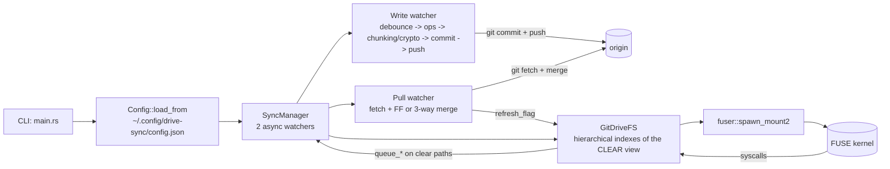

# Architecture: Overview

> Portuguese version: [pt-br/arquitetura.md](./pt-br/arquitetura.md)

## Overview

drive-sync is a FUSE filesystem in Rust that mounts the contents of a Git repository (on the
active branch) as a virtual filesystem and keeps bidirectional synchronization with the remote via
Git: local writes become automatic commits + pushes, and remote changes arrive through a periodic
pull watcher. The behavior is that of a "Dropbox-style" drive where the durable storage is a Git
repository (including GitHub).

Two optional storage transformations happen between the drive and the repo, both invisible to
whoever uses the mount:

- **Chunking** (Phase 2.6): a file above `chunk_threshold_mb` becomes a small manifest at the
  original path + content-addressed chunks in `.chunks/` — each blob below GitHub's 100 MB
  per-file limit.
- **Encryption at rest** (Phase 2.7): with `encryption_enabled`, content AND names live
  encrypted in the repo (working tree included); the mount presents everything in the clear.



---

## Directory Structure

```text
drive-sync/
├── Cargo.toml                    # fuser, git2, tokio, clap, serde, sha2, chacha20poly1305, hkdf...
├── AGENTS.md                     # invariants, pitfalls and guide for agents
├── README.md
├── .github/workflows/ci.yml     # verification CI (mirrors the commands in AGENTS.md)
├── docs/
│   ├── README.md
│   ├── usage.md                  # step-by-step user guide
│   ├── architecture.md
│   ├── sync-flow.md
│   ├── fuse-filesystem.md
│   └── pt-br/                    # Portuguese versions of the docs
├── src/
│   ├── main.rs                   # CLI, subcommand dispatch, mount lifecycle
│   ├── lib.rs                    # public modules for tests + log redirect
│   ├── fs.rs                     # GitDriveFS + fuser::Filesystem impl + apply_*
│   ├── git.rs                    # wrapper over git2 (read, commit, push, pull, ignore, mtime)
│   ├── sync.rs                   # SyncManager + causal queue + drain + sweeps
│   ├── chunk.rs                  # manifest + content-addressed slicing (Phase 2.6)
│   ├── crypt.rs                  # encryption at rest (Phase 2.7)
│   ├── config.rs                 # config.json loader
│   ├── paths.rs                  # path resolution (XDG ~/.config/drive-sync + legacy locations)
│   ├── status.rs                 # atomic status.json + status subcommand
│   ├── notify.rs                 # macOS notifications (osascript + rate limit)
│   ├── tray.rs                   # menu bar icon
│   └── launchd.rs                # LaunchAgents (install/uninstall)
├── tests/
│   ├── common/mod.rs             # helpers (deterministic init_repo, commit_*, bare remote)
│   ├── smoke.rs
│   ├── fs_hierarchy.rs           # hierarchical model, buffers, chunking and crypto in the FUSE view
│   ├── sync_flow.rs              # drain, commit, push, pull, migrations
│   └── e2e_integration.rs        # end-to-end scenarios
└── vendor/fuser/                 # fuser 0.14 with local patches (upstreaming is on the roadmap)
```

The config and the encryption key live in `~/.config/drive-sync/` (with a read fallback to the
legacy location in `~/Library/Application Support/drive-sync/`); status.json stays in Application
Support and logs in `~/Library/Logs/drive-sync/`.

---

## System Layers

| Layer | File | Responsibility |
| --- | --- | --- |
| CLI / Orchestration | `src/main.rs` | Subcommands (`status`/`install`/`uninstall`/`tray`/`key generate`) and mount mode: explicit tokio runtime, zombie mount recovery, encryption key validation (enabled without a key = abort), signal wait and clean shutdown (unmount -> final drain). |
| Filesystem | `src/fs.rs` | Implements `fuser::Filesystem`. Hierarchical indexes of the CLEAR view, write buffers (copy-on-write RAM or on-disk spool), reads through an LRU cache + persistent repo handle, lazy manifest detection, AEAD decryption, derived mtime, local-only files. |
| Git | `src/git.rs` | Reading trees/blobs (with `FileKind` for symlinks), working tree commit (`add_all` honoring ignore), push with per-ref rejection detection, fetch, FF and 3-way merge with conflicted copies, `is_working_tree_clean`, ignored files and `commit_times_by_path`. |
| Synchronization | `src/sync.rs` | Causal queue of `SyncOp` (coalescing only for Write, barriers for everything else), drain with clear->encrypted translation, chunking sweep, encryption migrations in both directions, orphaned-chunk GC, push with reconcile and pull watcher. |
| Chunking | `src/chunk.rs` | Versioned text manifest, `.chunks/<2 hex>/<sha256>` sharding, streaming slicing with an optional transform (sealing) and dedup via content-addressing. |
| Encryption | `src/crypt.rs` | Convergent XChaCha20-Poly1305 (nonce derived from the plaintext), HKDF subkeys, per-component names in lowercase base32 with a literal fallback, 0600 key file. |
| Observability | `src/status.rs`, `src/notify.rs`, `src/tray.rs` | Atomic `status.json`, rate-limited macOS notifications and a tray with 4 states. |
| Installation / Paths | `src/launchd.rs`, `src/paths.rs` | Template-based LaunchAgents, config/key migration from the legacy location, XDG resolution. |
| Configuration | `src/config.rs` | Loader with per-field `#[serde(default)]` (11 fields). Degrades to defaults with a log line. |

---

## Data Structures

### `FileEntry` — `src/fs.rs`

```rust
#[derive(Debug, Clone)]
pub(crate) struct FileEntry {
    pub(crate) inode: u64,
    pub(crate) path: String,          // full CLEAR path
    pub(crate) parent: u64,
    pub(crate) size: u64,             // plaintext size
    pub(crate) kind: git::FileKind,   // Regular | Symlink (filemode 120000)
    pub(crate) local_only: bool,      // ignored by .gitignore: lives in the worktree, never committed
}
```

### `SyncOp` and `WriteContent` — `src/sync.rs`

```rust
#[derive(Debug, Clone)]
pub enum WriteContent {
    Mem(Arc<Vec<u8>>),      // shared with the write buffer (zero copy on flush)
    Spooled(PathBuf),       // on-disk snapshot, applied with a rename during drain
}

#[derive(Debug, Clone)]
pub enum SyncOp {
    Write { path: String, content: WriteContent },
    Delete { path: String },
    Mkdir { path: String },
    Rmdir { path: String },
    Rename { from: String, to: String },
    Symlink { path: String, target: String },
}
```

The internal queue is a `Vec<SyncOp>` in **arrival order** — the FUSE kernel order is the causal
order (Phase 0 invariant). All paths in the queue are CLEAR; the translation to disk (encrypted
or not) happens when the drain materializes them.

### `Manifest` — `src/chunk.rs`

```rust
#[derive(Debug, Clone, PartialEq, Eq)]
pub struct Manifest {
    pub total_size: u64,        // PLAINTEXT bytes
    pub chunk_size: u64,
    pub hashes: Vec<String>,    // sha256 of each chunk (of the ciphertext, when encrypted)
}
```

### `Crypto` — `src/crypt.rs`

```rust
pub struct Crypto {
    content_cipher: XChaCha20Poly1305,   // HKDF subkey "content-key"
    name_cipher: XChaCha20Poly1305,      // HKDF subkey "name-key"
    content_nonce_key: [u8; 32],         // HMAC for a deterministic nonce (convergent)
    name_nonce_key: [u8; 32],
}
```

### `Config` — `src/config.rs`

```rust
#[derive(Debug, Deserialize)]
pub struct Config {
    pub write_debounce_secs: u64,          // 5
    pub pull_interval_secs: u64,           // 60
    pub read_cache_mb: u64,                // 64
    pub large_file_threshold_mb: u64,      // 64  (write buffer spool)
    pub chunk_threshold_mb: u64,           // 95  (manifest + .chunks)
    pub chunk_size_mb: u64,                // 80
    pub encryption_enabled: bool,          // false
    pub encryption_key_file: Option<String>,
    pub user_name: Option<String>,
    pub user_email: Option<String>,
    pub remote_token: Option<String>,
}
```

---

## Performance Notes

- Reads: inode buffer -> blob LRU cache (`read_cache_mb`) -> repo via a **persistent handle**
  (one open per mount, not per syscall). A file larger than the budget never enters the cache;
  chunked files use a last-chunk cache.
- Writes: RAM peak of ~1x the file size (Arc shared between buffer and queue); above
  `large_file_threshold_mb` the buffer lives in an on-disk spool.
- The pull watcher skips an iteration if there is a pending flush batch (avoids racing a local
  commit).
- `refresh_if_needed` is called on every `lookup`/`getattr`/`readdir`. Cheap in steady state;
  expensive after a pull (rebuild) or a local commit (gc + local-only sweep).
- `Config::load_from` runs a single time — there is no hot reload (changing `encryption_enabled`
  requires restarting the daemon; the migration runs on the next drain).

---

## Known Limitations

| # | Limitation | Origin |
| --- | --- | --- |
| 1 | Automatic `.gitkeep` on `mkdir`/`rmdir` | Git does not track empty directories — workaround in `src/sync.rs` |
| 2 | Credentials and key in plain text on local disk | `~/.config/drive-sync/` (keychain is a future candidate) |
| 3 | Merge conflicts become conflicted copies | 3-way `pull_and_merge`; without identity it degrades to FF-only |
| 4 | Failed push is not reverted | the local commit remains; automatic reconcile + retry |
| 5 | Detached HEAD aborts boot | `src/main.rs` |
| 6 | No FIFOs/sockets/real hardlinks | symlinks supported; `link` is a copy |
| 7 | `chmod` in memory, `chown` ignored | uid/gid are those of the mounting process |
| 8 | Blob cache does not cover files larger than the budget | a miss goes through the persistent repo handle |
| 9 | Refresh depends on FUSE syscalls | the kernel's 1s TTL can mask remote changes for ~1s |
| 10 | Files above `chunk_threshold_mb` become manifest + `.chunks/` | transparent on the mount; a plain clone sees the artifacts (`src/chunk.rs`) |
| 11 | Encryption at rest is optional and does not protect the past | pre-migration history remains readable; ignore/local-only are disabled in encrypted mode (`src/crypt.rs`) |
| 12 | Runtime is macOS-only | the test suite passes on Linux (CI); the fuse3 mount port is on the roadmap |

---

## How to add a new configuration field

1. Declare it in `src/config.rs` with `#[serde(default = "...")]`, or `#[serde(default)]` for `Option`.
1. Update `Config::default` to mirror the value.
1. Propagate it in `src/main.rs` (constructor parameter or post-construction setter, following
   the `set_chunking`/`set_crypto` pattern).
1. Update the tables in `README.md`, `docs/usage.md` and `AGENTS.md`.
1. Add a test in `src/config.rs::tests` covering the default and the override.

## How to add a new mutation operation

1. Add a variant to `SyncOp` (`src/sync.rs`) — decide whether it coalesces or acts as a barrier
   (`push_coalescing`); barrier is the safe default.
1. Implement `queue_*` on `SyncManager` calling `enqueue`.
1. Implement the handling in `apply_op_to_disk` (`src/sync.rs`), including path translation and
   sealing when `crypto` is active.
1. Implement a pure `apply_*` on `GitDriveFS` (`src/fs.rs`) that manipulates the indexes and calls
   the `queue_*`.
1. Create a thin wrapper in the `impl Filesystem` calling the `apply_*`.
1. Tests: unit tests for the queue, integration for `apply_*` and flow in `tests/sync_flow.rs`.

---

## References

| File | Responsibility |
| --- | --- |
| `src/main.rs` | Entry point, CLI, mount lifecycle and clean shutdown |
| `src/fs.rs` | `GitDriveFS`, hierarchical model, `apply_*`, `refresh_if_needed` |
| `src/git.rs` | Wrapper over `git2` (read, commit, push, pull, ignore, mtime) |
| `src/sync.rs` | `SyncManager`, causal queue, drain, sweeps and GC |
| `src/chunk.rs` | Manifest + content-addressed slicing |
| `src/crypt.rs` | Encryption at rest |
| `src/config.rs` | `config.json` loader |
| `src/paths.rs` | XDG + legacy path resolution |
| `tests/common/mod.rs` | Git repository helpers for tests |

Related docs:

- [usage.md](./usage.md)
- [sync-flow.md](./sync-flow.md)
- [fuse-filesystem.md](./fuse-filesystem.md)
