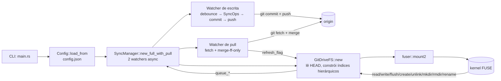

# Arquitetura: Visão Geral

## Visão Geral

drive-sync é um filesystem FUSE em Rust que monta o conteúdo de um repositório Git (no branch ativo) como um sistema de arquivos virtual e mantém sincronização bidirecional com o remote via Git: escritas locais viram commits + push automáticos e mudanças no remote chegam através de um pull watcher periódico. O comportamento é o de um drive "estilo Dropbox" onde o armazenamento durável é um repositório Git (incluindo GitHub).



---

## Estrutura de Diretórios

```text
drive-sync/
├── Cargo.toml                    # deps: fuser, git2, tokio, clap, parking_lot, serde, tempfile, serial_test
├── config.json                   # (em .gitignore) write_debounce_secs, pull_interval_secs, user_name, user_email, remote_token
├── CLAUDE.md
├── README.md
├── .gitignore
├── docs/
│   ├── README.md
│   ├── arquitetura.md
│   ├── fluxo-de-sincronizacao.md
│   └── filesystem-fuse.md
├── src/
│   ├── main.rs                   # entry point async, CLI, orquestração
│   ├── lib.rs                    # re-exporta módulos para testes de integração
│   ├── fs.rs                     # GitDriveFS + impl fuser::Filesystem + apply_*
│   ├── git.rs                    # wrapper sobre git2 (leitura + commit + push + pull)
│   ├── sync.rs                   # SyncManager + SyncOp + watchers
│   └── config.rs                 # Config loader
├── tests/
│   ├── common/mod.rs             # helpers (init_repo, commit_file, bare_remote...)
│   ├── smoke.rs
│   ├── fs_hierarchy.rs           # 36 testes do modelo hierárquico
│   ├── sync_flow.rs              # watcher + commit + push + pull
│   └── e2e_integration.rs        # cenários ponta-a-ponta
└── specs/plans/                  # especificações e planos (spec-plan workflow)
```

---

## Camadas do Sistema

| Camada | Arquivo | Responsabilidade |
| --- | --- | --- |
| CLI / Orquestração | `src/main.rs` | Parse de argumentos com `clap`, carga de config, detecção de branch, instanciação de `SyncManager` e `GitDriveFS`, chamada bloqueante a `fuser::mount2`. |
| Filesystem | `src/fs.rs` | Implementa `fuser::Filesystem`. Modelo hierárquico (`FileEntry` + `DirEntry`), alocador atômico de inodes, buffers de escrita em memória, `apply_*` puras para teste. |
| Git | `src/git.rs` | Abre repo, resolve revisões, lê blobs, lista arquivos/dirs. Cria commits com identidade, empurra refspec para remote, faz fetch + merge-ff-only. |
| Sincronização | `src/sync.rs` | `SyncManager` com enum `SyncOp` e dois watchers: (a) debounce-commit-push e (b) pull periódico com sinal de refresh via `AtomicBool`. |
| Configuração | `src/config.rs` | Loader de `config.json` com `#[serde(default)]` por campo. Defaults sensatos para os 5 campos. |

### CLI / Orquestração

`src/main.rs` — função `main` com `#[tokio::main]`. Detecta branch ativo e aborta em HEAD detached. Instancia `SyncManager::new_full_with_pull` passando identidade e intervalo de pull. Chama `fuser::mount2`, que é bloqueante.

### Filesystem

Ver [filesystem-fuse.md](./filesystem-fuse.md).

### Git

`src/git.rs` expõe funções puras sobre `git2::Repository`:

- `open_repo`, `get_commit`
- `read_file_at_commit`
- `list_files_at_commit`, `list_dirs_at_commit` — agora com paths completos
- `current_branch_name` — erro em HEAD detached
- `commit_working_tree(repo, branch, user, email, msg) -> Option<Oid>` — stage tudo, commita só se tree mudou
- `push_to_remote(repo, branch, remote, token)` — callbacks com `Cred::userpass_plaintext` se token, senão ssh-agent / default
- `fetch_remote(repo, branch, remote, token)` — mesma estratégia de credenciais do push
- `merge_ff_only(repo, branch)` — `Ok(true)` FF aplicado, `Ok(false)` up-to-date, `Err` divergência

### Sincronização

Ver [fluxo-de-sincronizacao.md](./fluxo-de-sincronizacao.md).

### Configuração

`src/config.rs` — 5 campos, todos opcionais com defaults. Degrada silenciosamente em qualquer erro (arquivo, I/O, parse).

---

## Estruturas de Dados

### `FileEntry` — `src/fs.rs`

```rust
#[derive(Debug, Clone)]
pub(crate) struct FileEntry {
    pub(crate) inode: u64,
    pub(crate) path: String,     // caminho completo no working tree
    pub(crate) parent: u64,      // inode do diretório-pai
    pub(crate) size: u64,
}
```

### `DirEntry` — `src/fs.rs`

```rust
#[derive(Debug, Clone)]
pub(crate) struct DirEntry {
    pub(crate) inode: u64,
    pub(crate) path: String,       // "" para raiz
    pub(crate) parent: u64,
    pub(crate) children: HashSet<u64>,
}
```

### `GitDriveFS` — `src/fs.rs`

```rust
pub struct GitDriveFS {
    repo_path: String,
    branch: String,
    files_by_inode: HashMap<u64, FileEntry>,
    dirs_by_inode: HashMap<u64, DirEntry>,
    inodes_by_path: HashMap<String, u64>,
    next_inode: Arc<AtomicU64>,                // alocador monotônico
    sync: SyncManager,
    write_buffers: Arc<parking_lot::Mutex<HashMap<u64, Vec<u8>>>>,
}
```

### `SyncOp` — `src/sync.rs`

```rust
#[derive(Debug, Clone)]
pub enum SyncOp {
    Write { path: String, content: Vec<u8> },
    Delete { path: String },
    Mkdir { path: String },
    Rmdir { path: String },
    Rename { from: String, to: String },
}
```

### `SyncManager` — `src/sync.rs`

```rust
#[derive(Clone)]
pub struct SyncManager {
    inner: Arc<Mutex<Inner>>,
    notify: Arc<Notify>,
    debounce_secs: u64,
    repo_path: PathBuf,
    branch: String,
    user_name: Option<String>,
    user_email: Option<String>,
    remote_name: Option<String>,
    remote_token: Option<String>,
    refresh_flag: Arc<AtomicBool>,
}
```

### `Config` — `src/config.rs`

```rust
#[derive(Debug, Deserialize)]
pub struct Config {
    pub write_debounce_secs: u64,     // default 5
    pub pull_interval_secs: u64,      // default 60
    pub user_name: Option<String>,
    pub user_email: Option<String>,
    pub remote_token: Option<String>,
}
```

---

## Notas de Performance

- `fs::read` (`src/fs.rs`) chama `git::open_repo` + `git::get_commit` + `git::read_file_at_commit` a cada syscall. Sem cache de `Repository`, `Commit` ou blob. O kernel pode dividir leitura em chunks de 128 KiB.
- Pull watcher roda a cada `pull_interval_secs` mas pula iteração se há lote pendente (evita corrida com commit local).
- `refresh_if_needed` é chamado em cada `lookup`/`getattr`/`readdir`. Barato em steady state (read atomic da flag); caro apenas após um pull bem-sucedido.
- `GitDriveFS::new` lê a tree do branch **uma** vez na montagem; pull periódico reconstrói índices via `refresh_if_needed`.
- `Config::load_from` roda uma única vez — não há hot-reload.

---

## Limitações Conhecidas

| # | Limitação | Origem |
| --- | --- | --- |
| 1 | `.gitkeep` automático em `mkdir`/`rmdir` | Git não rastreia diretórios vazios — workaround em `src/sync.rs` |
| 2 | Credenciais em texto plano | `config.json` no `.gitignore` por padrão |
| 3 | Merge apenas fast-forward | `src/git.rs::merge_ff_only` — divergência exige resolução manual |
| 4 | Push falho não é revertido | commit local permanece; próxima iteração retenta |
| 5 | HEAD detached aborta boot | `src/main.rs` |
| 6 | Sem symlinks/FIFOs/sockets/hardlinks | `GitDriveFS` só cobre `RegularFile` e `Directory` |
| 7 | `perm` fixo + uid/gid hardcoded | sem `chmod`/`chown` |
| 8 | Sem cache de blobs em `read` | ver performance |
| 9 | Refresh depende de syscalls FUSE | TTL de 1s no kernel pode mascarar mudanças remotas por ~1s |
| 10 | Sem criptografia | fora do escopo desta etapa; reservado para próxima spec |

---

## Como adicionar um novo campo de configuração

1. Declarar em `src/config.rs` com `#[serde(default = "...")]` ou `#[serde(default)]` para `Option`.
2. Atualizar `Config::default` para espelhar o valor.
3. Propagar pelo `SyncManager::new_full_with_pull` em `src/main.rs` se for relevante.
4. Atualizar `config.json` e a tabela em `README.md` / `CLAUDE.md`.
5. Adicionar teste em `src/config.rs::tests` cobrindo o novo campo.

## Como adicionar uma nova operação de mutação

1. Adicionar variante em `SyncOp` (`src/sync.rs`).
2. Implementar `queue_*` em `SyncManager` chamando `enqueue`.
3. Implementar tratamento em `apply_op_to_disk` (`src/sync.rs`).
4. Implementar `apply_*` puro em `GitDriveFS` (`src/fs.rs`) que manipula índices e chama o `queue_*`.
5. Criar wrapper fino no `impl Filesystem` chamando o `apply_*`.
6. Testes: unitário para `queue_*`, integração para `apply_*`, e-2-e em `tests/e2e_integration.rs`.

---

## Referências

| Arquivo | Responsabilidade |
| --- | --- |
| `src/main.rs` | Entry point, CLI, orquestração do mount |
| `src/lib.rs` | Re-exporta módulos |
| `src/fs.rs` | `GitDriveFS`, modelo hierárquico, `apply_*`, `refresh_if_needed` |
| `src/git.rs` | Wrapper sobre `git2` + commit/push/fetch/merge-ff |
| `src/sync.rs` | `SyncManager`, `SyncOp`, watchers (debounce e pull) |
| `src/config.rs` | Loader de `config.json` |
| `tests/common/mod.rs` | Helpers de repositório Git para testes |

Docs relacionadas:

- [fluxo-de-sincronizacao.md](./fluxo-de-sincronizacao.md)
- [filesystem-fuse.md](./filesystem-fuse.md)
