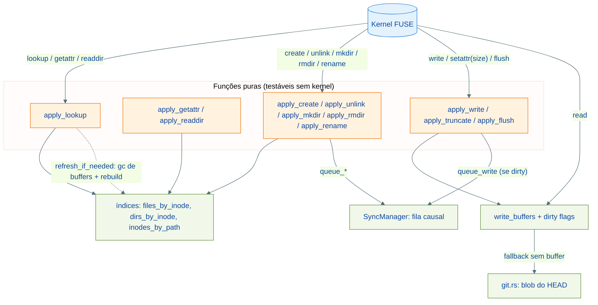

# Arquitetura: Filesystem FUSE

## Visão Geral

`GitDriveFS` é a ponte entre o kernel FUSE e o conteúdo versionado do repositório Git. Mantém um modelo hierárquico com `FileEntry` e `DirEntry` ligados por referências de inode, um alocador atômico para novos inodes criados em runtime (`create`/`mkdir`) e lógica extraída em métodos `apply_*` puros que são testáveis sem montar o kernel. Leituras consultam o write buffer do inode (se existir) e caem no blob Git do HEAD; mutações atualizam índices em memória, buffers de escrita e enfileiram `SyncOp`s para o `SyncManager`.



---

## Mapeamento de Inodes

### Constantes (`src/fs.rs`)

```rust
const TTL: Duration = Duration::from_secs(1);
const ROOT_INODE: u64 = 1;
const FILE_MODE: u16 = 0o644;
const DIR_MODE: u16 = 0o755;
```

### Estruturas

```rust
struct FileEntry {
    inode: u64,
    path: String,     // "foo/bar/baz.txt"
    parent: u64,      // inode do diretório-pai
    size: u64,
}

struct DirEntry {
    inode: u64,
    path: String,     // "" para raiz
    parent: u64,      // 0 para raiz
    children: HashSet<u64>,
}
```

### Alocador

`next_inode: Arc<AtomicU64>` inicializa em `2 + total_inodes_na_montagem`. `alloc_inode` faz `fetch_add(1, SeqCst)`. Monotônico — inodes deletados não são reciclados. No `refresh_if_needed`, paths preservados reutilizam o inode antigo e a alocação para paths novos é lazy (`unwrap_or_else`) — refresh sem mudanças não avança o contador.

### Inicialização em `GitDriveFS::new`

1. Insere raiz (`inode 1`, path `""`).
2. Chama `git::list_dirs_at_commit` e `git::list_files_at_commit` (paths completos).
3. Diretórios são ordenados por profundidade e inseridos do raso para o profundo, garantindo que o pai exista quando o filho for inserido.
4. Arquivos usam o mesmo esquema de resolução de pai via `path.rfind('/')`.
5. Raiz é tratada especialmente (path vazio -> pai é o `inodes_by_path[""]`).

---

## Ciclo de vida do write buffer

```mermaid
%%{init: {'theme':'base','themeVariables':{'primaryColor':'#E3F2FD','primaryTextColor':'#0D47A1','primaryBorderColor':'#1976D2','lineColor':'#546E7A'}}}%%
stateDiagram-v2
    accTitle: Ciclo de vida do write buffer de um inode
    accDescr: Sem buffer, o read cai no HEAD; a primeira escrita cria o buffer a partir do HEAD e marca dirty; o flush enfileira e limpa a marca; o gc descarta buffers limpos quando o HEAD passa a conter o conteudo.

    [*] --> SemBuffer: leitura direta do blob no HEAD
    SemBuffer --> Dirty: primeiro write ou truncate<br/>(buffer nasce como CÓPIA do conteúdo do HEAD)
    Dirty --> Limpo: flush enfileira a op de Write<br/>e limpa a marca
    Dirty --> Limpo: truncate / rename / exchange<br/>enfileiram o conteúdo direto
    Limpo --> Dirty: novo write
    Limpo --> SemBuffer: gc — commit_generation avançou<br/>ou refresh pós-pull
    Dirty --> SemBuffer: unlink
```

Cada inode com escrita pendente tem um `Vec<u8>` em `write_buffers` (o conteúdo INTEIRO do arquivo) e, opcionalmente, uma marca em `dirty`.



Regras que sustentam o modelo:

1. **Inicialização com conteúdo corrente** (`ensure_buffer`): o buffer nasce como cópia do blob no HEAD. Semântica POSIX — `write` em offset modifica só o intervalo escrito; `truncate` preserva o prefixo. Buffer nascendo vazio zerava tudo que não fosse reescrito (corrupção em append, páginas sujas de editor e truncate).
2. **Dirty flag por inode**: `flush` roda em todo `close(2)`, inclusive de fds abertos só para leitura. `apply_flush` só enfileira `SyncOp::Write` se o inode está dirty, e limpa a marca ao enfileirar — sem isso, um simples `cat` re-enfileirava conteúdo antigo e podia reverter uma mudança remota mergeada.
3. **GC de buffers limpos** (`refresh_if_needed`): quando `commit_generation` avança (drain commitou) ou no refresh pós-pull, buffers não-dirty são descartados — o conteúdo já está no HEAD e mantê-los esconderia mudanças remotas do `read` para sempre. Buffers dirty nunca são tocados.
4. **Operações que enfileiram direto limpam a marca**: `apply_truncate`, rename de arquivo, `exchange` e o swap implícito enfileiram o conteúdo corrente na hora, então o flush seguinte não deve duplicar a op.

---

## Operações Implementadas

| Op | Método do trait | Função pura | Comportamento |
| --- | --- | --- | --- |
| `lookup` | `lookup` | `apply_lookup(parent, name)` | Busca filho em `dirs_by_inode[parent].children` pelo `leaf_name`. Refresh antes. |
| `getattr` | `getattr` | `apply_getattr(ino)` | Retorna `FileAttr` com uid/gid do processo e mtime estável. Refresh antes. |
| `setattr` | `setattr` | `apply_truncate(ino, size)` | `mode` vai para `mode_overrides` (in-memory); `size` trunca o buffer preservando conteúdo; times atualizam `times`. |
| `readdir` | `readdir` | `apply_readdir(ino)` | Lista `.`, `..` e children ordenados por nome. Refresh só na primeira página (`offset == 0`). |
| `readdirplus` | `readdirplus` | `apply_readdir(ino)` | Variante com atributos inline — Finder usa `getattrlistbulk`. |
| `open` | `open` | — | Sempre aceita, fh = ino. |
| `read` | `read` | — | Buffer do inode primeiro; fallback reabre repo e lê blob do HEAD. Erros viram `EIO`. |
| `write` | `write` | `apply_write(ino, offset, data)` | Buffer inicializado do HEAD; escrita em offset; atualiza `entry.size`; marca dirty. |
| `flush` | `flush` | `apply_flush(ino)` | Enfileira `queue_write` só se dirty; limpa a marca; `touch`. |
| `release` | `release` | — | Apenas loga. |
| `create` | `create` | `apply_create(parent, name)` | Aloca inode, insere `FileEntry`, enfileira `queue_write(path, [])` para materializar em disco. |
| `unlink` | `unlink` | `apply_unlink(parent, name)` | Remove de índices, buffer e dirty; enfileira `queue_delete`. `EISDIR` se for diretório. |
| `mkdir` | `mkdir` | `apply_mkdir(parent, name)` | Aloca inode, insere `DirEntry`, enfileira `queue_mkdir`. Rejeita `.Trashes` na raiz (EPERM) para forçar delete via UNLINK no Finder. |
| `rmdir` | `rmdir` | `apply_rmdir(parent, name)` | Remove inode + path, enfileira `queue_rmdir`. `ENOTEMPTY` se há children. |
| `rename` | `rename` | `apply_rename(parent, name, new_parent, new_name)` | Move inode entre parents, atualiza paths de descendentes, reindexa. Dir usa `queue_rename`; arquivo vira `queue_write(dest) + queue_delete(src)` e limpa dirty. Nomes vazios acionam o swap implícito (encoding do exchangedata no macFUSE). |
| `exchange` | `exchange` (macOS) | — | Troca conteúdo de dois arquivos (safe save do TextEdit/iWork). Atualiza buffers, enfileira os dois writes, limpa dirty. |
| `link` | `link` | — | Simulado via cópia com inode novo (modelo 1 inode = 1 path). Cobre o backup transiente do safe save. |
| `statfs` | `statfs` | — | Volume advertido com ~1 TiB livre — sinal para o userland, não quota. |
| `setxattr`/`getxattr`/`listxattr`/`removexattr` | idem | — | `HashMap` em memória por inode; `ENOATTR` no macOS, `ENODATA` no Linux. |

### Códigos de erro

| Erro | Quando |
| --- | --- |
| `ENOENT` | Inode/nome não existe no índice |
| `ENOTDIR` | Parent esperado como diretório é arquivo |
| `EISDIR` | Operação de arquivo aplicada a diretório (unlink, exchange) |
| `EEXIST` | `create`/`mkdir`/`link`/`rename` para destino já existente (dir) |
| `ENOTEMPTY` | `rmdir` em diretório com children |
| `EINVAL` | Nome não-UTF8 |
| `EIO` | Erro do `git2` em `read` |
| `EXDEV` | Swap implícito sem par no destino (defesa contra encodings ambíguos do exchangedata) |
| `EPERM` | `mkdir .Trashes` na raiz |

Não implementadas (default `ENOSYS`): `symlink`, `readlink`, `mknod`, `fsync`, `fallocate`, `copy_file_range`.

---

## Refresh de Índice

`src/fs.rs::refresh_if_needed`, chamado no início de `lookup`, `getattr`, `readdir`/`readdirplus` (primeira página):

1. Se há ops pendentes na fila do sync (`has_pending_ops`), retorna — refresh reconstruiria os índices a partir do HEAD, descartando paths criados localmente que ainda não chegaram ao commit.
2. Se `commit_generation` avançou, descarta write buffers não-dirty (ver ciclo de vida acima).
3. Lê-e-limpa `refresh_flag`; se era `false`, retorna.
4. Descarta buffers não-dirty, reabre o repo, lista dirs + files do HEAD.
5. Preserva inodes de paths que continuam existindo; para paths novos, aloca via `next_inode` (lazy). Paths que sumiram perdem o inode.

`TTL = 1s` no kernel limita a frequência efetiva dessas chamadas.

---

## Leitura de Arquivos

`fuser::read` em `src/fs.rs`:

1. Se o inode tem write buffer (escrita ainda não commitada ou aguardando gc), serve dele.
2. Fallback: reabre repo, resolve `HEAD`, lê o blob do path. Três operações Git por syscall, sem cache — gargalo conhecido para arquivos grandes.

---

## Limitações

1. **Sem cache de blobs** em `read`.
2. **TTL de 1s** no kernel mascara mudanças vindas do pull por até 1 segundo.
3. **Sem symlinks / FIFOs / hardlinks reais** (`link` é cópia).
4. **Permissões e xattrs em memória** — `chmod` aceito mas não persiste entre montagens; `chown` ignorado.
5. **Timestamps em memória** — começam no boot do mount, avançam em escrita real, não persistem.
6. **Escritas não-commitadas são perdidas em crash** antes do debounce drenar.
7. **Swap implícito assume um único arquivo-filho** no diretório de origem — com vários, o primeiro da iteração é escolhido (validação prevista para a Fase 1).

---

## Como adicionar uma nova operação FUSE

1. Escrever teste em `tests/fs_hierarchy.rs` chamando `fs.apply_<op>(...)`.
2. Ver RED (função não existe).
3. Implementar `apply_<op>` em `src/fs.rs` como função pura sobre os índices/buffers.
4. Implementar o wrapper do trait `Filesystem` que delega e responde ao kernel.
5. Decidir o efeito no sync (`queue_*`) e no working tree.
6. Atualizar a tabela de operações acima.

## Como adicionar uma nova variante de `SyncOp`

Ver [fluxo-de-sincronizacao.md](./fluxo-de-sincronizacao.md#como-adicionar-uma-ação-pós-flush) para guia geral e [arquitetura.md](./arquitetura.md#como-adicionar-uma-nova-operação-de-mutação) para checklist end-to-end.

---

## Referências

| Arquivo | Responsabilidade |
| --- | --- |
| `src/fs.rs` | `GitDriveFS`, `FileEntry`, `DirEntry`, `apply_*`, write buffers + dirty, `refresh_if_needed`, impl `Filesystem` |
| `src/git.rs` | Leitura de blobs e listagem de tree |
| `src/sync.rs` | Consumidor de `queue_*` chamado pelas mutações FUSE |
| `tests/fs_hierarchy.rs` | Testes das funções `apply_*`, do modelo hierárquico e do ciclo do buffer |

Docs relacionadas:

- [arquitetura.md](./arquitetura.md)
- [fluxo-de-sincronizacao.md](./fluxo-de-sincronizacao.md)
