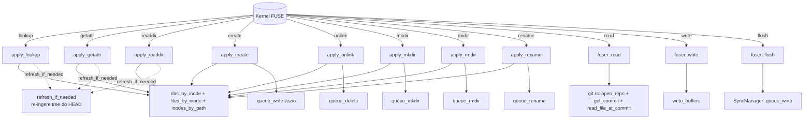

# Arquitetura: Filesystem FUSE

## Visão Geral

`GitDriveFS` é a ponte entre o kernel FUSE e o conteúdo versionado do repositório Git. Mantém um modelo hierárquico com `FileEntry` e `DirEntry` ligados por referências de inode, um alocador atômico para novos inodes criados em runtime (`create`/`mkdir`) e lógica extraída em métodos `apply_*` puros que são testáveis sem montar o kernel. Leituras consultam blobs Git; mutações atualizam índices em memória, buffers de escrita e enfileiram `SyncOp`s para o `SyncManager`.



---

## Mapeamento de Inodes

### Constantes (`src/fs.rs`)

```rust
const TTL: Duration = Duration::from_secs(1);
const ROOT_INODE: u64 = 1;
const FILE_MODE: u16 = 0o644;
const DIR_MODE: u16 = 0o755;
```

### Estruturas

```rust
struct FileEntry {
    inode: u64,
    path: String,     // "foo/bar/baz.txt"
    parent: u64,      // inode do diretório-pai
    size: u64,
}

struct DirEntry {
    inode: u64,
    path: String,     // "" para raiz
    parent: u64,      // 0 para raiz
    children: HashSet<u64>,
}
```

### Alocador

`next_inode: Arc<AtomicU64>` inicializa em `2 + total_inodes_na_montagem`. `alloc_inode` faz `fetch_add(1, SeqCst)`. Monotônico — inodes deletados não são reciclados (mesmo após `refresh_if_needed`).

### Inicialização em `GitDriveFS::new`

1. Insere raiz (`inode 1`, path `""`).
2. Chama `git::list_dirs_at_commit` e `git::list_files_at_commit` (paths completos).
3. Diretórios são ordenados por profundidade e inseridos do raso para o profundo, garantindo que o pai exista quando o filho for inserido.
4. Arquivos usam o mesmo esquema de resolução de pai via `path.rfind('/')`.
5. Raiz é tratada especialmente (path vazio → pai é o `inodes_by_path[""]`).

---

## Operações Implementadas

| Op | Método do trait | Função pura | Comportamento |
| --- | --- | --- | --- |
| `lookup` | `lookup` | `apply_lookup(parent, name)` | Busca filho em `dirs_by_inode[parent].children` pelo `leaf_name`. Refresh antes. |
| `getattr` | `getattr` | `apply_getattr(ino)` | Retorna `FileAttr`. Refresh antes. |
| `readdir` | `readdir` | `apply_readdir(ino)` | Lista `.`, `..` e children do diretório. Refresh antes. |
| `open` | `open` | — | Sempre aceita, fh = ino. |
| `read` | `read` | — | Reabre repo, resolve `HEAD`, lê blob do path. Sem cache. Erros viram `EIO`. |
| `write` | `write` | — | `write_buffers[ino]` acumula com zero-padding se necessário. |
| `flush` | `flush` | — | Remove `write_buffers[ino]` e chama `sync.queue_write`. |
| `release` | `release` | — | Apenas loga. |
| `create` | `create` | `apply_create(parent, name)` | Aloca inode, insere `FileEntry`, enfileira `queue_write(path, [])` para materializar em disco. |
| `unlink` | `unlink` | `apply_unlink(parent, name)` | Remove de índices + `write_buffers`, enfileira `queue_delete`. `EISDIR` se for diretório. |
| `mkdir` | `mkdir` | `apply_mkdir(parent, name)` | Aloca inode, insere `DirEntry`, enfileira `queue_mkdir`. |
| `rmdir` | `rmdir` | `apply_rmdir(parent, name)` | Remove inode + path, enfileira `queue_rmdir`. `ENOTEMPTY` se há children. |
| `rename` | `rename` | `apply_rename(parent, name, new_parent, new_name)` | Move inode entre parents, atualiza paths de descendentes recursivamente, reindexação completa de `inodes_by_path`, enfileira `queue_rename`. Overwrite implícito em arquivo destino. |

### Códigos de erro

| Erro | Quando |
| --- | --- |
| `ENOENT` | Inode/nome não existe no índice |
| `ENOTDIR` | Parent esperado como diretório é arquivo |
| `EISDIR` | Operação de arquivo aplicada a diretório (unlink, overwrite em rename) |
| `EEXIST` | `create`/`mkdir`/`rename` para destino já existente (dir) |
| `ENOTEMPTY` | `rmdir` em diretório com children |
| `EINVAL` | Nome não-UTF8 |
| `EIO` | Erro do `git2` em `read` |

Operações **não** implementadas (default retorna `ENOSYS`): `chmod`, `chown`, `symlink`, `link`, `readlink`, `statfs`, `access`, `setattr`, `fsync`, `opendir`, `releasedir`, `fsyncdir`.

---

## Refresh de Índice

`src/fs.rs::refresh_if_needed`:

1. Lê-e-limpa `refresh_flag` do `SyncManager`.
2. Se era `true`, reabre o repo, lista dirs + files do `HEAD`.
3. Preserva inodes de paths que continuam existindo (reutiliza do `inodes_by_path` antigo).
4. Para paths novos, aloca novo inode via `next_inode`.
5. Paths que sumiram perdem o inode.

Chamado no início de `lookup`, `getattr`, `readdir` (nos wrappers do trait `Filesystem`). `TTL = 1s` no kernel limita a frequência efetiva dessas chamadas.

---

## Leitura de Arquivos

`fuser::read` em `src/fs.rs`:

```rust
let repo = git::open_repo(&self.repo_path);
let commit = git::get_commit(&repo, "HEAD");
let content = git::read_file_at_commit(&repo, &commit, &entry.path);
```

- Três operações Git por syscall. Kernel fragmenta em 128 KiB.
- Sem cache.
- Erros do `git2` viram `EIO` (não panica mais, diferente do estado anterior que usava `unwrap()`).

---

## Escrita de Arquivos

1. `fuser::write` → buffer em memória indexado por inode, com zero-padding para offsets além do tamanho atual.
2. `fuser::flush` → consome o buffer e chama `sync.queue_write`.
3. `apply_create` pré-enfileira `queue_write(path, vec![])` para materializar arquivos recém-criados mesmo sem escrita explícita (`touch`).

---

## Limitações

1. **Sem cache de blobs** em `read`.
2. **TTL de 1s** no kernel mascara mudanças vindas do pull por até 1 segundo.
3. **Refresh é best-effort**: se o kernel cacheia atributos agressivamente, novas descobertas podem só aparecer no próximo `lookup`.
4. **Sem symlinks / FIFOs / hardlinks.**
5. **Permissões fixas** — sem `chmod`/`chown`.
6. **`uid`/`gid` hardcoded em 1000**.
7. **Escritas não-commitadas são perdidas em crash** antes do debounce drenar.
8. **Sem `setattr`** — ferramentas que tentem ajustar `mtime` recebem `ENOSYS`.

---

## Como adicionar uma nova operação FUSE (ex: `chmod`)

1. Escrever teste em `tests/fs_hierarchy.rs` chamando `fs.apply_chmod(ino, mode)`.
2. Ver RED (função não existe).
3. Implementar `apply_chmod(&mut self, ino, mode) -> Result<FileAttr, i32>` em `src/fs.rs`. Armazenar mode em `FileEntry` requer novo campo.
4. Implementar wrapper `fn setattr(&mut self, ..., reply: ReplyAttr)` que chama `apply_chmod`.
5. Decidir se o mode persiste no working tree (ex: `fs::set_permissions`) ou só in-memory.
6. Atualizar a tabela de operações acima.

## Como adicionar uma nova variante de `SyncOp`

Ver [fluxo-de-sincronizacao.md](./fluxo-de-sincronizacao.md#como-adicionar-uma-ação-pós-flush) para guia geral e [arquitetura.md](./arquitetura.md#como-adicionar-uma-nova-operação-de-mutação) para checklist end-to-end.

---

## Referências

| Arquivo | Responsabilidade |
| --- | --- |
| `src/fs.rs` | `GitDriveFS`, `FileEntry`, `DirEntry`, `apply_*`, `refresh_if_needed`, impl `Filesystem` |
| `src/git.rs` | Leitura de blobs e listagem de tree |
| `src/sync.rs` | Consumidor de `queue_*` chamado pelas mutações FUSE |
| `tests/fs_hierarchy.rs` | 36 testes das funções `apply_*` e construção do modelo |

Docs relacionadas:

- [arquitetura.md](./arquitetura.md)
- [fluxo-de-sincronizacao.md](./fluxo-de-sincronizacao.md)
