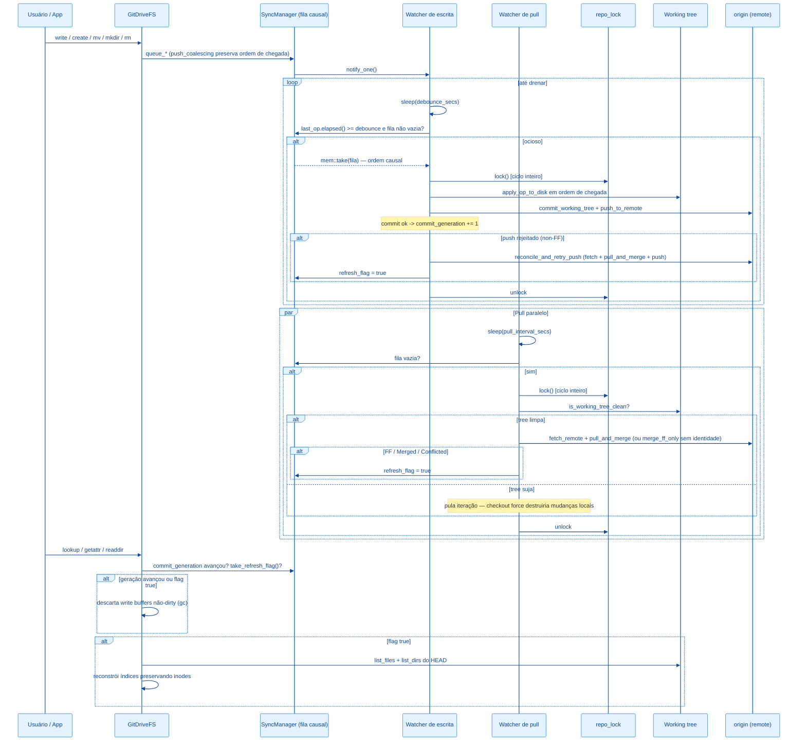

# Arquitetura: Fluxo de Sincronização

## Visão Geral

O `SyncManager` desacopla três tempos diferentes: (a) recebimento de operações vindas do kernel FUSE — rápido, em memória; (b) persistência no working tree + commit + push — custoso, roda no fim de um ciclo de ociosidade (debounce); (c) puxar mudanças do remote — também custoso, roda em intervalo independente (pull watcher). Os ciclos (b) e (c) são serializados por um lock compartilhado de repositório (`repo_lock`): drain e pull nunca executam concorrentes sobre o mesmo repo.



---

## Componentes

### `SyncManager`

```rust
#[derive(Clone)]
pub struct SyncManager {
    inner: Arc<Mutex<Inner>>,
    notify: Arc<Notify>,
    debounce_secs: u64,
    repo_path: PathBuf,
    branch: String,
    user_name: Option<String>,
    user_email: Option<String>,
    remote_name: Option<String>,
    remote_token: Option<String>,
    refresh_flag: Arc<AtomicBool>,
    commit_generation: Arc<AtomicU64>,
    repo_lock: Arc<Mutex<()>>,
    status: Arc<StatusState>,
}
```

- `inner` — fila `Vec<SyncOp>` em ordem de chegada + timestamp do último `queue_*`.
- `notify` — sinaliza ao watcher de escrita que há trabalho.
- `remote_name`/`remote_token` — credenciais opcionais para push/pull. Ausência desliga push/pull respectivamente.
- `refresh_flag` — `AtomicBool` setado quando o HEAD avança por pull ou reconcile; consumido por `GitDriveFS::refresh_if_needed`.
- `commit_generation` — `AtomicU64` incrementado a cada commit criado pelo drain; o `GitDriveFS` compara com o último valor visto para descartar write buffers cujo conteúdo já está no HEAD.
- `repo_lock` — serializa os ciclos completos do drain e do pull. A unidade atômica é o ciclo, não a chamada git individual: um commit entrando entre o fetch e o checkout do pull era a janela de corrida.
- `status` — estado observável (`src/status.rs`): eventos de boot/drain/pull e conflicted copies da sessão, persistidos atomicamente em `logs/status.json` quando `enable_status_file` é chamado (o main liga no boot). Lido pelo subcomando `drive-sync status`.

### `SyncOp` e a fila causal

```rust
#[derive(Debug, Clone)]
pub enum SyncOp {
    Write { path: String, content: Vec<u8> },
    Delete { path: String },
    Mkdir { path: String },
    Rmdir { path: String },
    Rename { from: String, to: String },
}
```

A fila preserva a **ordem de chegada** — a ordem do kernel FUSE é a ordem causal. Única coalescência permitida (`push_coalescing`): um `Write` substitui in-place o `Write` mais recente do mesmo path, desde que nenhuma op posterior a ele toque um path relacionado (igual ou ancestral/descendente) — `Rename`, `Delete`, `Mkdir` e `Rmdir` funcionam como barreiras. A correção nunca depende da coalescência; ela só evita conteúdo redundante em write storms.

Essa estrutura substituiu um `HashMap<String, SyncOp>` chaveado por path com sort por tipo de op no drain, que tinha duas classes de bug:

| Cenário no mesmo batch | Comportamento antigo | Comportamento atual |
| --- | --- | --- |
| `rename d1 -> d2` seguido de `rename d2 -> d3` | Ordem arbitrária do HashMap: um dos renames falhava com ENOENT | Aplica na ordem: só `d3` existe ao final |
| `mkdir a`, `rename a -> b`, `write b/f.txt` | Write (prioridade menor) criava `b` real antes do rename, que falhava com "destino existe" | mkdir, rename e write aplicam em ordem: `b/f.txt` existe, `a` não sobra |
| `rename a -> b` + `write b` | Write apagava o Rename da fila (mesma chave) | Ambos sobrevivem, em ordem |
| `write tmp` + `delete tmp` | Delete substituía o Write | Ambos aplicam; estado líquido nulo não gera commit |

---

## Watcher de escrita

Fluxo, ver `src/sync.rs::spawn_watcher`:

1. `notified().await` — dorme até o primeiro `queue_*`.
2. Loop interno dorme por `debounce_secs`.
3. Sob o lock de `inner`: se `last_op.elapsed() >= debounce` e a fila não está vazia, `mem::take` da fila; caso contrário continua esperando.
4. Adquire `repo_lock` (segura pelo ciclo inteiro; não há `.await` no escopo do guard).
5. Itera o lote **na ordem da fila** chamando `apply_op_to_disk` para cada `SyncOp`.
6. Se `user_name`/`user_email` estão presentes, `commit_batch` gera a mensagem `drive-sync: <N> changes (...)` e chama `git::commit_working_tree`. Commit criado incrementa `commit_generation`.
7. Se houve commit e `remote_name` está configurado, `push_batch` chama `git::push_to_remote`. Push rejeitado (tipicamente non-FF) dispara `reconcile_and_retry_push`: fetch + `pull_and_merge` + um retry de push. Recuperação seta `refresh_flag`. O commit local nunca é revertido.
8. Ao final do ciclo, `status.record_drain` registra ops aplicadas, oid do commit, resultado do push e ops ainda pendentes na fila — e persiste o `status.json`.

### Tradução `SyncOp` -> working tree

| Op | Efeito em disco |
| --- | --- |
| `Write` | `create_dir_all(parent)` + `fs::write`. |
| `Delete` | `fs::remove_file` (ENOENT é silencioso — path pode nunca ter chegado ao disco). |
| `Mkdir` | `create_dir_all(path)` + `fs::write(path/.gitkeep)`. Necessário porque Git não rastreia diretórios vazios. |
| `Rmdir` | Remove `.gitkeep` (se existir) + `fs::remove_dir` (ENOENT silencioso). |
| `Rename` | `create_dir_all(parent do destino)` + `fs::rename`. |

Erros são logados e o lote segue — arquivos restantes são tentados. **Sem atomicidade multi-arquivo**: um crash no meio do lote deixa estado parcial no working tree (sem commit).

---

## Watcher de pull

`src/sync.rs::spawn_pull_watcher`. Roda somente se `pull_interval_secs > 0` **e** `remote_name` está configurado.

1. Loop: `sleep(pull_interval_secs)`.
2. Se a fila não está vazia, pula a iteração (não rouba tempo do commit local).
3. Adquire `repo_lock` — serializa com o drain.
4. **Guarda de working tree**: `git::is_working_tree_clean` (staged, unstaged e untracked; ignorados fora). Tree suja pula a iteração — o checkout force do fast-forward destruiria mudanças locais não commitadas. No modo sem identidade (commits pulados por design), a primeira escrita local bloqueia o pull até o usuário commitar manualmente ou configurar identidade — comportamento aceito e registrado nas decisões da Fase 0.
5. `git::fetch_remote` (`git fetch origin <branch>`).
6. Com identidade: `git::pull_and_merge` — FF se possível; senão merge 3-way; conflito gera conflicted copy (`<path>.conflict-<host>-<ts>`) com a versão remota como canônica. Sem identidade: degrada para `git::merge_ff_only` (trava em divergência).
7. Qualquer outcome que toque a tree (`FastForwarded`/`Merged`/`Conflicted`) seta `refresh_flag = true`.
8. Toda iteração registra o outcome em `status.record_pull` — inclusive os pulos ("fila de sync pendente", "working tree sujo") e erros de fetch/merge. Conflicted copies entram na lista `conflicts` do status.

---

## Invalidação de índice e de buffers (`refresh_if_needed`)

`src/fs.rs::refresh_if_needed`, chamado em `lookup`/`getattr`/`readdir`:

1. Se há ops pendentes na fila (`has_pending_ops`), retorna — refresh com lote não drenado descartaria paths recém-criados dos índices.
2. Se `commit_generation` avançou desde a última observação, descarta write buffers **não-dirty** (gc): com a fila vazia e commit criado, o conteúdo deles já está no HEAD, e mantê-los esconderia mudanças remotas futuras do `read`.
3. `take_refresh_flag()`; se `false`, retorna.
4. Descarta buffers não-dirty de novo (o HEAD avançou por pull/merge) e reconstrói os índices: lista dirs e files do HEAD, preserva inodes de paths que ainda existem, aloca novos inodes (lazy, via `unwrap_or_else`) só para paths novos.

Buffers **dirty** (escrita ainda não enfileirada) nunca são descartados.

**Tradeoff:** paths que somem (deletados remotamente) perdem o inode; se o usuário tinha o arquivo aberto, próximos `read` retornam `ENOENT`. Aceitável no MVP.

---

## Comportamento de Concorrência

| Primitiva | Uso |
| --- | --- |
| `parking_lot::Mutex<Inner>` | Fila causal compartilhada entre thread FUSE e watchers. API sem `Result` e sem envenenamento em panic. |
| `Arc<parking_lot::Mutex<()>>` (`repo_lock`) | Serializa drain (apply + commit + push + reconcile) e pull (fetch + merge + checkout). Nunca é segurado através de um `.await`. |
| `Arc<Notify>` | Sinalização leve do `queue_*` para o watcher de escrita. |
| `Arc<AtomicBool>` (`refresh_flag`) | Canal de uma via dos watchers para `GitDriveFS`. `SeqCst`. |
| `Arc<AtomicU64>` (`commit_generation`) | Contador monotônico de commits do drain, base do gc de buffers. |
| `Arc<AtomicU64>` (`next_inode`) | Alocador monotônico de inodes. |
| `fs::*` síncrono | As gravações em disco acontecem fora do lock de `Inner` (mas dentro do `repo_lock`). |

---

## Mensagem de commit

`src/sync.rs::build_commit_message`:

- Formato: `drive-sync: <N> changes (<p1>, <p2>, <p3>[, +M more])`
- Até 3 paths inline; mais que isso adiciona `+<M> more`.
- `<path>` vem de `SyncOp::primary_path`.

---

## Filtro de paths efêmeros

`op_touches_ephemeral` descarta no `enqueue` (antes de entrar na fila):

- **Filtro total** (`is_fully_ephemeral_path`, todas as ops): componentes `._*`, `.DS_Store`, `.Spotlight-V100`, `.Trashes`, `.TemporaryItems`, `.fseventsd`, `.DocumentRevisions-V100`, `.apdisk`, `.VolumeIcon.icns`.
- **Filtro de criação** (`is_textedit_scratch_path`, só Write/Mkdir e destino de Rename): componentes contendo `.sb-` (temp dirs do safe-save do TextEdit/NSDocument). Delete/Rmdir passam para permitir limpar resíduos já commitados.

Renames de DIRETÓRIO com endpoint efêmero não chegam ao filtro como `Rename` (que seria descartado
inteiro, divergindo disco e índice): `apply_rename` expande a operação antes de enfileirar —
destino efêmero (ex.: mover pasta para o Trash) vira Delete/Rmdir recursivo dos paths reais
(bottom-up), com buffers preservando leitura e restore; origem efêmera virando real materializa via
Mkdir/Write top-down com o conteúdo corrente. Renames de ARQUIVO já se resolvem pela tradução
Write+Delete (o lado efêmero é filtrado individualmente).

---

## Limitações do Fluxo Atual

1. **Pull bloqueado no modo sem identidade.** Sem `user_name`/`user_email`, escritas locais nunca viram commit; a guarda de working tree então bloqueia o pull indefinidamente após a primeira escrita. Sync vira efetivamente unidirecional até commit manual ou configuração de identidade.
2. **Sem atomicidade multi-arquivo.** Crash no meio do lote deixa working tree parcialmente atualizado mas sem commit.
3. **Sem cancelamento.** Ops enfileiradas sempre rodam — não há API para descartar um `queue_write` antes do debounce.
4. **TTL de FUSE vs refresh.** `TTL = 1s` no kernel faz o refresh demorar até 1s extra para aparecer ao usuário.
5. **Falha persistente de push só loga.** Depois do retry único do reconcile, o commit fica local até o próximo ciclo com push bem-sucedido.

---

## Como adicionar uma ação pós-flush

Ponto de extensão em `src/sync.rs::spawn_watcher`, entre `commit_batch` e `push_batch`:

```rust
if committed {
    commit_generation.fetch_add(1, Ordering::SeqCst);
    meu_hook::on_flush(&ops, &repo_path);   // <- aqui
    if let Some(ref remote) = remote_name {
        // push_batch / reconcile_and_retry_push ...
    }
}
```

`ops` já contém `Vec<&SyncOp>` com todos os paths/conteúdos do lote, na ordem causal.

## Como adicionar uma nova regra de coalescência

A única coalescência hoje é Write-sobre-Write (`push_coalescing` em `src/sync.rs`). Para adicionar outra (ex.: create+delete se anulam):

1. Escrever primeiro o teste unitário em `src/sync.rs::tests` cobrindo a barreira — o que NÃO pode coalescer importa mais do que o que pode.
2. Alterar `push_coalescing` mantendo o invariante: a correção do drain nunca pode depender da coalescência, apenas a economia.
3. Rodar os quatro cenários de regressão de batch em `tests/sync_flow.rs` (`batch_*`).

---

## Referências

| Arquivo | Responsabilidade |
| --- | --- |
| `src/sync.rs` | `SyncManager`, `SyncOp`, fila causal (`push_coalescing`), watchers, `commit_batch`, `push_batch`, `reconcile_and_retry_push` |
| `src/fs.rs` | `write_buffers` + dirty flags, `refresh_if_needed` (gc de buffers + rebuild), chamadas a `sync.queue_*` nos `apply_*` |
| `src/git.rs` | `commit_working_tree`, `push_to_remote`, `fetch_remote`, `merge_ff_only`, `pull_and_merge`, `is_working_tree_clean` |
| `src/status.rs` | `SyncStatus`/`StatusState`, escrita atômica do `status.json`, formatação do subcomando |
| `src/config.rs` | Origem de `write_debounce_secs`, `pull_interval_secs`, `read_cache_mb`, identidade e token |

Docs relacionadas:

- [arquitetura.md](./arquitetura.md)
- [filesystem-fuse.md](./filesystem-fuse.md)
