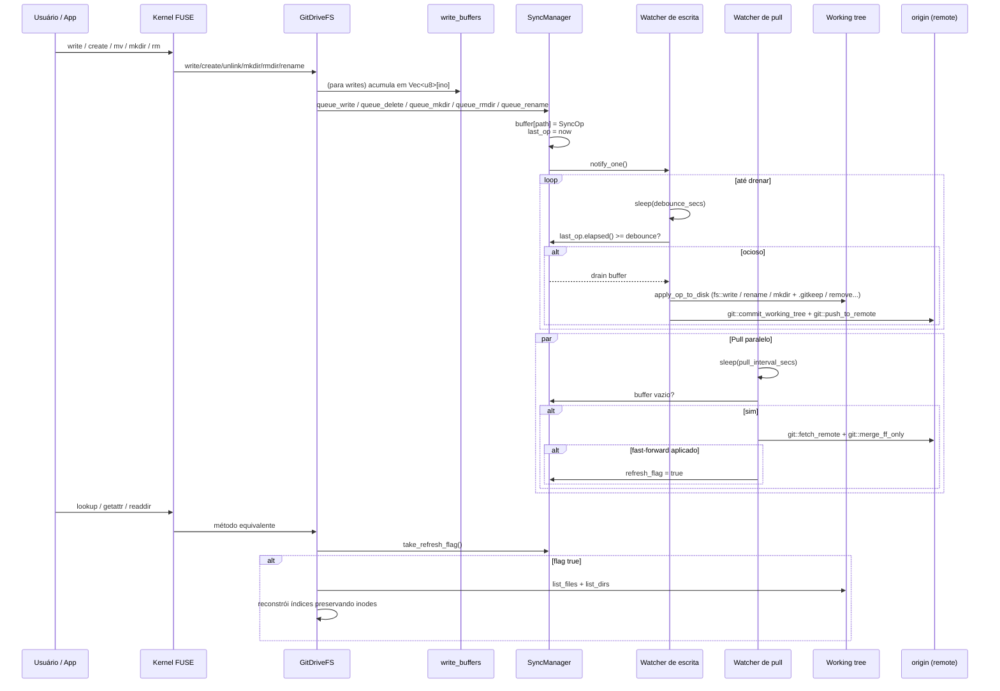

# Arquitetura: Fluxo de Sincronização

## Visão Geral

O `SyncManager` desacopla três tempos diferentes: (a) recebimento de operações vindas do kernel FUSE — rápido, em memória; (b) persistência no working tree + commit + push — custoso, roda no fim de um ciclo de ociosidade (debounce); (c) puxar mudanças do remote — também custoso, roda em intervalo independente (pull watcher). As três correntes compartilham apenas o repositório Git subjacente e um flag de refresh.



---

## Componentes

### `SyncManager`

```rust
#[derive(Clone)]
pub struct SyncManager {
    inner: Arc<Mutex<Inner>>,
    notify: Arc<Notify>,
    debounce_secs: u64,
    repo_path: PathBuf,
    branch: String,
    user_name: Option<String>,
    user_email: Option<String>,
    remote_name: Option<String>,
    remote_token: Option<String>,
    refresh_flag: Arc<AtomicBool>,
}
```

- `inner` — `HashMap<String, SyncOp>` chaveado por path "primário" + timestamp do último `queue_*`.
- `notify` — sinaliza ao watcher de escrita que há trabalho.
- `remote_name`/`remote_token` — credenciais opcionais para push/pull. Ausência desliga push/pull respectivamente.
- `refresh_flag` — `AtomicBool` setado pelo pull watcher quando o merge-ff foi aplicado; consumido pelo `GitDriveFS::refresh_if_needed`.

### `SyncOp`

```rust
#[derive(Debug, Clone)]
pub enum SyncOp {
    Write { path: String, content: Vec<u8> },
    Delete { path: String },
    Mkdir { path: String },
    Rmdir { path: String },
    Rename { from: String, to: String },
}
```

`SyncOp::primary_path` retorna `to` em `Rename` e `path` nas demais. Esse valor é a chave no `HashMap` — operações no mesmo destino coalescem (última vence).

---

## Watcher de escrita

Fluxo, ver `src/sync.rs::spawn_watcher`:

1. `notified().await` — dorme até o primeiro `queue_*`.
2. Loop interno dorme por `debounce_secs`.
3. Sob o lock de `inner`: se `last_op.elapsed() >= debounce`, drena o buffer; caso contrário continua esperando.
4. Liberado o lock, itera o lote chamando `apply_op_to_disk` para cada `SyncOp`.
5. Se `user_name`/`user_email` estão presentes, chama `commit_batch` que gera a mensagem `drive-sync: <N> changes (...)` e chama `git::commit_working_tree`.
6. Se houve commit e `remote_name` está configurado, `push_batch` chama `git::push_to_remote`. Erros de push logam e não revertem.

### Tradução `SyncOp` → working tree

| Op | Efeito em disco |
| --- | --- |
| `Write` | `create_dir_all(parent)` + `fs::write`. |
| `Delete` | `fs::remove_file`. |
| `Mkdir` | `create_dir_all(path)` + `fs::write(path/.gitkeep)`. Necessário porque Git não rastreia diretórios vazios. |
| `Rmdir` | Remove `.gitkeep` (se existir) + `fs::remove_dir`. |
| `Rename` | `create_dir_all(parent do destino)` + `fs::rename`. |

Erros são logados e o lote segue — arquivos restantes são tentados. **Sem atomicidade multi-arquivo**: um crash no meio do lote deixa estado parcial no working tree.

---

## Watcher de pull

`src/sync.rs::spawn_pull_watcher`. Roda somente se `pull_interval_secs > 0` **e** `remote_name` está configurado.

1. Loop: `sleep(pull_interval_secs)`.
2. Se `buffer` não vazio, pula iteração (não rouba tempo do commit local).
3. `git::fetch_remote` (`git fetch origin <branch>`).
4. `git::merge_ff_only`:
   - `Ok(true)` → FF aplicado, seta `refresh_flag = true`.
   - `Ok(false)` → up-to-date, nada a fazer.
   - `Err(_)` → divergência real, loga erro e espera o próximo ciclo.

O `refresh_flag` é consumido (get-and-clear) pelo `GitDriveFS::refresh_if_needed` em syscalls `lookup`/`getattr`/`readdir`.

---

## Invalidação de índice (`refresh_if_needed`)

`src/fs.rs::refresh_if_needed`:

1. `sync.take_refresh_flag()`; se `false`, retorna.
2. Abre repo, resolve `HEAD`, lista dirs e files com paths completos.
3. Captura `previous = inodes_by_path.clone()` para preservar inodes de paths que ainda existem.
4. Reconstrói `files_by_inode`, `dirs_by_inode`, `inodes_by_path` do zero.
5. Para cada dir/arquivo, reutiliza o inode antigo se o path existia; caso contrário aloca via `next_inode.fetch_add(1, SeqCst)`. O alocador é monotônico — nunca regride.

**Tradeoff:** paths que somem (deletados remotamente) perdem o inode; se o usuário tinha o arquivo aberto, próximos `read` retornam `ENOENT`. Aceitável no MVP.

---

## Comportamento de Concorrência

| Primitiva | Uso |
| --- | --- |
| `parking_lot::Mutex<Inner>` | Estado mutável compartilhado entre thread FUSE e watcher. API sem `Result` e sem envenenamento em panic. |
| `Arc<Notify>` | Sinalização leve do `queue_*` para o watcher de escrita. |
| `Arc<AtomicBool>` (`refresh_flag`) | Canal de uma via do pull watcher para `GitDriveFS`. `SeqCst` para garantir ordem global. |
| `Arc<AtomicU64>` (`next_inode`) | Alocador monotônico de inodes. |
| `fs::*` síncrono | As gravações em disco acontecem fora do lock de `Inner`. |

O pull watcher e o watcher de escrita **não** compartilham estado além de `buffer` (lido para decidir skip) e `repo_path`. O repositório Git é o único ponto de encontro real — `git2` gerencia seus próprios locks internos.

---

## Mensagem de commit

`src/sync.rs::build_commit_message`:

- Formato: `drive-sync: <N> changes (<p1>, <p2>, <p3>[, +M more])`
- Até 3 paths inline; mais que isso adiciona `+<M> more`.
- `<path>` vem de `SyncOp::primary_path`.

---

## Limitações do Fluxo Atual

1. **Commit pulado sem identidade.** Se `user_name` e `user_email` estão ausentes, working tree atualiza mas `HEAD` não avança. Pull subsequente pode conflitar com as mudanças não-commitadas.
2. **Merge apenas fast-forward.** Divergência real trava o watcher de pull até intervenção humana.
3. **Sem retry de push falho.** Se o push falha, o próximo commit também vai falhar (até que pull reconcilie). Não há re-tentativa automática.
4. **Sem atomicidade multi-arquivo.** Crash no meio do lote deixa working tree parcialmente atualizado mas sem commit.
5. **Sem cancelamento.** Ops enfileiradas sempre rodam — não há API para descartar um `queue_write` antes do debounce.
6. **TTL de FUSE vs refresh.** `TTL = 1s` no kernel faz o refresh demorar até 1s extra para aparecer ao usuário.

---

## Como adicionar uma ação pós-flush

Ponto de extensão em `src/sync.rs::spawn_watcher`, entre `commit_batch` e `push_batch`:

```rust
if committed {
    meu_hook::on_flush(&ops, repo_path);   // <- aqui
    if let Some(ref remote) = remote_name {
        push_batch(&repo_path, &branch, remote, &remote_token);
    }
}
```

`ops` já contém `Vec<&SyncOp>` com todos os paths/conteúdos do lote.

## Como adicionar uma segunda estratégia de resolução de conflito

Hoje só há FF. Para merge automático:

1. Substituir `git::merge_ff_only` por `git::merge_into_local(repo, branch, strategy)` onde `strategy` é um enum (`FastForwardOnly`, `RebaseOnConflict`, `MergeCommit`).
2. Propagar uma nova opção em `Config` (`pull_strategy: String`).
3. Em caso de merge real bem-sucedido, o `refresh_flag` continua sendo setado da mesma forma.

---

## Referências

| Arquivo | Responsabilidade |
| --- | --- |
| `src/sync.rs` | `SyncManager`, `SyncOp`, `spawn_watcher`, `spawn_pull_watcher`, `commit_batch`, `push_batch` |
| `src/fs.rs` | `write_buffers`, `refresh_if_needed`, chamadas a `sync.queue_*` nos `apply_*` |
| `src/git.rs` | `commit_working_tree`, `push_to_remote`, `fetch_remote`, `merge_ff_only` |
| `src/config.rs` | Origem de `write_debounce_secs`, `pull_interval_secs`, identidade e token |

Docs relacionadas:

- [arquitetura.md](./arquitetura.md)
- [filesystem-fuse.md](./filesystem-fuse.md)
