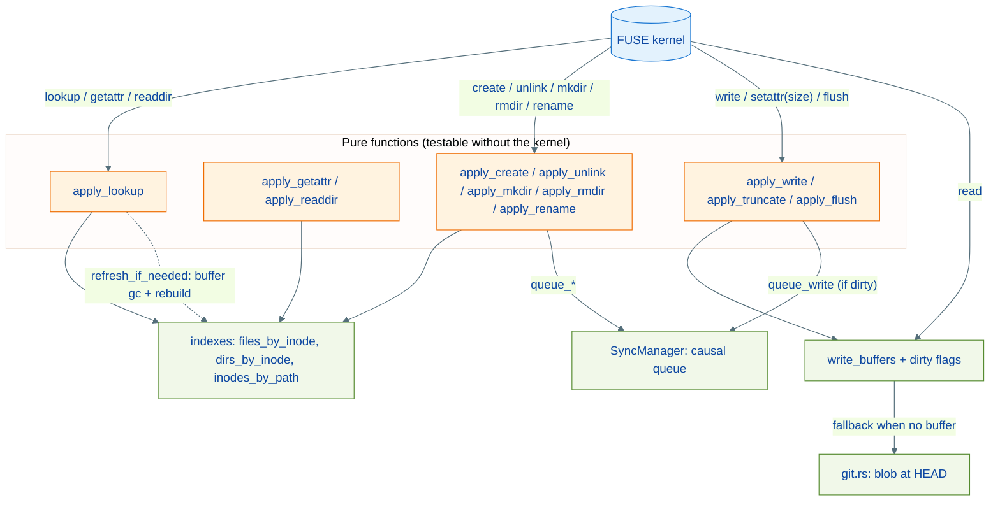

# Architecture: FUSE Filesystem

> Portuguese version: [pt-br/filesystem-fuse.md](./pt-br/filesystem-fuse.md)

## Overview

`GitDriveFS` is the bridge between the FUSE kernel and the versioned content of the Git repository. It maintains a hierarchical model with `FileEntry` and `DirEntry` linked by inode references, an atomic allocator for new inodes created at runtime (`create`/`mkdir`), and logic extracted into pure `apply_*` methods that are testable without mounting the kernel. Reads consult the inode's write buffer (if one exists) and fall back to the Git blob at HEAD; mutations update in-memory indexes and write buffers, and enqueue `SyncOp`s to the `SyncManager`.



---

## Inode Mapping

### Constants (`src/fs.rs`)

```rust
const TTL: Duration = Duration::from_secs(1);
const ROOT_INODE: u64 = 1;
const FILE_MODE: u16 = 0o644;
const DIR_MODE: u16 = 0o755;
```

### Structures

```rust
struct FileEntry {
    inode: u64,
    path: String,     // "foo/bar/baz.txt"
    parent: u64,      // inode of the parent directory
    size: u64,
}

struct DirEntry {
    inode: u64,
    path: String,     // "" for root
    parent: u64,      // 0 for root
    children: HashSet<u64>,
}
```

### Allocator

`next_inode: Arc<AtomicU64>` starts at `2 + total_inodes_at_mount`. `alloc_inode` does `fetch_add(1, SeqCst)`. Monotonic — deleted inodes are not recycled. In `refresh_if_needed`, preserved paths reuse the old inode and allocation for new paths is lazy (`unwrap_or_else`) — a refresh with no changes does not advance the counter.

### Initialization in `GitDriveFS::new`

1. Inserts the root (`inode 1`, path `""`).
2. Calls `git::list_dirs_at_commit` and `git::list_files_at_commit` (full paths).
3. Directories are sorted by depth and inserted from shallow to deep, guaranteeing the parent exists when the child is inserted.
4. Files use the same parent-resolution scheme via `path.rfind('/')`.
5. The root is special-cased (empty path → parent is `inodes_by_path[""]`).

---

## Write buffer lifecycle

Each inode with a pending write has a `WriteBuffer` in `write_buffers` — the ENTIRE file content, in copy-on-write RAM (`Arc` shared with the sync queue) below `large_file_threshold_mb`, or in a spool file above it — and, optionally, a mark in `dirty`. For a chunked file, the buffer is born from the streaming reassembly (decrypted, if encrypted).

```mermaid
%%{init: {'theme':'base','themeVariables':{'primaryColor':'#E3F2FD','primaryTextColor':'#0D47A1','primaryBorderColor':'#1976D2','lineColor':'#546E7A'}}}%%
stateDiagram-v2
    accTitle: Write buffer lifecycle of an inode
    accDescr: Without a buffer, read falls back to HEAD; the first write creates the buffer from HEAD and marks it dirty; flush enqueues and clears the mark; gc discards clean buffers once HEAD contains the content.

    [*] --> NoBuffer: reads go straight to the blob at HEAD
    NoBuffer --> Dirty: first write or truncate<br/>(buffer is born as a COPY of the HEAD content)
    Dirty --> Clean: flush enqueues the Write op<br/>and clears the mark
    Dirty --> Clean: truncate / rename / exchange<br/>enqueue the content directly
    Clean --> Dirty: new write
    Clean --> NoBuffer: gc — commit_generation advanced<br/>or post-pull refresh
    Dirty --> NoBuffer: unlink
```



Rules that sustain the model:

1. **Initialization with current content** (`ensure_buffer`): the buffer is born as a copy of the blob at HEAD. POSIX semantics — `write` at an offset modifies only the written range; `truncate` preserves the prefix. A buffer born empty zeroed out everything that was not rewritten (corruption in appends, editor dirty pages and truncates).
2. **Per-inode dirty flag**: `flush` runs on every `close(2)`, including fds opened read-only. `apply_flush` only enqueues `SyncOp::Write` if the inode is dirty, and clears the mark when enqueuing — without this, a simple `cat` re-enqueued stale content and could revert a merged remote change.
3. **GC of clean buffers** (`refresh_if_needed`): when `commit_generation` advances (a drain committed) or on the post-pull refresh, non-dirty buffers are discarded — the content is already at HEAD and keeping them would hide remote changes from `read` forever. Dirty buffers are never touched.
4. **Operations that enqueue directly clear the mark**: `apply_truncate`, file rename, `exchange` and the implicit swap enqueue the current content immediately, so the following flush must not duplicate the op.

---

## Implemented Operations

| Op | Trait method | Pure function | Behavior |
| --- | --- | --- | --- |
| `lookup` | `lookup` | `apply_lookup(parent, name)` | Finds the child in `dirs_by_inode[parent].children` by `leaf_name`. Refresh first. |
| `getattr` | `getattr` | `apply_getattr(ino)` | Returns `FileAttr` with the process uid/gid and a stable mtime (derived from the last commit that touched the path; session touches take precedence). Refresh first. |
| `setattr` | `setattr` | `apply_truncate(ino, size)` | `mode` goes to `mode_overrides` (in-memory); `size` truncates the buffer preserving content; times update `times`. |
| `readdir` | `readdir` | `apply_readdir(ino)` | Lists `.`, `..` and children sorted by name. Refresh only on the first page (`offset == 0`). |
| `readdirplus` | `readdirplus` | `apply_readdir(ino)` | Variant with inline attributes — Finder uses `getattrlistbulk`. |
| `open` | `open` | — | Always accepts, fh = ino. |
| `read` | `read` | `apply_read(ino, offset, size)` | Inode buffer (RAM or spool), blob cache, working tree (local-only) or blob at HEAD via a persistent repo handle (a miss populates the cache). Errors become `EIO`. |
| `write` | `write` | `apply_write(ino, offset, data)` | Buffer initialized from HEAD; write at offset; updates `entry.size`; marks dirty. |
| `flush` | `flush` | `apply_flush(ino)` | Enqueues `queue_write` only if dirty; clears the mark; `touch`. |
| `release` | `release` | — | Only logs. |
| `create` | `create` | `apply_create(parent, name)` | Allocates an inode, inserts a `FileEntry`, enqueues `queue_write(path, [])` to materialize on disk. |
| `unlink` | `unlink` | `apply_unlink(parent, name)` | Removes from indexes, buffer and dirty; enqueues `queue_delete`. `EISDIR` if it is a directory. |
| `mkdir` | `mkdir` | `apply_mkdir(parent, name)` | Allocates an inode, inserts a `DirEntry`, enqueues `queue_mkdir` (ephemeral paths such as `.Trashes` stay in memory only — Finder's native Trash). |
| `rmdir` | `rmdir` | `apply_rmdir(parent, name)` | Removes inode + path, enqueues `queue_rmdir`. `ENOTEMPTY` if it has children. |
| `rename` | `rename` | `apply_rename(parent, name, new_parent, new_name)` | Moves the inode between parents, updates descendant paths, reindexes. `renameatx_np` flags (patch in vendor/fuser): `RENAME_SWAP` routes to `apply_exchange`, `RENAME_EXCL` returns `EEXIST` if the destination exists. Directories use `queue_rename` — except ephemeral endpoints: an ephemeral destination expands into recursive Delete/Rmdir (bottom-up) and an ephemeral source materializes via Mkdir/Write. Files become `queue_write(dest) + queue_delete(src)`, populating a non-dirty buffer and clearing dirty. Empty names (defensive fallback of the old parsing) trigger the implicit swap. |
| `exchange` | `exchange` (macOS) | `apply_exchange(parent, name, newparent, newname)` | Swaps the content of two files (TextEdit/iWork safe save). Updates buffers, enqueues both writes, clears dirty. The same logic serves `rename` with `RENAME_SWAP`. |
| `link` | `link` | — | Simulated via a copy with a new inode (1 inode = 1 path model). Covers the transient backup of the safe save. |
| `readlink` | `readlink` | `apply_readlink(ino)` | Symlink target (content of the `120000` blob). `EINVAL` for a regular file. |
| `symlink` | `symlink` | `apply_symlink(parent, name, target)` | Creates an entry with symlink kind, a buffer with the target text, and enqueues `SyncOp::Symlink` (a barrier in the causal queue). |
| `statfs` | `statfs` | — | Volume advertised with ~1 TiB free — a signal to userland, not a quota. |
| `setxattr`/`getxattr`/`listxattr`/`removexattr` | same | — | In-memory `HashMap` per inode; `ENOATTR` on macOS, `ENODATA` on Linux. |

### Error codes

| Error | When |
| --- | --- |
| `ENOENT` | Inode/name does not exist in the index |
| `ENOTDIR` | Parent expected to be a directory is a file |
| `EISDIR` | File operation applied to a directory (unlink, exchange) |
| `EEXIST` | `create`/`mkdir`/`link`/`rename` to an already existing destination (dir) |
| `ENOTEMPTY` | `rmdir` on a directory with children |
| `EINVAL` | Non-UTF8 name |
| `EIO` | `git2` error in `read` |
| `EXDEV` | Implicit swap with no counterpart at the destination (defense against ambiguous exchangedata encodings) |

Not implemented (default `ENOSYS`): `mknod`, `fsync`, `fallocate`, `copy_file_range`.

---

## Index Refresh

`src/fs.rs::refresh_if_needed`, called at the start of `lookup`, `getattr`, `readdir`/`readdirplus` (first page):

1. If there are pending ops in the sync queue (`has_pending_ops`), it returns — a refresh would rebuild the indexes from HEAD, discarding locally created paths that have not reached a commit yet.
2. If `commit_generation` advanced, discards non-dirty write buffers (see lifecycle above).
3. Reads-and-clears `refresh_flag`; if it was `false`, returns.
4. Discards non-dirty buffers, reopens the repo, lists dirs + files at HEAD.
5. Preserves inodes of paths that still exist; for new paths, allocates via `next_inode` (lazy). Paths that disappeared lose their inode.

`TTL = 1s` in the kernel limits the effective frequency of these calls.

---

## Reading Files

`apply_read` in `src/fs.rs` (the `read` callback delegates). Source order:

1. **Write buffer** of the inode (pending mutations, post-create/rename content not yet committed).
2. **Blob cache** (`BlobCache`): LRU keyed by inode with a byte budget (`read_cache_mb` in
   `config.json`, default 64 MiB; `0` disables). A blob larger than the budget does not enter.
3. **Blob at HEAD**: reopens the repo and reads; the miss populates the cache.

Cache invalidation: full clear at the buffer gc points (`commit_generation` advance and
post-pull refresh — HEAD changed); per-inode removal on `unlink`, `write`, `truncate` and file
rename. `create` and file rename populate a non-dirty buffer with the current content — without
this, reading the new path before the commit hit a blob that did not exist at HEAD and returned `EIO`.

---

## Limitations

1. **1s TTL** in the kernel masks changes coming from a pull for up to 1 second.
2. **No FIFOs / real hardlinks** (`link` is a copy). Symlinks are supported: opaque target, never resolved (no-follow); an absolute target breaks on another machine, just like in plain Git.
3. **Permissions and xattrs in memory** — `chmod` is accepted but does not persist across mounts; `chown` is ignored.
4. **mtime derived from history** — a file untouched in the session exposes the timestamp of the last commit that touched the path (single revwalk with a 4096-commit ceiling; the residue falls back to the HEAD timestamp). Session touches (flush/setattr) take precedence and do not persist across mounts. `atime`/`ctime`/`crtime` mirror the available mtime.
5. **Uncommitted writes are lost on a crash** before the debounce drains.
6. **The implicit swap requires exactly one child file** in the source directory — ambiguity returns `EXDEV` and the app degrades to the copy flow.
7. **The blob cache does not cover files larger than the budget** (`read_cache_mb`) — their reads go to the repo on every syscall, but through a persistent handle (one open per mount, not one per syscall).
8. **Write buffers above `large_file_threshold_mb` live in a spool** (`.git/drive-sync-spool/`) with random access — RAM peak bounded by the threshold; the queue snapshot is applied at drain with `rename`.
9. **Files ignored by the repo's `.gitignore` are visible local-only** — they appear in the mount, persist in the working tree across remounts and never enter a commit/push.
10. **An encrypted repo is transparent** — with `encryption_enabled`, indexes are born from the decrypted names, reads open AEAD (wrong key/tampered blob = `EIO`), readlink presents the plaintext target and conflicted copies show the decrypted prefix. Ignore/local-only are disabled in this mode.
11. **Chunked files are transparent** — a path with a manifest exposes the real size and reads reassembled per chunk (sha256 verified, mismatch = `EIO`); `.chunks/` is invisible in the mount.

---

## How to add a new FUSE operation

1. Write a test in `tests/fs_hierarchy.rs` calling `fs.apply_<op>(...)`.
2. See RED (the function does not exist).
3. Implement `apply_<op>` in `src/fs.rs` as a pure function over the indexes/buffers.
4. Implement the `Filesystem` trait wrapper that delegates and replies to the kernel.
5. Decide the effect on sync (`queue_*`) and on the working tree.
6. Update the operations table above.

## How to add a new `SyncOp` variant

See [sync-flow.md](./sync-flow.md#how-to-add-a-post-flush-action) for the general guide and [architecture.md](./architecture.md#how-to-add-a-new-mutation-operation) for the end-to-end checklist.

---

## References

| File | Responsibility |
| --- | --- |
| `src/fs.rs` | `GitDriveFS`, `FileEntry`, `DirEntry`, `apply_*`, write buffers + dirty, `refresh_if_needed`, `Filesystem` impl |
| `src/git.rs` | Blob reading and tree listing |
| `src/sync.rs` | Consumer of `queue_*` called by the FUSE mutations |
| `tests/fs_hierarchy.rs` | Tests for the `apply_*` functions, the hierarchical model and the buffer lifecycle |

Related docs:

- [architecture.md](./architecture.md)
- [sync-flow.md](./sync-flow.md)
