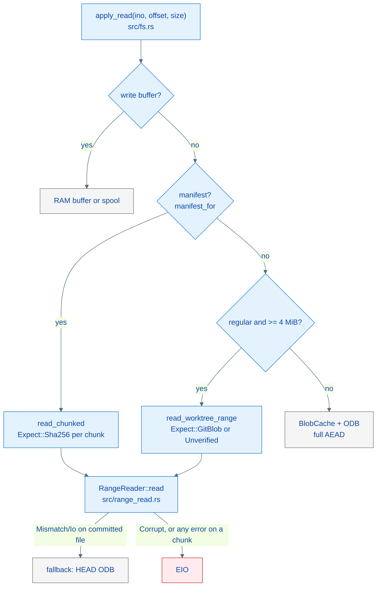
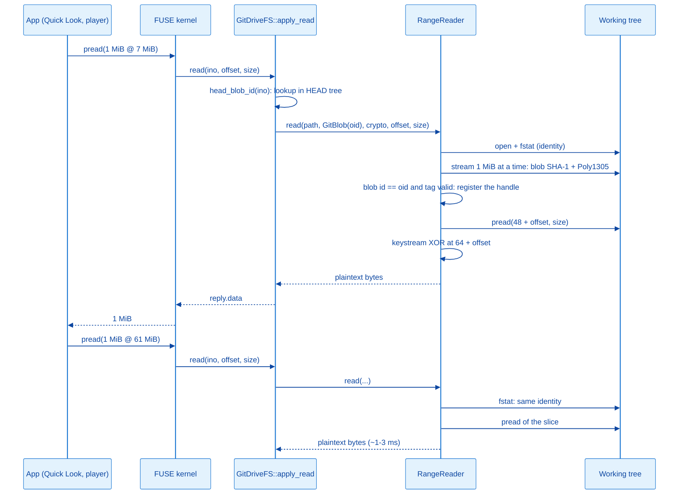

# Architecture: Large File Reads

> Portuguese version: [pt-br/arquitetura-leitura-de-arquivos-grandes.md](./pt-br/arquitetura-leitura-de-arquivos-grandes.md)

## Overview

Large files are read **by range, straight from the working tree**: each kernel read request fetches from disk only the requested bytes and, if the content is encrypted, decrypts only that slice. Before the first byte is served, the file is verified once per session against what it should contain (manifest hash for a chunk, HEAD blob id plus AEAD tag for a committed file). After that, the open handle stays in a registry together with the file's identity, and subsequent reads cost one `pread` and one keystream XOR.



---

## The problem that motivated it

On the Mac, opening large videos from the drive in Finder/Quick Look froze the mount and made the chunked videos flip between thumbnail and generic icon, with the size oscillating between 345 bytes and 291 MB. The diagnosis (2026-10-13) found four causes, all measured on the real mount:

| # | Cause | Measurement before the fix |
| --- | --- | --- |
| 1 | `setattr` replied with the manifest size instead of the real size; the kernel keeps the reply for 1 s | After a `utime` with the file open, the 114 MB video became 201 bytes and `pread` returned 0 bytes for ~1.2 s |
| 2 | An atime-only `setattr` stored the atime as the mtime | Modification date changing on every open (09:22:26 became 09:28:59 with `touch -a`) |
| 3 | A file above the `BlobCache` budget (64 MB) and below the chunk threshold (95 MB) reread the whole blob from the ODB (decompression + AEAD) on every FUSE request | 21.5 s per 1 MiB `pread` on a 70 MB video |
| 4 | Single-slot chunk cache (`last_chunk`): switching chunks reread, hashed and decrypted 80 MB | 0.2 s to 9.6 s per 1 MiB `pread` with concurrent readers |

The FUSE loop serves one request at a time. A read that takes seconds freezes the whole mount, and that is what Finder shows as a "deadlock".

---

## Why this approach?

| Approach | Cost per read | Extra disk | Plaintext on disk | First open | Decision |
| --- | --- | --- | --- | --- | --- |
| Range read from the working tree (adopted) | `pread` + XOR of the slice (~1 ms/MiB) | none | no | one-time verification: ~40 ms per chunk, ~160 ms per 70 MB | adopted |
| Plaintext cache in `/tmp` or `~/Library/Caches` | `pread` | 1x each opened file | yes | decrypts the whole file before the first byte | rejected |
| LRU of decrypted chunks in RAM | memcpy | ~320 MB of RAM | no | ~0.5 s per chunk | rejected |
| Per-block AEAD (new format) | `pread` + AEAD of the block | none | no | none | rejected: changes the on-disk format |

The full record of each choice (alternatives, trade-offs and when to reconsider) lives in `specs/plans/2026-10-13-094723_leitura-por-faixa-de-chunks/decisoes.md`, which is local, not versioned.

---

## File Structure

| File | Role in the read path |
| --- | --- |
| `src/crypt.rs` | `decrypt_range_in_place` (seekable keystream), `tag_verifier` and `SealedTagVerifier` (streaming Poly1305), `sealed_nonce`, sealed layout constants, format KAT |
| `src/range_read.rs` | `RangeReader`: registry of verified handles (LRU), streaming verification, range read, `prune_missing` |
| `src/fs.rs` | `apply_read` (source order), `read_chunked`, `read_worktree_range`, `head_blob_id`, `apply_setattr`, constants `RANGE_READ_MIN_BYTES` and `RANGE_READ_HANDLES` |
| `Cargo.toml` | direct `chacha20`, `poly1305`, `sha1`; `sha2` with `asm` |
| `.cargo/config.toml` | `--cfg chacha20_force_neon` on aarch64 targets |

---

## System Layers

### 1. Cryptographic primitives — `src/crypt.rs`

The sealed envelope is `MAGIC(24) || nonce(24) || ciphertext || tag(16)`, and the ciphertext has the same size as the plaintext. The `XChaCha20Poly1305` from `chacha20poly1305` 0.10.1 spends keystream block 0 on the Poly1305 key and encrypts the content starting at byte 64. That is why plaintext byte `i` is `ct[i] XOR keystream[64 + i]`, and any slice can be decrypted on its own:

```rust
pub fn decrypt_range_in_place(&self, nonce: &[u8; NONCE_LEN], offset: u64, buf: &mut [u8]) {
    let mut cipher = chacha20::XChaCha20::new((&self.content_key).into(), nonce.into());
    cipher.seek(CONTENT_KEYSTREAM_START + offset);
    cipher.apply_keystream(buf);
}
```

Range decryption **does not authenticate**. The tag is checked once, in streaming, with the same construction that `open` uses (RFC 8439, empty AAD). The verifier holds the bytes left over from a 16-byte block, because padding in the middle of the stream would change the tag:

```rust
pub fn verify(mut self, tag: &[u8]) -> bool {
    if tag.len() != TAG_LEN {
        return false;
    }
    self.mac.update_padded(&self.pending[..self.pending_len]);
    let mut lengths = poly1305::Block::default();
    // AAD length (always 0 here) || ciphertext length, both u64 LE.
    lengths[8..].copy_from_slice(&self.ct_len.to_le_bytes());
    self.mac.update(&[lengths]);
    self.mac.verify(poly1305::Block::from_slice(tag)).is_ok()
}
```

### 2. Verified read registry — `src/range_read.rs`

The `RangeReader` knows nothing about inodes or Git. It receives a path, an expectation and a range:

```rust
pub enum Expect {
    /// Chunk: SHA-256 (lowercase hex) of the bytes on disk, from the manifest.
    Sha256(String),
    /// Committed file: Git blob id at HEAD (SHA-1 object format). A sealed
    /// blob also has its AEAD tag checked: the blob id alone does not prove
    /// it was sealed with our key.
    GitBlob(git2::Oid),
    /// Local-only file: outside Git, nothing to check against. Re-opened when
    /// the path stops pointing at the open handle.
    Unverified,
}

pub fn read(
    &mut self,
    path: &Path,
    expect: &Expect,
    crypto: Option<&Crypto>,
    expected_plain_len: Option<u64>,
    offset: u64,
    size: usize,
) -> Result<(Vec<u8>, Layout), RangeError>
```

How it works:

1. **Valid handle?** Is there an open handle for the path, with the same expectation and the same identity (dev, inode, size, mtime in ns, via `fstat`)? For `Unverified`, the path must also still point at it.
1. **Otherwise, open and verify.** Reads the header: with `crypto` and the magic present, the file is sealed (`plain_len = len - 64`). Then the streaming verification, in 1 MiB blocks:
   - `Sha256`: the file's SHA-256 must match the manifest's;
   - `GitBlob`: in a single pass, the SHA-1 of `blob <len>\0` + content (the Git blob id) and, if sealed, the Poly1305 over the ciphertext. Finally, an `fstat` confirms that the file did not change during the pass.
1. **Read the slice.** `pread` of `[base + offset, base + offset + n)` (`base` is 48 if sealed) and, if sealed, `decrypt_range_in_place`.

| Error | Meaning | Who decides the effect |
| --- | --- | --- |
| `Mismatch` | the content is another version (different hash or blob id) | the caller: a chunk becomes `EIO`; a committed file falls back to the ODB |
| `Corrupt` | invalid tag, truncated sealed file or size contradicting the caller | `EIO` |
| `Io` | file missing or unreadable | a chunk becomes `EIO`; a committed file falls back to the ODB |

Handles live in an LRU of 64 (`RANGE_READ_HANDLES`). `prune_missing` closes the handles whose path no longer leads to the same file; without it, a deleted video would keep taking up disk space for as long as the handle stayed open.

### 3. Filesystem read path — `src/fs.rs`

The source order in `apply_read`:

1. write buffer (pending writes, swap, rename): always wins;
1. manifest (`manifest_for`): `read_chunked`, per chunk, with `Expect::Sha256(hash)` and the expected chunk size;
1. regular file of at least `RANGE_READ_MIN_BYTES` (4 MiB): `read_worktree_range`;
1. otherwise: `BlobCache` and ODB through the persistent handle, with full AEAD (the previous path, unchanged).

`read_worktree_range` builds the expectation:

```rust
let (rel, expect) = if local_only {
    (path.to_string(), Expect::Unverified)
} else {
    let disk = self.disk_path(path);
    let oid = self.head_blob_id(ino, &disk)?;
    (disk, Expect::GitBlob(oid))
};
```

`head_blob_id` does a lookup in HEAD's tree through the persistent handle, without loading the blob, and caches the result per inode. That cache (`head_blob_ids`) is cleared in `gc_clean_buffers`, which runs when HEAD changes (local commit or pull). A `Mismatch` on a committed file logs a warning per inode and returns `None`, and `apply_read` moves on to the ODB.

Why the per-inode blob id cache does not serve content from another path: renaming a non-chunked file creates a write buffer with the content; renaming a chunked file moves only the manifest (chunks are content-addressed); `exchange` and implicit swap create buffers for both inodes. Those buffers are only collected together with `head_blob_ids`.

### 4. `setattr` — `src/fs.rs`

`apply_setattr` (called by `fuser`'s `setattr`) replies with `apply_getattr`, the same effective size that `getattr` and `lookup` return. An atime-only setattr is accepted and discarded: atime, ctime and crtime mirror the mtime (limitation 8 in `AGENTS.md`), so the atime cannot move the mtime.

---

## Data Flow



---

## Integrity Guarantees

| Content | What is checked | When | Failure |
| --- | --- | --- | --- |
| Chunk | SHA-256 of the bytes on disk equal to the manifest's (the manifest is sealed with AEAD); size consistent with the manifest | first read through the handle and after any identity change | `EIO` |
| Committed file of 4 MiB or more | blob id equal to that of the HEAD entry; valid Poly1305 tag if sealed | same as above | different or missing blob id: HEAD ODB; invalid tag: `EIO` |
| Local-only of 4 MiB or more | nothing (outside Git, as before) | the path is checked on every read | `EIO` if unreadable |
| Small file | full AEAD on every load into the `BlobCache` | as before | `EIO` |

No byte is served from a file that has not passed verification against its expectation. The tag is not recomputed per read, but the verified handle does not change content without changing identity: the only exception is a tool that rewrites the file in place and restores the mtime with nanosecond precision.

---

## Measured Performance

Environment: sandbox mount (its own encrypted repo, no remote), random-data files (incompressible, like video) of 70 MB (not chunked) and 200 MB (3 chunks of up to 80 MB). "Cold" means freshly mounted, with no kernel page cache. Mac M1 with macOS 26; allmight x86_64 with Arch Linux and btrfs, without SHA-NI.

### macOS

| Measurement | Old binary | New binary |
| --- | --- | --- |
| 1 MiB random `pread`, 70 MB (p50) | 24,513 ms | 0.9 ms |
| 1 MiB random `pread`, 200 MB chunked (p50) | 381 ms | 1.9 ms |
| 2 concurrent readers, 1 MiB (p95) | - | 4.3 ms (70 MB), 6.1 ms (200 MB) |
| First read (includes verification), 70 MB | 22,816 ms | 163 ms |
| First read, 200 MB chunked | 741 ms | 50 ms |
| Cold sequential | - | 195 MB/s (70 MB), 287-354 MB/s (200 MB) |
| Repeated sequential (kernel cache) | - | ~12 GB/s |
| Copy into the mount | - | 227 MB/s (70 MB), 167 MB/s (200 MB) |
| `stat` after `utime` with the file open | 273 bytes | real size |

### Linux

| Measurement | Old binary | New binary |
| --- | --- | --- |
| 1 MiB random `pread`, 70 MB (p50) | 4,623 ms | 0.6 ms |
| 1 MiB random `pread`, 200 MB chunked (p50) | 448 ms | 1.3 ms |
| 2 concurrent readers, 1 MiB (p95) | - | 2.7 ms (70 MB), 2.8 ms (200 MB) |
| Sequential | - | 941-965 MB/s |
| Copy into the mount | - | 260 MB/s (70 MB), 369 MB/s (200 MB) |
| `stat` after `utime` with the file open | 273 bytes | real size |

### Mac production mount (after deploy)

| File | Before | After |
| --- | --- | --- |
| 70 MB video (not chunked), 1 MiB `pread` | 21,500 ms | 2.4-2.7 ms (166 ms on the first read) |
| 114 MB video (chunked), 1 MiB `pread` | 200-9,600 ms | 2.1-2.9 ms (37 ms on the first access to a chunk) |
| 291 MB video (chunked), 1 MiB `pread` | thumbnail flipping | 2.0-2.7 ms (38-78 ms on the first access to a chunk) |

The SHA-256 hashes of the three videos read through the Mac and allmight production mounts are identical.

### Comparison with Google Drive and Dropbox

- **Random read latency** (opening, generating a thumbnail, seeking in a video): 1 to 3 ms per MiB after the first access. Equivalent to a local file, as in Dropbox, and well below Google Drive streaming, which depends on the network for whatever is not cached.
- **First access:** 40 to 160 ms of one-time verification per file or chunk. Google Drive in streaming mode downloads the file at that moment; Dropbox with a local file verifies nothing.
- **Cold sequential:** ~950 MB/s on Linux. On macOS, 200 to 350 MB/s, limited by macFUSE (the same build and the same logic do ~950 MB/s on Linux FUSE). A native Dropbox file on APFS reads at ~3 GB/s, and that difference is the cost of FUSE on macOS.
- **Reread on macOS:** ~12 GB/s, from the kernel cache.

---

## Hardware Acceleration

| Primitive | Without acceleration | With acceleration | How |
| --- | --- | --- | --- |
| SHA-256 (chunk verification, drain chunking) | 314 MB/s | 2,137 MB/s | `sha2` with the `asm` feature (ARMv8 SHA2; on x86_64 it uses SHA-NI when the CPU has it) |
| XChaCha20 keystream | 643 MB/s | 1,208 MB/s | `--cfg chacha20_force_neon` in `.cargo/config.toml` (aarch64); x86_64 uses AVX2 at runtime |
| Blob id (SHA-1) | 495 MB/s (libgit2's sha1dc) | 848 MB/s | Rust `sha1` crate, in the same pass as the tag |

Measured on the M1. The `crypt::tests::sealed_format_known_answer` test pins the SHA-256 of the sealed output of a reference content and the encrypted name of a path, using the values from the build that was in production. It passes on the Mac (NEON) and on allmight (x86_64): the encrypted format is identical across platforms.

---

## Limitations and Future Work

1. **Page cache on Linux.** The kernel drops the file's cache on every open, so rereads go through FUSE again (~950 MB/s). Keeping the cache across opens (`FOPEN_KEEP_CACHE`) requires explicit invalidation (`notify_inval_inode`) on every content change: pull, swap, exchange and rename over an existing file.
1. **Cold sequential on macOS** limited to 200-350 MB/s by macFUSE; `iosize=1048576` was measured and changed nothing.
1. **First chunk access without SHA-NI**: on allmight, ~430 ms per 80 MB chunk, once per session.
1. **Single FUSE thread**: the long operations that remain (post-pull refresh, flush of a huge file on a system without CoW copy) still block the mount while they last.
1. **Git's SHA-256 object format** is not supported by the blob id verification (a repo in that format would always fall back to the ODB).

---

## How to Extend

### How to serve a new kind of content by range

1. Define how the content can be verified. If it has an authenticated digest (like the hash in the manifest), use `Expect::Sha256`. If it has a blob id at HEAD, use `Expect::GitBlob`. Use `Expect::Unverified` only for content outside Git.
1. If you need another expectation, add a variant to `Expect` and handle it in `RangeReader::open_and_verify` with streaming verification (never load the whole file into memory).
1. In `fs.rs`, call `self.range.read(...)` and map each `RangeError` to the right effect: with no alternative source, `EIO`; with a correct alternative source, fallback.
1. Make sure the expectation changes when the expected content changes (clear the corresponding cache in `gc_clean_buffers`).
1. Write tests in `tests/fs_hierarchy.rs` covering: correct range read, one-time verification (`range_verifications_for_test`), corruption after verification and divergence.

### How to change the 4 MiB threshold

1. Change `RANGE_READ_MIN_BYTES` in `src/fs.rs`.
1. Adjust `large_payload()` in `tests/fs_hierarchy.rs` if it falls below the new threshold.
1. Run the benchmark (below) with files on both sides of the threshold before deciding.

### How to swap or update a cryptographic backend safely

1. Run `cargo test --lib crypt` before and after the change: the `sealed_format_known_answer` KAT must keep passing without changing the expected values.
1. Also run the suite on allmight (x86_64): the format must be identical between aarch64 and x86_64.
1. Never regenerate the KAT values "to make it pass": a different value means existing repos would no longer open.

### How to measure again

1. Set up a sandbox: `git init` a new repo, its own key (`git-drive key generate --out <dir>/drive.key`) and a `config.json` with `encryption_enabled`, an identity, `pull_interval_secs: 0` and no remote.
1. Run the binary with `-r <repo> -m <mnt> --config <cfg> --log-dir <dir> --status-file <dir>/status.json`.
1. Copy files from `/dev/urandom` above and below `chunk_threshold_mb` into the mount and wait for the commit.
1. Unmount and mount again before measuring cold reads: after a sequential pass, the macOS kernel cache serves everything and FUSE is no longer what is being measured.
1. Do 1 MiB random reads before the sequential one and check the SHA-256 read through the mount against the original file.

---

## References

| File | Responsibility |
| --- | --- |
| `src/range_read.rs` | `RangeReader`, `Expect`, `RangeError`, streaming verification, LRU, `prune_missing` |
| `src/crypt.rs` | `decrypt_range_in_place`, `tag_verifier`, `SealedTagVerifier`, `sealed_nonce`, `SEALED_HEADER_LEN`, `SEALED_TAG_LEN`, KAT |
| `src/fs.rs` | `apply_read`, `read_chunked`, `read_worktree_range`, `head_blob_id`, `apply_setattr`, `gc_clean_buffers` |
| `src/chunk.rs` | `Manifest`, `chunks_for_range`, `shard_rel_path` |
| `tests/fs_hierarchy.rs` | thrash, corruption, fallback, tag, local-only, mixed state and `setattr` tests |
| `.cargo/config.toml` | NEON flag for aarch64 |
| [architecture.md](./architecture.md) | overview, chunking and encryption |
| [fuse-filesystem.md](./fuse-filesystem.md) | FUSE operations and buffers |
