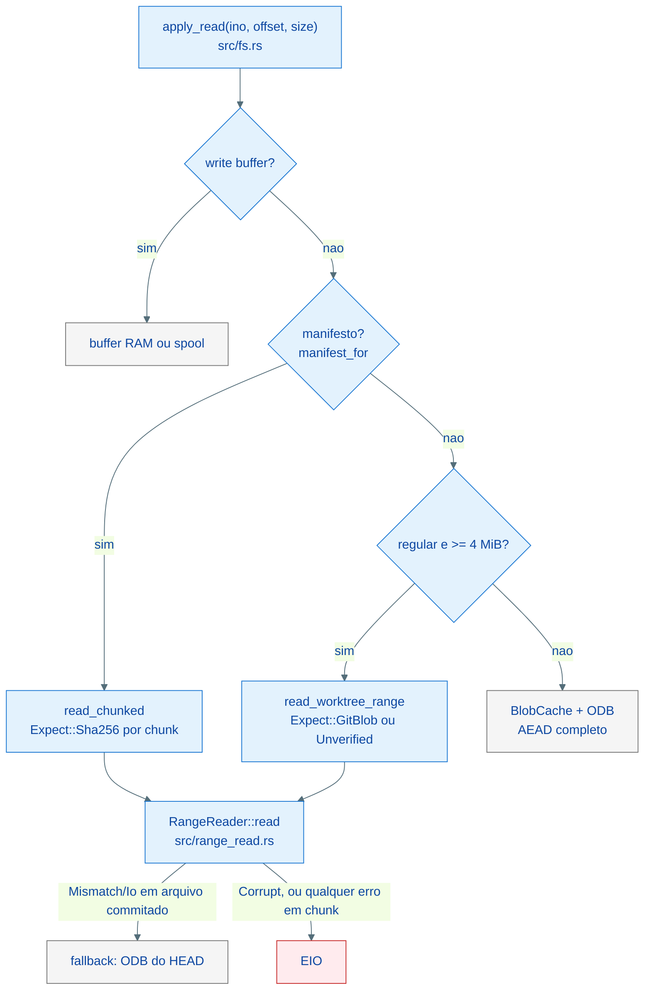
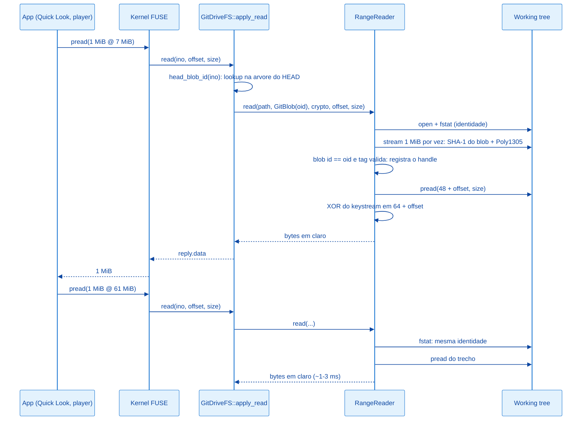

# Arquitetura: Leitura de Arquivos Grandes

> English version: [../large-file-reads.md](../large-file-reads.md)

## Visão Geral

Arquivos grandes são lidos **por faixa, direto do working tree**: cada requisição de leitura do kernel busca no disco só os bytes pedidos e, se o conteúdo é cifrado, decifra só esse trecho. Antes do primeiro byte servido, o arquivo é verificado uma vez por sessão contra o que deveria conter (hash do manifesto para chunk, blob id do HEAD mais tag AEAD para arquivo commitado). Depois disso, o handle aberto fica num registro com a identidade do arquivo, e as leituras seguintes custam um `pread` e um XOR de keystream.



---

## O problema que motivou

No Mac, abrir no Finder/Quick Look vídeos grandes do drive travava o mount e fazia os vídeos chunkados alternarem entre thumbnail e ícone genérico, com o tamanho oscilando entre 345 bytes e 291 MB. O diagnóstico (13-10-2026) encontrou quatro causas, todas medidas no mount real:

| # | Causa | Medida antes da correção |
| --- | --- | --- |
| 1 | `setattr` respondia com o tamanho do manifesto em vez do tamanho real; o kernel guarda a resposta por 1 s | Depois de um `utime` com o arquivo aberto, o vídeo de 114 MB passou a ter 201 bytes e `pread` devolvia 0 bytes por ~1,2 s |
| 2 | `setattr` só de atime gravava o atime como mtime | Data de modificação mudando a cada abertura (09:22:26 virou 09:28:59 com `touch -a`) |
| 3 | Arquivo acima do orçamento do `BlobCache` (64 MB) e abaixo do limite de chunk (95 MB) relia o blob inteiro do ODB (descompressão + AEAD) a cada requisição FUSE | 21,5 s por `pread` de 1 MiB num vídeo de 70 MB |
| 4 | Cache de chunk com um slot só (`last_chunk`): trocar de chunk relia, hasheava e decifrava 80 MB | 0,2 s a 9,6 s por `pread` de 1 MiB com leitores concorrentes |

O loop FUSE atende uma requisição por vez. Uma leitura de segundos trava o mount inteiro, e é isso que o Finder mostra como "deadlock".

---

## Por que esta abordagem?

| Abordagem | Custo por leitura | Disco extra | Texto claro em disco | Primeira abertura | Decisão |
| --- | --- | --- | --- | --- | --- |
| Leitura por faixa do working tree (adotada) | `pread` + XOR do trecho (~1 ms/MiB) | nenhum | não | verificação única: ~40 ms por chunk, ~160 ms por 70 MB | adotada |
| Cache claro em `/tmp` ou `~/Library/Caches` | `pread` | 1x cada arquivo aberto | sim | decifra o arquivo inteiro antes do primeiro byte | rejeitada |
| LRU de chunks decifrados em RAM | memcpy | ~320 MB de RAM | não | ~0,5 s por chunk | rejeitada |
| AEAD por bloco (novo formato) | `pread` + AEAD do bloco | nenhum | não | nenhuma | rejeitada: muda o formato em disco |

O registro completo de cada escolha (alternativas, trade-offs e quando reconsiderar) fica em `specs/plans/2026-10-13-094723_leitura-por-faixa-de-chunks/decisoes.md`, que é local e não versionado.

---

## Estrutura de Arquivos

| Arquivo | Papel no caminho de leitura |
| --- | --- |
| `src/crypt.rs` | `decrypt_range_in_place` (keystream com seek), `tag_verifier` e `SealedTagVerifier` (Poly1305 em streaming), `sealed_nonce`, constantes do layout selado, KAT do formato |
| `src/range_read.rs` | `RangeReader`: registro de handles verificados (LRU), verificação em streaming, leitura por faixa, `prune_missing` |
| `src/fs.rs` | `apply_read` (ordem das fontes), `read_chunked`, `read_worktree_range`, `head_blob_id`, `apply_setattr`, constantes `RANGE_READ_MIN_BYTES` e `RANGE_READ_HANDLES` |
| `Cargo.toml` | `chacha20`, `poly1305`, `sha1` diretos; `sha2` com `asm` |
| `.cargo/config.toml` | `--cfg chacha20_force_neon` em alvos aarch64 |

---

## Camadas do Sistema

### 1. Primitivas criptográficas — `src/crypt.rs`

O envelope selado é `MAGIC(24) || nonce(24) || ciphertext || tag(16)`, e o ciphertext tem o mesmo tamanho do texto claro. O `XChaCha20Poly1305` do `chacha20poly1305` 0.10.1 gasta o bloco 0 do keystream na chave do Poly1305 e cifra o conteúdo a partir do byte 64. Por isso o byte `i` do texto claro é `ct[i] XOR keystream[64 + i]`, e qualquer trecho pode ser decifrado sozinho:

```rust
pub fn decrypt_range_in_place(&self, nonce: &[u8; NONCE_LEN], offset: u64, buf: &mut [u8]) {
    let mut cipher = chacha20::XChaCha20::new((&self.content_key).into(), nonce.into());
    cipher.seek(CONTENT_KEYSTREAM_START + offset);
    cipher.apply_keystream(buf);
}
```

A decifragem por faixa **não autentica**. A tag é conferida uma vez, em streaming, com a mesma construção que `open` usa (RFC 8439, AAD vazio). O verificador guarda os bytes que sobram de um bloco de 16, porque um padding no meio do fluxo mudaria a tag:

```rust
pub fn verify(mut self, tag: &[u8]) -> bool {
    if tag.len() != TAG_LEN {
        return false;
    }
    self.mac.update_padded(&self.pending[..self.pending_len]);
    let mut lengths = poly1305::Block::default();
    // AAD length (always 0 here) || ciphertext length, both u64 LE.
    lengths[8..].copy_from_slice(&self.ct_len.to_le_bytes());
    self.mac.update(&[lengths]);
    self.mac.verify(poly1305::Block::from_slice(tag)).is_ok()
}
```

### 2. Registro de leitura verificada — `src/range_read.rs`

O `RangeReader` não sabe nada de inodes nem de Git. Ele recebe um path, uma expectativa e um intervalo:

```rust
pub enum Expect {
    /// Chunk: SHA-256 (lowercase hex) of the bytes on disk, from the manifest.
    Sha256(String),
    /// Committed file: Git blob id at HEAD (SHA-1 object format). A sealed
    /// blob also has its AEAD tag checked: the blob id alone does not prove
    /// it was sealed with our key.
    GitBlob(git2::Oid),
    /// Local-only file: outside Git, nothing to check against. Re-opened when
    /// the path stops pointing at the open handle.
    Unverified,
}

pub fn read(
    &mut self,
    path: &Path,
    expect: &Expect,
    crypto: Option<&Crypto>,
    expected_plain_len: Option<u64>,
    offset: u64,
    size: usize,
) -> Result<(Vec<u8>, Layout), RangeError>
```

Funcionamento:

1. **Handle válido?** Existe um handle aberto para o path, com a mesma expectativa e a mesma identidade (dev, inode, tamanho, mtime em ns, via `fstat`)? Para `Unverified`, o path também precisa continuar apontando para ele.
1. **Senão, abre e verifica.** Lê o cabeçalho: com `crypto` e o magic presente, o arquivo é selado (`plain_len = len - 64`). Depois a verificação em streaming, em blocos de 1 MiB:
   - `Sha256`: o SHA-256 do arquivo tem que bater com o do manifesto;
   - `GitBlob`: numa passada só, o SHA-1 de `blob <len>\0` + conteúdo (o blob id do Git) e, se selado, o Poly1305 sobre o ciphertext. Por fim, um `fstat` confirma que o arquivo não mudou durante a passada.
1. **Lê o trecho.** `pread` de `[base + offset, base + offset + n)` (`base` é 48 se selado) e, se selado, `decrypt_range_in_place`.

| Erro | Significado | Quem decide o efeito |
| --- | --- | --- |
| `Mismatch` | o conteúdo é outra versão (hash ou blob id diferentes) | o chamador: chunk vira `EIO`; arquivo commitado cai no ODB |
| `Corrupt` | tag inválida, selado truncado ou tamanho contradizendo o chamador | `EIO` |
| `Io` | arquivo ausente ou ilegível | chunk vira `EIO`; arquivo commitado cai no ODB |

Handles ficam num LRU de 64 (`RANGE_READ_HANDLES`). `prune_missing` fecha os handles cujo path não leva mais ao mesmo arquivo; sem isso, um vídeo apagado continuaria ocupando disco enquanto o handle estivesse aberto.

### 3. Caminho de leitura do filesystem — `src/fs.rs`

A ordem das fontes em `apply_read`:

1. write buffer (escritas pendentes, swap, rename): sempre ganha;
1. manifesto (`manifest_for`): `read_chunked`, por chunk, com `Expect::Sha256(hash)` e o tamanho esperado do chunk;
1. arquivo regular de pelo menos `RANGE_READ_MIN_BYTES` (4 MiB): `read_worktree_range`;
1. caso contrário: `BlobCache` e ODB pelo handle persistente, com AEAD completo (caminho de antes, inalterado).

`read_worktree_range` monta a expectativa:

```rust
let (rel, expect) = if local_only {
    (path.to_string(), Expect::Unverified)
} else {
    let disk = self.disk_path(path);
    let oid = self.head_blob_id(ino, &disk)?;
    (disk, Expect::GitBlob(oid))
};
```

`head_blob_id` faz um lookup na árvore do HEAD pelo handle persistente, sem carregar o blob, e guarda o resultado por inode. Esse cache (`head_blob_ids`) é limpo em `gc_clean_buffers`, que roda quando o HEAD muda (commit local ou pull). Um `Mismatch` em arquivo commitado registra um aviso por inode e devolve `None`, e `apply_read` segue para o ODB.

Por que o cache de blob id por inode não serve conteúdo de outro path: rename de arquivo sem chunk cria um write buffer com o conteúdo; rename de arquivo chunkado move só o manifesto (chunks são endereçados por conteúdo); `exchange` e swap implícito criam buffers para os dois inodes. Esses buffers só são coletados junto com `head_blob_ids`.

### 4. `setattr` — `src/fs.rs`

`apply_setattr` (chamada pelo `setattr` do `fuser`) responde com `apply_getattr`, o mesmo tamanho efetivo que `getattr` e `lookup` entregam. Um setattr só de atime é aceito e descartado: atime, ctime e crtime espelham o mtime (limitação 8 do `AGENTS.md`), então o atime não pode mover o mtime.

---

## Fluxo de Dados



---

## Garantias de Integridade

| Conteúdo | O que é conferido | Quando | Falha |
| --- | --- | --- | --- |
| Chunk | SHA-256 dos bytes em disco igual ao do manifesto (o manifesto é selado com AEAD); tamanho compatível com o manifesto | primeira leitura do handle e depois de qualquer mudança de identidade | `EIO` |
| Arquivo commitado de 4 MiB ou mais | blob id igual ao da entrada no HEAD; tag Poly1305 válida se selado | idem | blob id diferente ou ausente: ODB do HEAD; tag inválida: `EIO` |
| Local-only de 4 MiB ou mais | nada (fora do Git, como antes) | o path é conferido a cada leitura | `EIO` se ilegível |
| Arquivo pequeno | AEAD completo a cada carga no `BlobCache` | como antes | `EIO` |

Nenhum byte é servido de um arquivo que não passou pela verificação da sua expectativa. A tag não é recalculada por leitura, mas o handle verificado não muda de conteúdo sem mudar de identidade: a única exceção é uma ferramenta que reescreve o arquivo no lugar e restaura o mtime com precisão de nanossegundos.

---

## Desempenho Medido

Ambiente: mount sandbox (repo cifrado próprio, sem remote), arquivos de dados aleatórios (incompressíveis, como vídeo) de 70 MB (sem chunk) e 200 MB (3 chunks de até 80 MB). "Frio" significa recém-montado, sem cache de páginas do kernel. Mac M1 com macOS 26; allmight x86_64 com Arch Linux e btrfs, sem SHA-NI.

### macOS

| Medida | Binário antigo | Binário novo |
| --- | --- | --- |
| `pread` 1 MiB aleatório, 70 MB (p50) | 24.513 ms | 0,9 ms |
| `pread` 1 MiB aleatório, 200 MB chunkado (p50) | 381 ms | 1,9 ms |
| 2 leitores concorrentes, 1 MiB (p95) | - | 4,3 ms (70 MB), 6,1 ms (200 MB) |
| Primeira leitura (inclui verificação), 70 MB | 22.816 ms | 163 ms |
| Primeira leitura, 200 MB chunkado | 741 ms | 50 ms |
| Sequencial fria | - | 195 MB/s (70 MB), 287-354 MB/s (200 MB) |
| Sequencial repetida (cache do kernel) | - | ~12 GB/s |
| Cópia para dentro do mount | - | 227 MB/s (70 MB), 167 MB/s (200 MB) |
| `stat` depois de `utime` com o arquivo aberto | 273 bytes | tamanho real |

### Linux

| Medida | Binário antigo | Binário novo |
| --- | --- | --- |
| `pread` 1 MiB aleatório, 70 MB (p50) | 4.623 ms | 0,6 ms |
| `pread` 1 MiB aleatório, 200 MB chunkado (p50) | 448 ms | 1,3 ms |
| 2 leitores concorrentes, 1 MiB (p95) | - | 2,7 ms (70 MB), 2,8 ms (200 MB) |
| Sequencial | - | 941-965 MB/s |
| Cópia para dentro do mount | - | 260 MB/s (70 MB), 369 MB/s (200 MB) |
| `stat` depois de `utime` com o arquivo aberto | 273 bytes | tamanho real |

### Mount de produção do Mac (depois do deploy)

| Arquivo | Antes | Depois |
| --- | --- | --- |
| Vídeo de 70 MB (sem chunk), `pread` 1 MiB | 21.500 ms | 2,4-2,7 ms (166 ms na primeira leitura) |
| Vídeo de 114 MB (chunkado), `pread` 1 MiB | 200-9.600 ms | 2,1-2,9 ms (37 ms no primeiro acesso a um chunk) |
| Vídeo de 291 MB (chunkado), `pread` 1 MiB | thumbnail alternando | 2,0-2,7 ms (38-78 ms no primeiro acesso a um chunk) |

Os SHA-256 dos três vídeos lidos pelos mounts de produção do Mac e do allmight são idênticos.

### Comparação com Google Drive e Dropbox

- **Latência de leitura aleatória** (abrir, gerar thumbnail, avançar num vídeo): 1 a 3 ms por MiB depois do primeiro acesso. Equivale a um arquivo local, como no Dropbox, e fica bem abaixo do streaming do Google Drive, que depende da rede para o que não está em cache.
- **Primeiro acesso:** 40 a 160 ms de verificação única por arquivo ou chunk. O Google Drive em modo streaming baixa o arquivo nesse momento; o Dropbox com arquivo local não verifica nada.
- **Sequencial fria:** ~950 MB/s no Linux. No macOS, 200 a 350 MB/s, limitado pelo macFUSE (a mesma build e a mesma lógica fazem ~950 MB/s no FUSE do Linux). Um arquivo nativo do Dropbox no APFS lê a ~3 GB/s, e essa diferença é o custo do FUSE no macOS.
- **Releitura no macOS:** ~12 GB/s, do cache do kernel.

---

## Aceleração de Hardware

| Primitiva | Sem aceleração | Com aceleração | Como |
| --- | --- | --- | --- |
| SHA-256 (verificação de chunk, chunking do drain) | 314 MB/s | 2137 MB/s | `sha2` com a feature `asm` (ARMv8 SHA2; no x86_64 usa SHA-NI quando a CPU tem) |
| Keystream XChaCha20 | 643 MB/s | 1208 MB/s | `--cfg chacha20_force_neon` em `.cargo/config.toml` (aarch64); x86_64 usa AVX2 em runtime |
| Blob id (SHA-1) | 495 MB/s (sha1dc da libgit2) | 848 MB/s | crate `sha1` em Rust, na mesma passada da tag |

Medido no M1. O teste `crypt::tests::sealed_format_known_answer` fixa o SHA-256 do selado de um conteúdo de referência e o nome cifrado de um path, com os valores do build que estava em produção. Ele passa no Mac (NEON) e no allmight (x86_64): o formato cifrado é idêntico entre as plataformas.

---

## Limitações e Trabalho Futuro

1. **Cache de páginas no Linux.** O kernel descarta o cache do arquivo a cada abertura, então releituras passam de novo pelo FUSE (~950 MB/s). Manter o cache entre aberturas (`FOPEN_KEEP_CACHE`) exige invalidação explícita (`notify_inval_inode`) em toda mudança de conteúdo: pull, swap, exchange e rename sobre arquivo existente.
1. **Sequencial fria no macOS** limitada a 200-350 MB/s pelo macFUSE; `iosize=1048576` foi medido e não mudou nada.
1. **Primeiro acesso a chunk sem SHA-NI**: no allmight, ~430 ms por chunk de 80 MB, uma vez por sessão.
1. **Thread FUSE única**: operações longas que restam (refresh pós-pull, flush de arquivo enorme em sistema sem cópia CoW) ainda bloqueiam o mount enquanto duram.
1. **Formato de objetos SHA-256 do Git** não é suportado pela verificação de blob id (um repo nesse formato cairia sempre no fallback do ODB).

---

## Como Estender

### Como servir um novo tipo de conteúdo por faixa

1. Defina como o conteúdo pode ser verificado. Se ele tem um digest autenticado (como o hash no manifesto), use `Expect::Sha256`. Se tem um blob id no HEAD, use `Expect::GitBlob`. Use `Expect::Unverified` só para conteúdo fora do Git.
1. Se precisar de outra expectativa, acrescente uma variante em `Expect` e trate-a em `RangeReader::open_and_verify` com verificação em streaming (nunca carregue o arquivo inteiro na memória).
1. No `fs.rs`, chame `self.range.read(...)` e mapeie cada `RangeError` para o efeito certo: sem fonte alternativa, `EIO`; com fonte alternativa correta, fallback.
1. Garanta que a expectativa muda quando o conteúdo esperado muda (limpe o cache correspondente em `gc_clean_buffers`).
1. Escreva testes em `tests/fs_hierarchy.rs` cobrindo: leitura correta por faixa, verificação única (`range_verifications_for_test`), corrupção depois da verificação e divergência.

### Como mudar o limiar de 4 MiB

1. Altere `RANGE_READ_MIN_BYTES` em `src/fs.rs`.
1. Ajuste `large_payload()` em `tests/fs_hierarchy.rs` se ele ficar abaixo do novo limiar.
1. Rode o benchmark (abaixo) com arquivos dos dois lados do limiar antes de decidir.

### Como trocar ou atualizar um backend criptográfico com segurança

1. Rode `cargo test --lib crypt` antes e depois da mudança: o KAT `sealed_format_known_answer` precisa continuar passando sem alterar os valores esperados.
1. Rode a suíte também no allmight (x86_64): o formato precisa ser idêntico entre aarch64 e x86_64.
1. Nunca regenere os valores do KAT para "fazer passar": um valor diferente significa que repos existentes deixariam de abrir.

### Como medir de novo

1. Monte um sandbox: `git init` de um repo novo, uma chave própria (`git-drive key generate --out <dir>/drive.key`) e um `config.json` com `encryption_enabled`, identidade, `pull_interval_secs: 0` e sem remote.
1. Rode o binário com `-r <repo> -m <mnt> --config <cfg> --log-dir <dir> --status-file <dir>/status.json`.
1. Copie para dentro do mount arquivos de `/dev/urandom` acima e abaixo de `chunk_threshold_mb` e espere o commit.
1. Desmonte e monte de novo antes de medir leitura fria: depois de uma passada sequencial, o cache do kernel no macOS serve tudo e o FUSE deixa de ser medido.
1. Faça leituras aleatórias de 1 MiB antes da sequencial e confira o SHA-256 lido pelo mount contra o arquivo original.

---

## Referências

| Arquivo | Responsabilidade |
| --- | --- |
| `src/range_read.rs` | `RangeReader`, `Expect`, `RangeError`, verificação em streaming, LRU, `prune_missing` |
| `src/crypt.rs` | `decrypt_range_in_place`, `tag_verifier`, `SealedTagVerifier`, `sealed_nonce`, `SEALED_HEADER_LEN`, `SEALED_TAG_LEN`, KAT |
| `src/fs.rs` | `apply_read`, `read_chunked`, `read_worktree_range`, `head_blob_id`, `apply_setattr`, `gc_clean_buffers` |
| `src/chunk.rs` | `Manifest`, `chunks_for_range`, `shard_rel_path` |
| `tests/fs_hierarchy.rs` | testes de thrash, corrupção, fallback, tag, local-only, estado misto e `setattr` |
| `.cargo/config.toml` | flag do NEON para aarch64 |
| [arquitetura.md](./arquitetura.md) | visão geral, chunking e criptografia |
| [filesystem-fuse.md](./filesystem-fuse.md) | operações FUSE e buffers |
