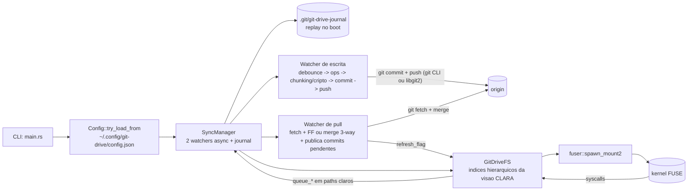
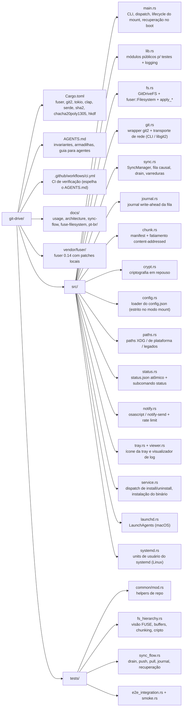

# Arquitetura: Visão Geral

> English version: [../architecture.md](../architecture.md)

## Visão Geral

git-drive é um filesystem FUSE em Rust que monta o conteúdo de um repositório Git (no branch
ativo) como um sistema de arquivos virtual e mantém sincronização bidirecional com o remote via
Git: escritas locais viram commits + push automáticos e mudanças no remote chegam através de um
pull watcher periódico. O comportamento é o de um drive "estilo Dropbox" onde o armazenamento
durável é um repositório Git (incluindo GitHub).

Duas transformações de armazenamento opcionais acontecem entre o drive e o repo, ambas invisíveis
para quem usa o mount:

- **Chunking** (Fase 2.6): arquivo acima de `chunk_threshold_mb` vira um manifest pequeno no path
  original + chunks content-addressed em `.chunks/` — cada blob abaixo do limite de 100 MB por
  arquivo do GitHub.
- **Criptografia em repouso** (Fase 2.7): com `encryption_enabled`, conteúdo E nomes vivem
  cifrados no repo (working tree incluso); o mount apresenta tudo claro.



---

## Estrutura de Diretórios



O config e a chave de criptografia vivem em `~/.config/git-drive/` (com fallback de leitura para
os locais legados `~/.config/drive-sync/` e `~/Library/Application Support/`). O daemon instalado
guarda o status.json no Application Support e os logs em `~/Library/Logs/git-drive/` no macOS, e
ambos em `$XDG_STATE_HOME/git-drive/` (padrão `~/.local/state/git-drive/`) no Linux. O serviço
sempre roda a cópia instalada em `~/.local/bin/git-drive`.

---

## Camadas do Sistema

| Camada | Arquivo | Responsabilidade |
| --- | --- | --- |
| CLI / Orquestração | `src/main.rs` | Subcomandos (`status`/`install`/`uninstall`/`tray`/`viewer`/`key generate`) e modo mount: carga estrita do config, resolução do transporte, runtime tokio explícito, replay do journal + recuperação de boot antes do mount, recuperação de mount zumbi, validação da chave de criptografia (habilitada sem chave = aborta), espera de sinais e shutdown limpo (unmount -> drain final). |
| Filesystem | `src/fs.rs` | Implementa `fuser::Filesystem`. Índices hierárquicos da visão CLARA, buffers de escrita (RAM copy-on-write ou spool em disco), leitura com cache LRU + handle de repo persistente, detecção lazy de manifests, decifração AEAD, mtime derivado, local-only. |
| Git | `src/git.rs` | Leitura de trees/blobs (tamanhos pelo header do objeto, `FileKind` p/ symlinks), commit do working tree (`add_all` respeitando ignore), transporte de rede (`git` CLI do sistema por padrão, fallback libgit2 com callback de credencial com estado), push com detecção de rejeição por ref, fetch, FF e merge 3-way (ambos modificaram -> conflicted copy, modify/delete -> a edição vence, sidecars restaurados), `is_working_tree_clean`, ignorados, `commit_times_by_path` e `commit_times_between`. |
| Sincronização | `src/sync.rs`, `src/journal.rs` | Fila causal de `SyncOp` (coalescing só de Write, barreiras no resto) com journal write-ahead, drain com tradução claro->cifrado, varredura de chunking, migrações de criptografia nos dois sentidos (inclusive reparo de conflicted copies cifradas duas vezes), GC de chunks órfãos, push com reconcile em várias rodadas, pull watcher que também publica commits pendentes, recuperação no boot. |
| Chunking | `src/chunk.rs` | Manifest texto versionado, sharding `.chunks/<2 hex>/<sha256>`, fatiamento em streaming com transform opcional (selagem) e dedup por content-addressing. |
| Criptografia | `src/crypt.rs` | XChaCha20-Poly1305 convergente (nonce derivado do plaintext), HKDF de subchaves, nomes por componente em base32 lowercase com fallback literal, arquivo de chave 0600. |
| Observabilidade | `state/src/status.rs`, `src/notify.rs`, `src/tray.rs` | `status.json` atômico, notificações com rate limit (osascript no macOS, notify-send no Linux; processos filhos colhidos), tray com 4 estados, tempos de índice/refresh no log. |
| Instalação / Paths | `src/service.rs`, `src/launchd.rs`, `src/systemd.rs`, `state/src/paths.rs` | Dispatch por plataforma, binário instalado em `~/.local/bin/git-drive`, LaunchAgents por template (macOS) e units de usuário do systemd (Linux), migração de config/chave dos locais legados, resolução XDG. |
| Configuração | `src/config.rs` | Loader com `#[serde(default)]` por campo (16 campos). Arquivo ausente = defaults; arquivo existente e inválido aborta o modo mount. |

---

## Estruturas de Dados

### `FileEntry` — `src/fs.rs`

```rust
#[derive(Debug, Clone)]
pub(crate) struct FileEntry {
    pub(crate) inode: u64,
    pub(crate) path: String,          // caminho completo CLARO
    pub(crate) parent: u64,
    pub(crate) size: u64,             // tamanho do plaintext
    pub(crate) kind: git::FileKind,   // Regular | Symlink (filemode 120000)
    pub(crate) local_only: bool,      // ignorado pelo .gitignore: vive no worktree, nunca commita
}
```

### `SyncOp` e `WriteContent` — `src/sync.rs`

```rust
#[derive(Debug, Clone)]
pub enum WriteContent {
    Mem(Arc<Vec<u8>>),      // compartilhado com o write buffer (zero cópia no flush)
    Spooled(PathBuf),       // snapshot em disco, aplicado com rename no drain
}

#[derive(Debug, Clone)]
pub enum SyncOp {
    Write { path: String, content: WriteContent },
    Delete { path: String },
    Mkdir { path: String },
    Rmdir { path: String },
    Rename { from: String, to: String },
    Symlink { path: String, target: String },
}
```

A fila interna é um `Vec<SyncOp>` em **ordem de chegada** — a ordem do kernel FUSE é a ordem
causal (invariante da Fase 0). Todos os paths na fila são CLAROS; a tradução para o disco
(cifrada ou não) acontece na materialização do drain.

### `Manifest` — `src/chunk.rs`

```rust
#[derive(Debug, Clone, PartialEq, Eq)]
pub struct Manifest {
    pub total_size: u64,        // bytes de PLAINTEXT
    pub chunk_size: u64,
    pub hashes: Vec<String>,    // sha256 de cada chunk (do ciphertext, se cifrado)
}
```

### `Crypto` — `src/crypt.rs`

```rust
pub struct Crypto {
    content_cipher: XChaCha20Poly1305,   // subchave HKDF "content-key"
    name_cipher: XChaCha20Poly1305,      // subchave HKDF "name-key"
    content_nonce_key: [u8; 32],         // HMAC p/ nonce determinístico (convergente)
    name_nonce_key: [u8; 32],
}
```

### `Config` — `src/config.rs`

```rust
#[derive(Debug, Deserialize)]
pub struct Config {
    pub write_debounce_secs: u64,          // 5
    pub pull_interval_secs: u64,           // 60
    pub read_cache_mb: u64,                // 64
    pub large_file_threshold_mb: u64,      // 64  (spool de write buffers)
    pub chunk_threshold_mb: u64,           // 95  (manifest + .chunks)
    pub chunk_size_mb: u64,                // 80
    pub encryption_enabled: bool,          // false
    pub encryption_key_file: Option<String>,
    pub user_name: Option<String>,
    pub user_email: Option<String>,
    pub remote_token: Option<String>,
    pub commit_batch_mb: u64,              // 256
    pub log_max_mb: u64,                   // 50
    pub log_keep_files: usize,             // 10
    pub log_level: String,                 // "info"
    pub git_transport: String,             // "auto" | "cli" | "libgit2"
}
```

---

## Notas de Performance

- Leitura: buffer do inode -> arquivos chunkados e regulares de 4 MiB ou mais **por faixa do
  working tree** (cada arquivo verificado uma vez por sessão, depois `pread` + decifragem só dos
  bytes pedidos) -> para arquivos pequenos, cache LRU de blobs (`read_cache_mb`) -> repo via
  **handle persistente**. Leituras aleatórias de 1 MiB em arquivo grande levam 1-3 ms (antes de
  13-10-2026 levavam de 0,4 a 24 s); ver
  [arquitetura-leitura-de-arquivos-grandes.md](./arquitetura-leitura-de-arquivos-grandes.md).
- Escrita: pico de RAM ~1x o tamanho do arquivo (Arc compartilhado buffer/fila); acima de
  `large_file_threshold_mb` o buffer vive em spool no disco.
- Pull watcher pula iteração se há lote pendente (evita corrida com commit local).
- As varreduras do drain (chunking, migração de criptografia, GC de chunks) são incrementais: uma
  passada completa por estado e depois só arquivos sujos mais paths alterados desde o último HEAD
  conforme. Do salvamento ao commit no drive real: de 4 min 22 s para 8,4 s no Mac e 4,3 s no Linux.
  O GC de chunks ainda lê todo arquivo pequeno da árvore (precisa das referências de todos os
  manifestos), então só roda quando pode haver órfãos: um path do escopo era manifesto, ou uma
  varredura substituiu chunks. Um arquivo grande novo só acrescenta chunks — antes, ele disparava o
  GC, ~90 s de um commit de 2 minutos de um vídeo de 136 MB no drive de 210 mil arquivos do Mac.
- `refresh_if_needed` é chamado em cada `lookup`/`getattr`/`readdir`. Barato em steady state;
  após um pull reconstrói o índice com a thread FUSE bloqueada. Tamanhos de blob vêm do header dos
  objetos, nomes decifrados de um cache reaproveitado entre refreshes, e os mtimes são recalculados
  só para os commits novos: num drive cifrado de 96.878 arquivos, o boot caiu de ~25 s para ~9 s e
  o refresh pós-pull de 8,1 s para 1,1 s.
- Toda op enfileirada custa uma escrita extra (o registro no journal) — o preço de não perder
  escritas confirmadas num crash.
- O config é carregado uma única vez — não há hot-reload (mudar `encryption_enabled` exige
  reiniciar o daemon; a migração roda no drain seguinte).

---

## Limitações Conhecidas

| # | Limitação | Origem |
| --- | --- | --- |
| 1 | `.gitkeep` automático em `mkdir`/`rmdir` | Git não rastreia diretórios vazios — workaround em `src/sync.rs` |
| 2 | Credenciais e chave em texto plano no disco local | `~/.config/git-drive/` (keychain é candidato futuro) |
| 3 | Edição concorrente do mesmo arquivo vira conflicted copy | `pull_and_merge` 3-way; modify/delete mantém a edição; sem identidade degrada para FF-only |
| 4 | Push falho não é revertido | commit local permanece; reconcile em até 3 rodadas; o ciclo de pull tenta publicar de novo |
| 5 | HEAD detached aborta boot | `src/main.rs` |
| 6 | Sem FIFOs/sockets/hardlinks reais | symlinks suportados; `link` é cópia |
| 7 | `chmod` em memória, `chown` ignorado | uid/gid são os do processo do mount |
| 8 | Cache de blobs não cobre arquivo maior que o orçamento | miss usa handle de repo persistente |
| 9 | Refresh depende de syscalls FUSE | TTL de 1s no kernel pode mascarar mudanças remotas por ~1s |
| 10 | Arquivos acima de `chunk_threshold_mb` viram manifest + `.chunks/` | transparente no mount; clone puro vê os artefatos (`src/chunk.rs`) |
| 11 | Criptografia em repouso é opcional e não protege o passado | história pré-migração permanece legível; ignore/local-only desativados no modo cifrado (`src/crypt.rs`) |
| 12 | Journal sem fsync | escritas confirmadas sobrevivem a crash do processo, não a queda de energia dentro da janela de write-back do SO (`src/journal.rs`) |
| 13 | Serviço Linux só roda com o usuário logado, sem linger | `loginctl enable-linger $USER` (`src/systemd.rs`) |

---

## Como adicionar um novo campo de configuração

1. Declarar em `src/config.rs` com `#[serde(default = "...")]` ou `#[serde(default)]` para `Option`.
1. Atualizar `Config::default` para espelhar o valor.
1. Propagar em `src/main.rs` (parâmetro de construtor ou setter pós-construção, padrão
   `set_chunking`/`set_crypto`).
1. Atualizar as tabelas em `README.md`, `docs/usage.md` (e `./uso.md`) e `AGENTS.md`.
1. Adicionar teste em `src/config.rs::tests` cobrindo default e override.

## Como adicionar uma nova operação de mutação

1. Adicionar variante em `SyncOp` (`src/sync.rs`) — decidir se coalesce ou é barreira
   (`push_coalescing`); barreira é o default seguro.
1. Implementar `queue_*` em `SyncManager` chamando `enqueue`.
1. Implementar tratamento em `apply_op_to_disk` (`src/sync.rs`), incluindo a tradução de path e
   selagem quando `crypto` estiver ativo.
1. Implementar `apply_*` puro em `GitDriveFS` (`src/fs.rs`) que manipula índices e chama o `queue_*`.
1. Criar wrapper fino no `impl Filesystem` chamando o `apply_*`.
1. Testes: unitário para a fila, integração para `apply_*` e fluxo em `tests/sync_flow.rs`.

---

## Referências

| Arquivo | Responsabilidade |
| --- | --- |
| `src/main.rs` | Entry point, CLI, lifecycle do mount e shutdown limpo |
| `src/fs.rs` | `GitDriveFS`, modelo hierárquico, `apply_*`, `refresh_if_needed` |
| `src/git.rs` | Wrapper sobre `git2` (leitura, commit, merge, ignore, mtime) + transporte de rede |
| `src/sync.rs` | `SyncManager`, fila causal, drain, varreduras e GC |
| `src/journal.rs` | Journal write-ahead da fila |
| `src/chunk.rs` | Manifest + fatiamento content-addressed |
| `src/crypt.rs` | Criptografia em repouso |
| `src/config.rs` | Loader de `config.json` |
| `state/src/paths.rs` | Resolução XDG + plataforma + legados |
| `src/service.rs` | Dispatch do serviço de login e instalação do binário |
| `src/launchd.rs` / `src/systemd.rs` | LaunchAgents (macOS) / units de usuário do systemd (Linux) |
| `tests/common/mod.rs` | Helpers de repositório Git para testes |

Docs relacionadas:

- [uso.md](./uso.md)
- [fluxo-de-sincronizacao.md](./fluxo-de-sincronizacao.md)
- [filesystem-fuse.md](./filesystem-fuse.md)
