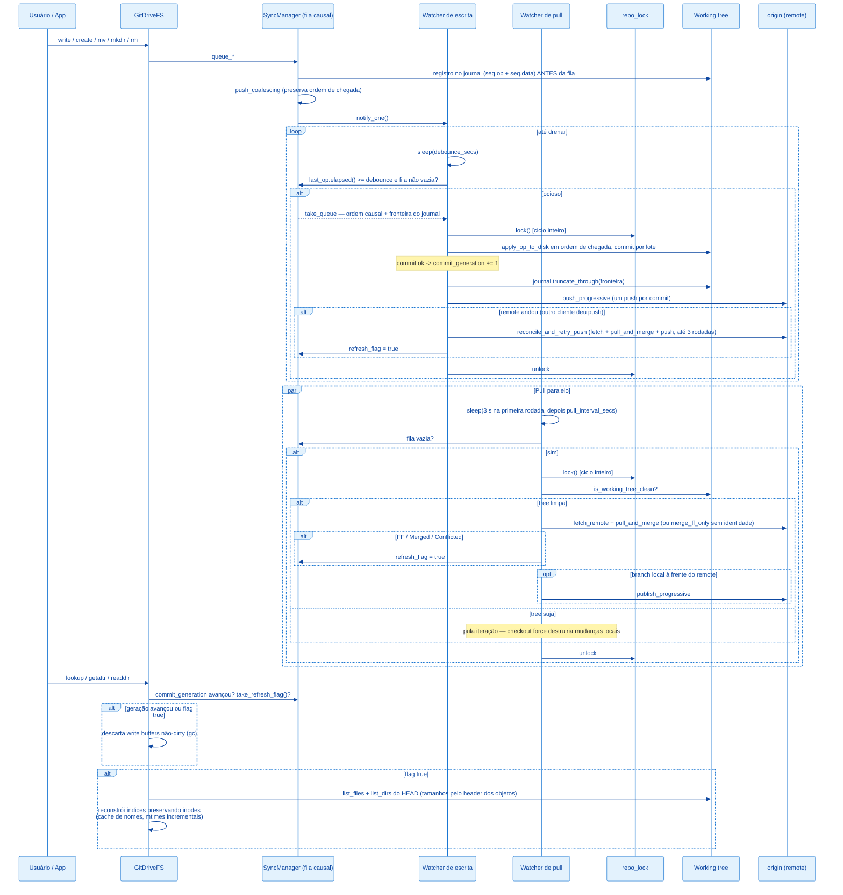
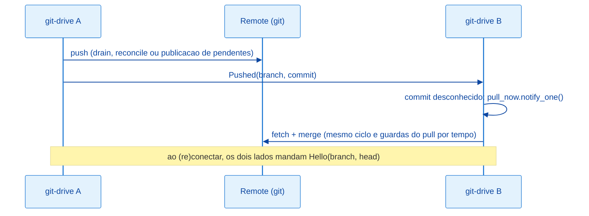

# Arquitetura: Fluxo de Sincronização

> English version: [../sync-flow.md](../sync-flow.md)

## Visão Geral

O `SyncManager` desacopla três tempos diferentes: (a) recebimento de operações vindas do kernel FUSE — rápido, registrado no journal em disco e enfileirado em memória; (b) persistência no working tree + commit + push — custoso, roda no fim de um ciclo de ociosidade (debounce); (c) puxar mudanças do remote e publicar commits locais que o remote não tem — também custoso, roda em intervalo independente (pull watcher). Os ciclos (b) e (c) são serializados por um lock compartilhado de repositório (`repo_lock`): drain e pull nunca executam concorrentes sobre o mesmo repo. As operações de rede (fetch/push) passam pelo transporte escolhido no boot para o processo todo (`git_transport`: o `git` CLI do sistema por padrão, libgit2 como fallback).



No boot, antes do mount, o `enable_journal` faz o replay do que uma sessão que caiu deixou no journal e o `recover_at_boot` drena isso de forma síncrona (ou commita um working tree sujo) — ver [Journal write-ahead](#journal-write-ahead).

---

## Componentes

### `SyncManager`

```rust
#[derive(Clone)]
pub struct SyncManager {
    inner: Arc<Mutex<Inner>>,
    notify: Arc<Notify>,
    debounce_secs: u64,
    repo_path: PathBuf,
    branch: String,
    user_name: Option<String>,
    user_email: Option<String>,
    remote_name: Option<String>,
    remote_token: Option<String>,
    refresh_flag: Arc<AtomicBool>,
    commit_generation: Arc<AtomicU64>,
    repo_lock: Arc<Mutex<()>>,
    status: Arc<StatusState>,
    notifier: Arc<Notifier>,
    chunk_threshold_bytes: Arc<AtomicU64>,
    chunk_size_bytes: Arc<AtomicU64>,
    commit_batch_bytes: Arc<AtomicU64>,
    crypto: Arc<Mutex<Option<Arc<crate::crypt::Crypto>>>>,
    migration_crypto: Arc<Mutex<Option<Arc<crate::crypt::Crypto>>>>,
}

struct Inner {
    buffer: Vec<SyncOp>,
    last_op: Option<Instant>,
    journal: Option<Arc<crate::journal::Journal>>,
    next_seq: u64,
}
```

- `inner` — fila `Vec<SyncOp>` em ordem de chegada, timestamp do último `queue_*`, o journal write-ahead opcional e o seq do próximo registro (atribuído sob este lock junto com o push na fila).
- `notify` — sinaliza ao watcher de escrita que há trabalho.
- `remote_name`/`remote_token` — credenciais opcionais para push/pull. Ausência desliga push/pull respectivamente.
- `refresh_flag` — `AtomicBool` setado quando o HEAD avança por pull ou reconcile; consumido por `GitDriveFS::refresh_if_needed`.
- `commit_generation` — `AtomicU64` incrementado a cada commit criado pelo drain; o `GitDriveFS` compara com o último valor visto para descartar write buffers cujo conteúdo já está no HEAD.
- `repo_lock` — serializa os ciclos completos do drain e do pull. A unidade atômica é o ciclo, não a chamada git individual: um commit entrando entre o fetch e o checkout do pull era a janela de corrida.
- `status` — estado observável (`state/src/status.rs`): eventos de boot/drain/pull e conflicted copies da sessão, persistidos atomicamente em `logs/status.json` quando `enable_status_file` é chamado (o main liga no boot). Lido pelo subcomando `git-drive status`.

### `SyncOp` e a fila causal

```rust
#[derive(Debug, Clone)]
pub enum SyncOp {
    Write { path: String, content: WriteContent },
    Delete { path: String },
    Mkdir { path: String },
    Rmdir { path: String },
    Rename { from: String, to: String },
    Symlink { path: String, target: String },
}
```

`WriteContent` tem duas formas: `Mem(Arc<Vec<u8>>)` — o MESMO `Arc` do write buffer do inode, sem
cópia no flush — e `Spooled(PathBuf)` — snapshot em arquivo de spool (`.git/git-drive-spool/`)
para buffers acima de `large_file_threshold_mb`, aplicado no drain com `rename` (sem passar pela
RAM).

A fila preserva a **ordem de chegada** — a ordem do kernel FUSE é a ordem causal. Única coalescência permitida (`push_coalescing`): um `Write` substitui in-place o `Write` mais recente do mesmo path, desde que nenhuma op posterior a ele toque um path relacionado (igual ou ancestral/descendente) — `Rename`, `Delete`, `Mkdir`, `Rmdir` e `Symlink` funcionam como barreiras. Snapshot spooled substituído tem o arquivo removido na hora. A correção nunca depende da coalescência; ela só evita conteúdo redundante em write storms.

Essa estrutura substituiu um `HashMap<String, SyncOp>` chaveado por path com sort por tipo de op no drain, que tinha duas classes de bug:

| Cenário no mesmo batch | Comportamento antigo | Comportamento atual |
| --- | --- | --- |
| `rename d1 -> d2` seguido de `rename d2 -> d3` | Ordem arbitrária do HashMap: um dos renames falhava com ENOENT | Aplica na ordem: só `d3` existe ao final |
| `mkdir a`, `rename a -> b`, `write b/f.txt` | Write (prioridade menor) criava `b` real antes do rename, que falhava com "destino existe" | mkdir, rename e write aplicam em ordem: `b/f.txt` existe, `a` não sobra |
| `rename a -> b` + `write b` | Write apagava o Rename da fila (mesma chave) | Ambos sobrevivem, em ordem |
| `write tmp` + `delete tmp` | Delete substituía o Write | Ambos aplicam; estado líquido nulo não gera commit |

---

## Journal write-ahead

`src/journal.rs`, diretório `.git/git-drive-journal/`. A fila vive em RAM até o drain, então sem
journal um crash (kill -9, panic, OOM) perdia toda op dos últimos segundos — inclusive arquivos cujo
`close(2)` já tinha devolvido sucesso para o aplicativo.

| Etapa | Onde | O que acontece |
| --- | --- | --- |
| Preparar | `enqueue`, fora do lock da fila | `Journal::prepare` grava `tmp-<pid>-<n>.op` (cabeçalho JSON, ex.: `["rename","a","b"]`) e, para uma escrita, `tmp-<pid>-<n>.data` (os bytes de um conteúdo `Mem`, ou uma cópia do arquivo de spool — cópia, não hard link, porque o drain renomeia o spool para dentro do working tree). |
| Confirmar | `enqueue`, sob o lock da fila | `seq = next_seq++`, os temporários são renomeados para `<seq>.data` e depois `<seq>.op` (o rename do `.op` é o que faz o registro existir), e a op entra na fila. |
| Tomar | `take_queue` | O drain pega a fila e a fronteira `next_seq - 1`: exatamente os registros das ops que ele pegou. |
| Truncar | `DrainCtx::run`, sob `repo_lock` | Depois que o último lote foi aplicado e commitado (ou aplicado sem commit no modo sem identidade), os registros `<= fronteira` são apagados (o `.op` primeiro) — ANTES do push, ainda sob o lock, então nenhum pull entra entre o commit e a limpeza. |
| Replay | boot, `enable_journal` | Os registros são carregados em ordem de seq (ordem de chegada) e empurrados na fila com `push_coalescing`; temporários restantes (ops que nunca ganharam seq, logo nunca chegaram à fila) são descartados; um registro de escrita cujo arquivo de conteúdo sumiu já foi movido para o working tree por um drain interrompido e é descartado. |
| Recuperação | boot, `recover_at_boot` | Com ops replayadas, o `drain_now` roda de forma síncrona antes do mount, então o drive sobe num HEAD que já as contém (sem janela em que o usuário edita a versão velha). Sem registros, um working tree sujo (crash entre apply e commit, ou sessão anterior ao journal) é commitado como `git-drive: recover uncommitted changes`. |

Fazer replay de ops já commitadas é inofensivo: reaplicar a mesma sequência causal sobre o próprio
resultado produz o mesmo estado final para todo path que ela toca. Não há fsync — os registros
sobrevivem a crash do processo (page cache), não a uma queda de energia dentro da janela de
write-back do SO.

---

## Watcher de escrita

Fluxo, ver `src/sync.rs::spawn_watcher`:

1. `notified().await` — dorme até o primeiro `queue_*`.
2. Loop interno dorme por `debounce_secs`.
3. Se `last_op.elapsed() >= debounce` e a fila não está vazia, `take_queue` pega a fila e sua fronteira de journal; caso contrário continua esperando.
4. Adquire `repo_lock` (segura pelo ciclo inteiro; não há `.await` no escopo do guard).
5. Itera o lote **na ordem da fila** chamando `apply_op_to_disk` para cada `SyncOp`. Com criptografia habilitada, a tradução claro->cifrado de paths e a selagem de conteúdo acontecem NESTA materialização (a fila trabalha 100% em claro). Em seguida, com chunking habilitado (`chunk_threshold_mb > 0`), a varredura converte qualquer arquivo bruto acima do limiar em manifest + `.chunks/` (com criptografia, cada chunk é selado e o hash é do ciphertext); as varreduras de migração conformam o worktree ao estado do config (cifrar tudo ou decifrar tudo, com aviso de que a história permanece como era); e o GC remove chunks que nenhum manifest referencia (exige a chave quando os manifests estão selados — nunca coleta às cegas). Essas varreduras são **incrementais** (`SweepScope`): o primeiro drain de um estado (chave, modo de criptografia, limiar de chunking) faz uma passada completa e registra o HEAD conforme em `.git/git-drive-sweep`; os drains seguintes só examinam arquivos sujos (`git status`, que inclui o lote atual) mais os paths alterados desde aquele HEAD (pulls, merges), e o GC só roda quando um desses paths era manifest de chunks. A passada completa a cada drain abria todos os arquivos do drive — minutos por salvamento num worktree de 157 mil arquivos.
6. Se `user_name`/`user_email` estão presentes, `commit_batch` gera a mensagem `git-drive: <N> changes (...)` e chama `git::commit_working_tree` (`add_all` com `IndexAddOption::DEFAULT` — arquivos que casam com o `.gitignore` do repo montado ficam fora do commit por especificação; no mount eles viram local-only visíveis). Quando o escopo do sweep é incremental e nenhum sweep alterou o tree (o save comum), chama `git::commit_working_tree_paths`, que estagia só os caminhos encontrados pelo status do escopo: o `add_all` compara o working tree inteiro (10,7 s num índice de 219 mil entradas, contra 1,2 s por caminho). A fila é fatiada em lotes limitados por tamanho (`commit_batch_mb`), um commit cada. Commit criado incrementa `commit_generation`. Depois do último lote, os registros de journal cobertos pelo drain são truncados.
7. Se houve commit e `remote_name` está configurado, `publish_progressive` faz um push por commit (`git::push_progressive`). Push recusado porque o remote andou (`Publish::RemoteMoved`: non-FF, "fetch first", "cannot lock ref") dispara `reconcile_and_retry_push`: fetch + `pull_and_merge` + push, repetido por até 3 rodadas enquanto outro cliente continua dando push no meio. Essa divergência esperada loga WARN; só falha real loga ERROR e notifica (com rate limit, chave `push_failed`). Recuperação seta `refresh_flag`. O commit local nunca é revertido — se a publicação ainda falhar, o próximo ciclo de pull tenta de novo.
8. Ao final do ciclo, `status.record_drain` registra ops aplicadas, oid do commit, resultado do push e ops ainda pendentes na fila — e persiste o `status.json`.

O corpo do ciclo vive em `DrainCtx::run`, compartilhado entre o watcher e o `drain_now` do shutdown
limpo: SIGTERM/SIGINT/eject disparam unmount (o kernel entrega os flushes de fds abertos), depois
`drain_now` drena a fila final de forma síncrona — nada enfileirado se perde na parada. Push falho
pós-reconcile e conflicted copies também disparam notificações macOS (`notify.rs`).

### Tradução `SyncOp` -> working tree

| Op | Efeito em disco |
| --- | --- |
| `Write` | `create_dir_all(parent)` + `fs::write`. |
| `Delete` | `fs::remove_file` (ENOENT é silencioso — path pode nunca ter chegado ao disco). |
| `Mkdir` | `create_dir_all(path)` + `fs::write(path/.gitkeep)`. Necessário porque Git não rastreia diretórios vazios. |
| `Rmdir` | Remove `.gitkeep` (se existir) + `fs::remove_dir` (ENOENT silencioso). |
| `Rename` | `create_dir_all(parent do destino)` + `fs::rename`. |
| `Symlink` | Remove path pré-existente + `std::os::unix::fs::symlink(target, path)` — o `add_all` estagia como entrada `120000`. |

Erros são logados e o lote segue — arquivos restantes são tentados. **Sem atomicidade multi-arquivo**: um crash no meio do lote deixa estado parcial no working tree (sem commit) — o boot seguinte faz o replay do journal e commita (ver acima).

---

## Watcher de pull

`src/sync.rs::spawn_pull_watcher`. Roda somente se `pull_interval_secs > 0` **e** `remote_name` está configurado.

1. Loop: a primeira iteração dorme `min(pull_interval_secs, 3)` segundos — uma máquina acordando ou religando se atualiza em segundos — e as seguintes `pull_interval_secs`, esticado para `p2p_idle_pull_interval_secs` enquanto o canal P2P está online (`next_pull_delay`). O aviso de um peer acorda o loop na hora (`pull_now`). Um ciclo que não terminou — pulado, erro de fetch ou merge, publicação recusada — sempre volta em `pull_interval_secs`: o intervalo ocioso pressupõe que não sobrou nada a fazer.
2. Se a fila não está vazia, pula a iteração (não rouba tempo do commit local).
3. Adquire `repo_lock` — serializa com o drain.
4. **Guarda de working tree**: `git::is_working_tree_clean` (staged, unstaged e untracked; ignorados fora). Tree suja pula a iteração — o checkout force do fast-forward destruiria mudanças locais não commitadas. No modo sem identidade (commits pulados por design), a primeira escrita local bloqueia o pull até o usuário commitar manualmente ou configurar identidade — comportamento aceito e registrado nas decisões da Fase 0.
5. `git::fetch_remote` (`git fetch origin <branch>`).
6. Com identidade: `git::pull_and_merge` (ver [Política de merge](#política-de-merge)). Sem identidade: degrada para `git::merge_ff_only` (trava em divergência).
7. Qualquer outcome que toque a tree (`FastForwarded`/`Merged`/`Conflicted`) seta `refresh_flag = true`.
8. Se a branch local tem commits que `refs/remotes/origin/<branch>` não tem e a ponta remota é ancestral (`local_ahead_of_remote`) — push que falhou offline, sessão anterior que morreu antes de publicar, ou o commit de merge recém-criado —, `publish_progressive` publica nesse mesmo ciclo. Antes, eles esperavam a próxima escrita local, então uma máquina que ficou quieta depois de escrever offline nunca sincronizava.
9. Toda iteração registra o outcome em `status.record_pull` — inclusive os pulos ("fila de sync pendente", "working tree sujo") e erros de fetch/merge. Conflicted copies entram na lista `conflicts` do status pelo nome em claro (no modo cifrado o merge enxerga nomes de disco base32/`dslong_`; `conflict_copies_for_display` decodifica, resolvendo sidecars).

---

## Canal P2P de avisos

`src/peer/` (opcional: `p2p_enabled`; código de rede só com a feature `p2p` do cargo). Os dispositivos avisam uns aos outros "fiz push do commit X"; quem recebe acorda o pull watcher. O git continua a fonte da verdade: o aviso é uma dica, então um aviso perdido, duplicado ou atrasado só atrasa a mudança até o próximo polling, e o canal nunca escreve no repositório.



| Peça | Papel |
| --- | --- |
| `peer::identity` | Segredo do dispositivo (semente da chave do iroh), 64 hex, 0600, `peer.key` ao lado da config em uso. |
| `peer::registry` | `.git-drive/peers/<id>` (id = chave pública em hex), um arquivo por dispositivo para registros simultâneos nunca conflitarem; conteúdo `{"name"}` selado no drive cifrado. Commit de auto-registro no boot, sob o `repo_lock`. `.git-drive/` é reservado (`reserved::is_reserved_path`): invisível no mount e ignorado pelas varreduras. |
| `peer::protocol` | `Hello`/`Pushed`, JSON, no máximo 4 KiB, ALPN `git-drive/notify/1`; `should_wake` = nosso branch e um commit que o repo não tem. |
| `peer::node` | Endpoint iroh (relays da n0 por padrão, `p2p_relay_url` para relay próprio). Os dois lados discam para cada dispositivo registrado; quando duas conexões chegam, fica a que o ID menor iniciou. Conexão de um ID fora do registro é fechada (código 1, para quem discou continuar no backoff até 60 s em vez de rediscar a cada segundo) e acorda o nosso pull, porque o dispositivo pode ter se registrado depois do nosso último pull: por dispositivo, a primeira recusa acorda na hora e a janela dobra de 30 s até 1 h (um dispositivo removido ainda ligado custa um fetch por hora), e no total no máximo um despertar a cada 30 s. Um dispositivo fora do próprio registro (removido) não disca para ninguém. |
| `peer::channel` | Ligação no boot: chave, registro, nó, `SyncManager::set_p2p` (`on_pushed` -> `announce`, `on_head_changed` -> releitura do registro) e a seção `p2p` do `status.json`. |

Online = conexão com o relay ou pelo menos uma conexão viva com um peer. Qualquer falha (chave, bind, relay, DNS) só deixa o canal offline: o polling volta a `pull_interval_secs`.

---

## Política de merge

`git::pull_and_merge`, usado pelo pull watcher e pelo reconcile:

| Situação | Resultado |
| --- | --- |
| Só o remote avançou | Fast-forward (`checkout force` só dos caminhos que diferem do HEAD, atrás da guarda de tree limpa). |
| Os dois lados mudaram arquivos diferentes | Merge 3-way, commit de merge com 2 pais. |
| Os dois lados mudaram (ou criaram) o mesmo arquivo | Versão remota canônica no path; versão local preservada como `<path>.conflict-<host>-<ts>`. |
| Um lado editou, o outro apagou | A edição vence e fica no próprio path — só uma versão sobrevive, então não há o que conflitar. (Uma conflicted copy aqui deixava o nome original sumido e, no modo cifrado, uma cópia órfã sem o sidecar de nome longo.) |
| Entrada de nome longo perdeu o sidecar (o lado que apagou removeu `dslong_<h>.name`) | `restore_missing_long_name_sidecars` restaura a partir do HEAD local ou da tree remota, para o nome continuar decodificável. |

No modo cifrado a conflicted copy se chama `<nome cifrado>.conflict-...` em disco; a varredura de
migração trata esse formato como conforme (ela cifrava o nome base32 uma segunda vez, e a cópia
aparecia com o nome cifrado do original) e repara cópias já danificadas assim
(`repair_double_encrypted_conflicts`).

---

## Invalidação de índice e de buffers (`refresh_if_needed`)

`src/fs.rs::refresh_if_needed`, chamado em `lookup`/`getattr`/`readdir`:

1. Se há ops pendentes na fila (`has_pending_ops`), retorna — refresh com lote não drenado descartaria paths recém-criados dos índices.
2. Se `commit_generation` avançou desde a última observação, descarta write buffers **não-dirty** (gc): com a fila vazia e commit criado, o conteúdo deles já está no HEAD, e mantê-los esconderia mudanças remotas futuras do `read`.
3. `take_refresh_flag()`; se `false`, retorna.
4. Descarta buffers não-dirty de novo (o HEAD avançou por pull/merge) e reconstrói os índices: lista dirs e files do HEAD (tamanho dos blobs pelo header do objeto via `odb.read_header`, sem carregar conteúdo), preserva inodes de paths que ainda existem, aloca novos inodes (lazy, via `unwrap_or_else`) só para paths novos. No modo cifrado, os nomes em claro vêm do `name_cache` (path em disco -> path em claro; só paths novos são decodificados e leem seus sidecars). Os mtimes são recalculados só para os paths tocados por `indexed_head..new_head` (`git::commit_times_between`), com fallback para o walk completo acima de 4096 commits.

O refresh roda na thread FUSE, então sua duração é tempo de drive congelado. Medido num drive cifrado
de 96.878 arquivos: 8,1 s antes dessas otimizações, 1,1 s depois. Todo refresh loga
`refresh: index rebuilt in <t> (<n> files)`.

Buffers **dirty** (escrita ainda não enfileirada) nunca são descartados.

**Tradeoff:** paths que somem (deletados remotamente) perdem o inode; se o usuário tinha o arquivo aberto, próximos `read` retornam `ENOENT`. Aceitável no MVP.

---

## Comportamento de Concorrência

| Primitiva | Uso |
| --- | --- |
| `parking_lot::Mutex<Inner>` | Fila causal compartilhada entre thread FUSE e watchers. API sem `Result` e sem envenenamento em panic. |
| `Arc<parking_lot::Mutex<()>>` (`repo_lock`) | Serializa drain (apply + commit + push + reconcile) e pull (fetch + merge + checkout). Nunca é segurado através de um `.await`. |
| `Arc<Notify>` | Sinalização leve do `queue_*` para o watcher de escrita. |
| `Arc<AtomicBool>` (`refresh_flag`) | Canal de uma via dos watchers para `GitDriveFS`. `SeqCst`. |
| `Arc<AtomicU64>` (`commit_generation`) | Contador monotônico de commits do drain, base do gc de buffers. |
| `Arc<AtomicU64>` (`next_inode`) | Alocador monotônico de inodes. |
| `fs::*` síncrono | As gravações em disco acontecem fora do lock de `Inner` (mas dentro do `repo_lock`). A exceção é o journal: o conteúdo do registro é gravado fora do lock de `Inner`, mas os dois renames que dão o seq acontecem sob ele, junto com o push na fila. |
| Processos `git` filhos (transporte CLI) | Rodam dentro do `repo_lock`; stdin fechado, sem prompts, encerrados após 300 s sem saída para que uma conexão travada não segure o lock para sempre. |

---

## Mensagem de commit

`src/sync.rs::build_commit_message`:

- Formato: `git-drive: <N> changes (<p1>, <p2>, <p3>[, +M more])`
- Até 3 paths inline; mais que isso adiciona `+<M> more`.
- `<path>` vem de `SyncOp::primary_path`.
- Modo cifrado: só a contagem (`git-drive: <N> changes`) — paths em claro vazariam nomes no histórico.
- Recuperação de boot de tree suja sem op na fila: `git-drive: recover uncommitted changes`.

---

## Filtro de paths efêmeros

`op_touches_ephemeral` descarta no `enqueue` (antes de entrar na fila):

- **Filtro total** (`is_fully_ephemeral_path`, todas as ops): componentes `._*`, `.DS_Store`, `.Spotlight-V100`, `.Trashes`, `.TemporaryItems`, `.fseventsd`, `.DocumentRevisions-V100`, `.apdisk`, `.VolumeIcon.icns`.
- **Filtro de criação** (`is_textedit_scratch_path`, só Write/Mkdir e destino de Rename): componentes contendo `.sb-` (temp dirs do safe-save do TextEdit/NSDocument). Delete/Rmdir passam para permitir limpar resíduos já commitados.

Renames de DIRETÓRIO com endpoint efêmero não chegam ao filtro como `Rename` (que seria descartado
inteiro, divergindo disco e índice): `apply_rename` expande a operação antes de enfileirar —
destino efêmero (ex.: mover pasta para o Trash) vira Delete/Rmdir recursivo dos paths reais
(bottom-up), com buffers preservando leitura e restore; origem efêmera virando real materializa via
Mkdir/Write top-down com o conteúdo corrente. Renames de ARQUIVO já se resolvem pela tradução
Write+Delete (o lado efêmero é filtrado individualmente).

---

## Limitações do Fluxo Atual

1. **Pull bloqueado no modo sem identidade.** Sem `user_name`/`user_email`, escritas locais nunca viram commit; a guarda de working tree então bloqueia o pull indefinidamente após a primeira escrita. Sync vira efetivamente unidirecional até commit manual ou configuração de identidade.
2. **Sem atomicidade multi-arquivo.** Crash no meio do lote deixa working tree parcialmente atualizado mas sem commit; o replay do journal no boot seguinte completa e commita. O journal não usa fsync: uma queda de energia ainda pode perder os últimos segundos.
3. **Sem cancelamento.** Ops enfileiradas sempre rodam — não há API para descartar um `queue_write` antes do debounce.
4. **TTL de FUSE vs refresh.** `TTL = 1s` no kernel faz o refresh demorar até 1s extra para aparecer ao usuário.
5. **Falha persistente de push mantém os commits locais.** Depois das rodadas do reconcile, os commits ficam locais; todo ciclo de pull tenta publicar de novo assim que o remote volta a ser alcançável.
6. **Canal P2P e dispositivos mistos.** Um dispositivo sem o canal (ou com ele quebrado sem perceber) só é visto pelos outros em `p2p_idle_pull_interval_secs`. Por padrão, os relays da n0 veem IDs e IPs dos dispositivos (nunca conteúdo).

---

## Como adicionar uma ação pós-flush

Ponto de extensão em `src/sync.rs::DrainCtx::run`, logo após o commit de um lote (Fase A), antes da
truncagem do journal e da publicação (Fase B):

```rust
if let Some(oid) = commit_oid {
    commits_created += 1;
    last_commit = Some(oid);
    self.commit_generation.fetch_add(1, Ordering::SeqCst);
    meu_hook::on_commit(&ops, &self.repo_path);   // <- aqui
}
```

`ops` já contém `Vec<&SyncOp>` com todos os paths/conteúdos do lote, na ordem causal. Mantenha o
hook fora da truncagem do journal: registros só podem sair depois que o drain deles commitou.

## Como adicionar uma nova regra de coalescência

A única coalescência hoje é Write-sobre-Write (`push_coalescing` em `src/sync.rs`). Para adicionar outra (ex.: create+delete se anulam):

1. Escrever primeiro o teste unitário em `src/sync.rs::tests` cobrindo a barreira — o que NÃO pode coalescer importa mais do que o que pode.
2. Alterar `push_coalescing` mantendo o invariante: a correção do drain nunca pode depender da coalescência, apenas a economia.
3. Rodar os quatro cenários de regressão de batch em `tests/sync_flow.rs` (`batch_*`).

---

## Referências

| Arquivo | Responsabilidade |
| --- | --- |
| `src/sync.rs` | `SyncManager`, `SyncOp`, fila causal (`push_coalescing`), `take_queue`, `enable_journal`, `recover_at_boot`, watchers, `commit_batch`, `publish_progressive`, `reconcile_and_retry_push`, `local_ahead_of_remote` |
| `src/journal.rs` | Journal write-ahead: `prepare`/`commit`/`truncate_through`/`open` (replay) |
| `src/fs.rs` | `write_buffers` + dirty flags, `refresh_if_needed` (gc de buffers + rebuild), chamadas a `sync.queue_*` nos `apply_*` |
| `src/git.rs` | `commit_working_tree`, transporte (`Transport`, `run_git_net`, `CredAttempts`), `push_progressive`, `fetch_remote`, `merge_ff_only`, `pull_and_merge`, `is_working_tree_clean`, `commit_times_between` |
| `state/src/status.rs` | `SyncStatus`/`StatusState`, escrita atômica do `status.json`, formatação do subcomando |
| `src/notify.rs` | Notificações (osascript no macOS, notify-send no Linux) com rate limit para eventos persistentes |
| `src/config.rs` | Origem de `write_debounce_secs`, `pull_interval_secs`, `read_cache_mb`, `large_file_threshold_mb`, `chunk_threshold_mb`, `chunk_size_mb`, `commit_batch_mb`, `encryption_enabled`, `encryption_key_file`, identidade, token e `git_transport` |

Docs relacionadas:

- [arquitetura.md](./arquitetura.md)
- [filesystem-fuse.md](./filesystem-fuse.md)
