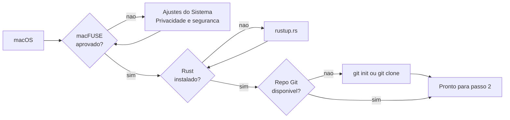
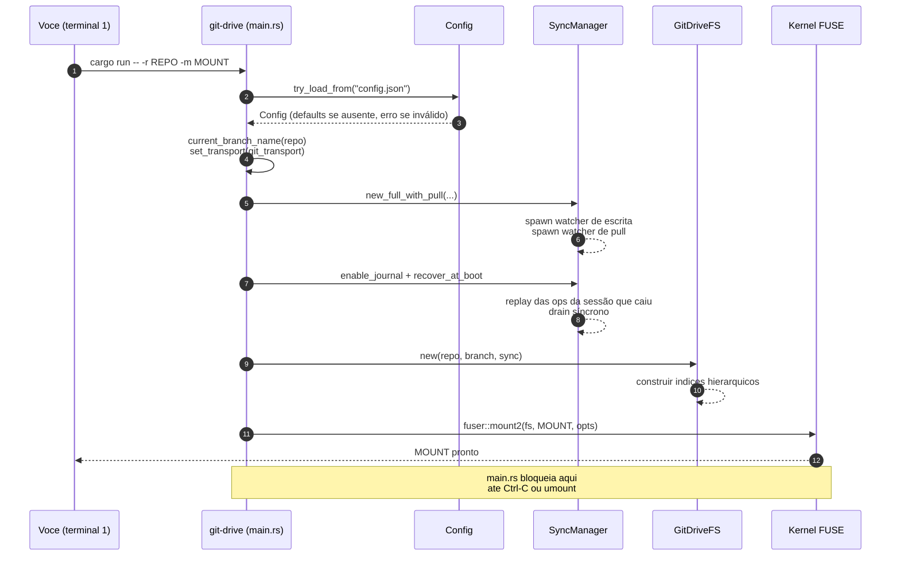

# Guia de uso: git-drive passo a passo

> English version: [../usage.md](../usage.md)

Este guia mostra, na ordem em que você deve executar, como preparar o ambiente, configurar credenciais, montar um repositório Git como filesystem FUSE e usar o git-drive no dia a dia. Para a visão arquitetural, consulte [arquitetura.md](./arquitetura.md). Para mecânica interna de sincronização, [fluxo-de-sincronizacao.md](./fluxo-de-sincronizacao.md).

## Sumário

- [1. Pré-requisitos](#1-pré-requisitos)
- [2. Preparar o projeto](#2-preparar-o-projeto)
- [3. Escolher o repositório a montar](#3-escolher-o-repositório-a-montar)
- [4. Criar o ponto de montagem](#4-criar-o-ponto-de-montagem)
- [5. Configurar credenciais do remote](#5-configurar-credenciais-do-remote)
- [6. Ajustar `config.json`](#6-ajustar-configjson)
- [7. Montar o drive](#7-montar-o-drive)
- [8. Usar o filesystem no dia a dia](#8-usar-o-filesystem-no-dia-a-dia)
- [9. Observar o ciclo de sincronização](#9-observar-o-ciclo-de-sincronização)
- [10. Montar automaticamente no login (launchd / systemd)](#10-montar-automaticamente-no-login-launchd--systemd)
- [11. Lixeira do Finder](#11-lixeira-do-finder)
- [12. Desmontar](#12-desmontar)
- [13. Cenários completos](#13-cenários-completos)
- [14. Troubleshooting](#14-troubleshooting)
- [Como estender este guia](#como-estender-este-guia)

---

## 1. Pré-requisitos

Antes de qualquer coisa, garanta que seu sistema tem:

| Dependência | Como instalar | Verificação |
| --- | --- | --- |
| macOS ou Linux | — | `uname` retorna `Darwin` ou `Linux` |
| [macFUSE](https://osxfuse.github.io/) (macOS) | `brew install --cask macfuse` | `kextstat \| grep -i fuse` lista módulo carregado |
| fuse3 (Linux) | pacote da distro (`fuse3`; ex.: `pacman -S fuse3`, `apt install fuse3`) | `fusermount3 --version` |
| Rust 1.85+ (edition 2021) | `curl --proto '=https' --tlsv1.2 -sSf https://sh.rustup.rs \| sh` | `rustc --version` |
| Git 2.31+ | `brew install git` (ou Xcode CLT) / pacote da distro | `git --version` — também usado pelo daemon no fetch/push (ver passo 5) |
| Um repositório Git local | ver passo 3 | `git -C <path> rev-parse --abbrev-ref HEAD` |

> **Atenção macFUSE:** após instalar via Homebrew, o macOS exige aprovação manual da extensão em **Ajustes do Sistema → Privacidade e segurança**. Sem isso, `fuser::mount2` falha com erro genérico de I/O.



---

## 2. Preparar o projeto

Clone e compile uma vez antes do primeiro uso.

```bash
git clone <url-deste-repo> git-drive
cd git-drive
cargo build                    # primeiro build baixa deps (fuser, git2, tokio...)
cargo test                     # opcional, valida toolchain (~315 testes)
```

O binário fica em `target/debug/git-drive`. Para build otimizada (recomendado após estabilizar seu fluxo):

```bash
cargo build --release          # binario em target/release/git-drive
```

O restante deste guia usa `cargo run -- ...`, que funciona para debug e release. Se preferir chamar o binário diretamente, substitua `cargo run --` por `./target/release/git-drive`.

---

## 3. Escolher o repositório a montar

git-drive monta **um branch checked-out** de um repo Git comum. Três situações típicas:

### 3.1. Repo já clonado

Nada a fazer além de checar o branch:

```bash
cd ~/Projects/meu-repo
git rev-parse --abbrev-ref HEAD   # precisa ser um branch nomeado, nao "HEAD"
```

Se o resultado for literalmente `HEAD`, você está em **detached HEAD** e o git-drive aborta no boot. Faça `git checkout <branch>` antes.

### 3.2. Clonar agora

```bash
git clone https://github.com/usuario/meu-drive.git ~/Projects/meu-drive
cd ~/Projects/meu-drive
git checkout main              # ou o branch desejado
```

### 3.3. Criar repositório do zero (uso local, sem remote)

```bash
mkdir -p ~/Projects/meu-drive-local
cd ~/Projects/meu-drive-local
git init -b main
echo "# drive" > README.md
git add README.md
git -c user.email=voce@example.com -c user.name="Voce" commit -m "init"
```

Sem `origin`, o git-drive ainda funciona: commits locais são criados, apenas `push` e o pull watcher não têm para onde apontar (logs avisam).

---

## 4. Criar o ponto de montagem

FUSE exige que o diretório de montagem **já exista** e esteja **vazio**. O git-drive não cria por você.

```bash
mkdir -p /tmp/gitmount
ls -la /tmp/gitmount           # tem que estar vazio
```

> Evite montar dentro do próprio repo que você vai montar — isso gera loops de I/O com watchers externos.

---

## 5. Configurar credenciais do remote

Por padrão (`"git_transport": "auto"`) o git-drive faz fetch e push pelo **binário `git` do
sistema**, então autentica exatamente como um `git fetch` digitado no repo: OpenSSH com o seu
`~/.ssh/config` (aliases de Host, `IdentityFile`, portas), o ssh-agent, o Keychain do macOS
(`UseKeychain`) e qualquer tipo de chave; HTTPS passa pelo seu credential helper. O daemon nunca
pergunta nada: roda com `GIT_TERMINAL_PROMPT=0` e, salvo um `core.sshCommand` seu, com
`ssh -o BatchMode=yes`. Um comando de rede que fica 300 s sem produzir saída é encerrado, então uma
conexão travada nunca bloqueia o drive.

| Fonte da credencial | Quando é usada |
| --- | --- |
| `remote_token` no `config.json` | Remotes HTTPS. Enviado como `http.extraHeader` (Basic, usuário `x-access-token`) pelo ambiente — nunca aparece na lista de processos. |
| Seu setup normal de git/ssh | Todo o resto (remotes SSH, HTTPS sem token). |

**Regra prática:** se `git -C <repo> fetch` funciona num terminal daquela máquina (com o mesmo
usuário, sem digitar nada), o daemon também funciona.

`"git_transport": "libgit2"` força o transporte em processo (também é o fallback quando não existe
binário `git`). Ele só conhece o ssh-agent e as chaves padrão `~/.ssh/id_ed25519`, `id_ecdsa` e
`id_rsa` (sem passphrase) — ignora `~/.ssh/config` e o Keychain.

### 5.1. Usando SSH (recomendado para uso pessoal)

```bash
ssh -T git@github.com          # deve responder "Hi <usuario>! You've successfully..."
git -C ~/Projects/meu-drive fetch --dry-run origin   # precisa funcionar sem pedir nada
```

Se a URL do remote já é `git@github.com:...` e isso funciona, deixe `remote_token: null` no
`config.json`. Uma chave com passphrase precisa estar disponível sem interação: no agent, ou no
Keychain do macOS com `UseKeychain yes` para aquele host no `~/.ssh/config`.

### 5.2. Usando token HTTPS (ex.: GitHub PAT)

1. Gere um PAT em [github.com/settings/tokens](https://github.com/settings/tokens) com escopo `repo` (ou fine-grained com write nesse repositório).
2. Garanta que a URL do remote é HTTPS:

   ```bash
   git -C ~/Projects/meu-drive remote -v
   # origin  https://github.com/usuario/meu-drive.git (fetch)
   ```

3. Coloque o token em `config.json` (passo 6). **Nunca** comite esse arquivo — `.gitignore` do git-drive já cobre.

### 5.3. Sem remote

Se o repo é local-only (`git init` sem `git remote add`), ignore esta etapa inteira. Os logs vão reportar falha de push a cada ciclo, mas commits locais continuam funcionando.

---

## 6. Ajustar `config.json`

`config.json` fica em **`~/.config/git-drive/config.json`** (junto da chave da criptografia; um
`./config.json` no CWD tem precedência no fluxo dev). Ausente → defaults; **presente mas inválido →
o daemon se recusa a subir** (um fallback silencioso subiria com a criptografia desligada e sem
identidade). Instalações antigas (`~/.config/drive-sync/`, Application Support) são migradas pelo
`install`.

### 6.1. Template completo comentado

```json
{
  "write_debounce_secs": 5,
  "pull_interval_secs": 60,
  "read_cache_mb": 64,
  "large_file_threshold_mb": 64,
  "chunk_threshold_mb": 95,
  "chunk_size_mb": 80,
  "encryption_enabled": false,
  "encryption_key_file": null,
  "user_name": "Juliano",
  "user_email": "juliano@example.com",
  "remote_token": null,
  "git_transport": "auto",
  "p2p_enabled": false,
  "p2p_idle_pull_interval_secs": 600,
  "log_level": "info",
  "log_categories": { "network": "warn" }
}
```

| Campo | Quando ajustar |
| --- | --- |
| `write_debounce_secs` | Diminua (`1`–`2`) para ver commits mais rápido em dev; aumente (`30`) se fizer muitas escritas em rajada para agrupar em menos commits. |
| `pull_interval_secs` | `0` desliga o pull watcher (útil em repos locais-only). Aumente se o remote muda pouco para reduzir chamadas de rede. |
| `read_cache_mb` | Orçamento do cache de leitura em MiB (default `64`). Aumente para repos com arquivos grandes lidos com frequência; `0` desativa (toda leitura vai ao repo, via handle persistente). |
| `large_file_threshold_mb` | Limiar em MiB acima do qual buffers de escrita vão para arquivo de spool em disco em vez de RAM (default `64`). Copiar um vídeo de 4 GiB para o drive não exige 4 GiB de RAM. `0` desativa o spool. |
| `chunk_threshold_mb` | Arquivo acima disso (default `95`) é sincronizado como manifest + chunks de até `chunk_size_mb` em `.chunks/` — abaixo do limite de 100 MB por arquivo do GitHub. `0` desativa (pushes de arquivos grandes voltam a ser rejeitados pelo GitHub). |
| `chunk_size_mb` | Tamanho máximo de cada chunk (default `80`). |
| `encryption_enabled` | Criptografia em repouso (ver seção 8.10). Default `false`. |
| `encryption_key_file` | Path do arquivo de chave. Default: `~/.config/git-drive/drive.key`. |
| `user_name` / `user_email` | Se qualquer um for `null`, git-drive **aplica as mudanças no working tree mas não commita**. Deixe ambos preenchidos para ter histórico. |
| `remote_token` | PAT para HTTPS. `null` cai para o seu setup de git/ssh. |
| `git_transport` | `auto` (padrão: `git` do sistema quando disponível), `cli` ou `libgit2`. Só mude se o `git` faltar ou se comportar mal naquela máquina. |
| `p2p_enabled` | Sincronização instantânea entre os seus dispositivos (seção 8.12). Padrão `false`: o drive sincroniza só consultando o git, como sempre. Exige `user_name`/`user_email`. |
| `p2p_idle_pull_interval_secs` | Intervalo do pull enquanto o canal P2P está online (padrão `600`): as mudanças chegam como aviso, e o polling é só a rede de segurança. |
| `p2p_key_file` | Chave do dispositivo no canal. Padrão: `peer.key` ao lado do `config.json` em uso, criada na primeira subida (0600). |
| `p2p_device_name` | Nome deste dispositivo no registro. Padrão: o hostname curto. |
| `p2p_relay_url` | Servidor de relay próprio. Padrão: os relays públicos da n0 (veem só IDs e IPs dos dispositivos, nunca conteúdo). |
| `repo_quota_gb` | Quanto o repositório pode ocupar, em GB, comparado ao tamanho dele na Central de Controle e no UnniFiles. Padrão: o do host (GitHub: 10 GB, o máximo que ele recomenda, com uma marca nos 5 GB abaixo dos quais ele recomenda fortemente ficar; GitLab.com: 10 GB; sem limite nos demais). O GitHub não impõe um total: só recusa push acima de 2 GB ou arquivo acima de 100 MB. |
| `log_level` | Nível base do arquivo de log (`off`, `error`, `warn`, `info`, `debug`, `trace`). Padrão `info`. |
| `log_categories` | Nível por área: `sync`, `git`, `fuse`, `crypto`, `p2p`, `network` (a pilha de rede do P2P, `warn` se não definido) e `service`. Área sem nível segue o `log_level`; `off` tira a área do arquivo. Mais fácil de editar na Central de Controle (seção 9.1.4). |

### 6.2. Receita rápida por cenário

**Repo local-only, sem remote:**

```json
{
  "write_debounce_secs": 3,
  "pull_interval_secs": 0,
  "user_name": "Voce",
  "user_email": "voce@example.com",
  "remote_token": null
}
```

**GitHub via SSH (ssh-agent ativo):**

```json
{
  "write_debounce_secs": 5,
  "pull_interval_secs": 60,
  "user_name": "Voce",
  "user_email": "voce@example.com",
  "remote_token": null
}
```

**GitHub via HTTPS com PAT:**

```json
{
  "write_debounce_secs": 5,
  "pull_interval_secs": 60,
  "user_name": "Voce",
  "user_email": "voce@example.com",
  "remote_token": "github_pat_xxxxxxxxxxxxxxxxxxxxxxxx"
}
```

---

## 7. Montar o drive

Com repo escolhido, ponto de montagem vazio e `config.json` salvo:

```bash
cargo run -- -r ~/Projects/meu-drive -m /tmp/gitmount
```

Saída esperada nos primeiros segundos:

```text
Debounce: 5s
Repositório Git: /Users/voce/Projects/meu-drive
Montando em: /tmp/gitmount
Branch ativo: main
```

O processo fica **em primeiro plano** — a chamada a `fuser::mount2` é bloqueante. Abra outro terminal para interagir com o drive. Ctrl-C no terminal da montagem desliga o filesystem.



---

## 8. Usar o filesystem no dia a dia

Com `/tmp/gitmount` montado, trate-o como qualquer diretório. Abaixo, as operações suportadas (v0.2.1).

### 8.1. Criar arquivo

```bash
echo "hello" > /tmp/gitmount/hello.txt
```

Fluxo interno: `create` → buffer de escrita → `flush` → `queue_write` → debounce de `write_debounce_secs` → `apply_op_to_disk` no repo → `commit_working_tree` → `push_to_remote`.

### 8.2. Editar arquivo

```bash
echo "mais uma linha" >> /tmp/gitmount/hello.txt
```

Edições usam o mesmo caminho. O commit final tem mensagem:

```text
git-drive: 1 changes (hello.txt)
```

### 8.3. Criar diretório

```bash
mkdir /tmp/gitmount/notas
```

Como Git não rastreia diretórios vazios, git-drive cria um `.gitkeep` dentro. Quando o primeiro arquivo real chega, o `.gitkeep` é removido automaticamente.

### 8.4. Arquivos em subdiretórios

```bash
mkdir -p /tmp/gitmount/notas/2026
echo "abr/24" > /tmp/gitmount/notas/2026/entrada.md
```

### 8.5. Renomear / mover

```bash
mv /tmp/gitmount/hello.txt /tmp/gitmount/notas/hello.txt
```

O kernel emite `rename`; git-drive enfileira `SyncOp::Rename` que, no working tree, vira delete + create (Git detecta rename por heurística no commit).

### 8.6. Remover arquivo ou diretório

```bash
rm /tmp/gitmount/notas/hello.txt
rmdir /tmp/gitmount/notas/2026   # precisa estar vazio
```

### 8.7. Symlinks

`ln -s alvo link` funciona: o symlink é commitado como entrada `120000` (mesma representação do
Git puro) e chega ao remote. O alvo é texto opaco — git-drive nunca o resolve nem valida; um
symlink com alvo absoluto criado numa máquina fica quebrado em outra, exatamente como em um clone
comum.

### 8.8. Arquivos ignorados (`.gitignore`)

Arquivos que casam com o `.gitignore` do repo montado são **local-only visíveis**: aparecem no
drive, persistem no working tree entre remounts, mas **nunca entram em commit nem push**. É o
mecanismo de exclusão do drive — não há allowlist própria. Para política local sem tocar o
`.gitignore` do repo, use `.git/info/exclude`. Atenção: local-only não sincroniza entre máquinas.

### 8.9. Arquivos grandes (chunking)

Arquivo acima de `chunk_threshold_mb` (default 95 MiB) é sincronizado em pedaços: no repo, o path
vira um **manifest** texto pequeno e o conteúdo vai para `.chunks/<2 hex>/<sha256>`, cada chunk
abaixo do limite de 100 MB por arquivo do GitHub. **No drive você não percebe nada** — o arquivo
aparece inteiro, com o tamanho real, e a leitura é remontada com verificação de integridade.

O que um clone Git puro (sem git-drive) vê: o manifest e o diretório `.chunks/`. Recuperação
manual de um arquivo:

```bash
# o manifest lista os hashes na ordem; concatene os chunks:
grep '^sha256 ' arquivo.zip | awk '{print ".chunks/" substr($2,1,2) "/" $2}' | xargs cat > arquivo-recuperado.zip
```

Não crie conteúdo próprio dentro de `.chunks/` — o diretório é reservado e o GC do git-drive
remove o que nenhum manifest referencia.

### 8.10. Criptografia em repouso (repo público como drive)

Com a criptografia habilitada, o repo — incluindo o working tree local — guarda **tudo cifrado**
(conteúdo e nomes, XChaCha20-Poly1305); só o drive montado apresenta os arquivos em claro. Dá para
usar até um repo público do GitHub como drive: sem a chave, ele é só uma árvore de blobs opacos.

Passo a passo:

```bash
# 1. Gere a chave (uma vez; faça backup DELA fora do repo — sem ela os dados são irrecuperáveis)
git-drive key generate

# 2. Habilite no config.json
#    "encryption_enabled": true

# 3. Reinicie o daemon. O próximo drain migra todo o conteúdo existente para cifrado.
```

| O que saber | Detalhe |
| --- | --- |
| Migração | Mudar `encryption_enabled` migra o worktree automaticamente no próximo drain, nos dois sentidos. |
| História antiga | Habilitar depois NÃO protege o passado: commits antigos continuam legíveis no remote. Para repo público, comece de um repo novo. |
| Multi-máquina | Copie o arquivo de chave (`~/.config/git-drive/drive.key`) para a outra máquina, com permissão 0600. |
| Chave perdida | Dados irrecuperáveis — não existe backdoor. |
| O que continua visível | Tamanhos aproximados, quantidade de arquivos/pastas, profundidade da árvore e cadência de commits. Quem já possui um arquivo idêntico consegue confirmar que ele está no repo (cifra convergente, necessária para o Git). |
| `.gitignore`/local-only | Desativados no modo cifrado (regras casariam contra nomes cifrados). |
| Nomes longos | Componente de nome com mais de ~119 bytes não pode ser criado no modo cifrado (limite de 255 do filesystem após cifrar). |

### 8.11. O que **não** funciona

| Operação | Motivo |
| --- | --- |
| Hardlinks (`ln`) | Simulado como cópia (modelo 1 inode = 1 path). |
| `chmod` / `chown` | `chmod` aceito só em memória (não persiste entre montagens); `chown` ignorado; `uid`/`gid` são os do processo do mount. |
| FIFOs, sockets, device files | Só `RegularFile`, `Directory` e `Symlink`. |
| Modificar `.git/` | O próprio `.git` do repo montado não é exposto via FUSE. |
| Git LFS | Repos com LFS mostram o ponteiro de texto, não o conteúdo (libgit2 sem filtros smudge/clean). |

### 8.12. Sincronização instantânea entre dispositivos (canal P2P)

Por padrão, cada dispositivo consulta o git a cada `pull_interval_secs` (60 s): uma mudança feita num
dispositivo leva até um minuto para aparecer nos outros. Com o canal P2P, quem faz o push avisa os
outros na hora, e eles buscam em segundos. Sem atividade, cada dispositivo consulta só a cada
`p2p_idle_pull_interval_secs` (10 minutos).

```bash
# Em cada dispositivo: ligue no config.json e reinicie o daemon
#    "p2p_enabled": true

# Confira os dispositivos (registro lido do repo, estado online vindo do daemon)
git-drive peers
#    mac (8f9180e8): this device
#    allmight (8e83643b): online
```

| O que saber | Detalhe |
| --- | --- |
| Como os dispositivos se encontram | Cada dispositivo tem uma chave (`peer.key`); a chave pública é o ID dele. Na primeira subida com o canal ligado, o dispositivo se registra em `.git-drive/peers/` dentro do repo (um commit, invisível no mount). Só dispositivos registrados são aceitos. |
| Qualquer rede | Os dispositivos conectam direto quando conseguem (mesma LAN ou hole punching no NAT) e por um relay quando não. Sem VPN e sem abrir porta. |
| O que trafega | Só "fiz push do commit X". O conteúdo dos arquivos continua indo pelo git. As conexões são cifradas de ponta a ponta; os relays veem IDs e IPs dos dispositivos, nunca conteúdo. |
| Medido | Sandbox com um Mac e uma máquina Linux (14-10-2026): um arquivo salvo apareceu na outra máquina 3,5 s depois, dos quais 3 s eram o debounce de escrita; parados, zero pulls em 3 minutos. |
| Fallback | O canal nunca trava o drive. Desligado, offline ou quebrado, o drive sincroniza por polling como antes. Um binário sem a feature `p2p` nem contém o código de rede. |
| Remover um dispositivo | `git-drive peers remove <nome>` com o daemon parado; a próxima subida publica a mudança. Dispositivos nunca são removidos automaticamente (um laptop dormindo uma semana continua registrado). |
| Dispositivos mistos | Um dispositivo sem o canal só é visto pelos outros no intervalo ocioso. Ligue em todos. |

---

## 9. Observar o ciclo de sincronização

### 9.1. Logs do processo

Os logs da sessão ficam em `logs/git-drive-<timestamp>.log` (o path é anunciado no boot; use `-v` para espelhar no terminal). Cada ciclo de drain imprime:

```text
[14:32:07.101] drain: sincronizando alterações
[14:32:07.104] disk: write hello.txt
[14:32:07.130] commit: criado ab12cd3...
[14:32:07.512] push: origin ok
```

Quando o pull watcher roda:

```text
[14:33:05.220] pull: fast-forward applied
[14:33:06.341] refresh: index rebuilt in 1.1s (70981 files)
```

No boot o daemon informa quanto o índice levou (`boot: index of N files built in ...`, com a
divisão listagem/nomes/mtimes) e qual transporte de rede usa (`boot: git transport=Cli`). Um aviso
`push: origin moved (another client pushed) — reconciling` é o caso concorrente normal (outra
máquina deu push antes); ele é seguido de merge e de um novo push.

### 9.1.1. `git-drive status`

Resumo do estado sem ler log cru — rode do mesmo diretório de onde o daemon foi lançado (ou aponte com `--file`):

```bash
git-drive status
git-drive status --file /outro/caminho/status.json
```

Saída típica:

```text
git-drive — branch main
  repo: /Users/voce/Projects/meu-drive
  daemon: rodando (pid 4242)
  iniciado há 2 h 10 min | atualizado há 12 s
  ops pendentes: 0
  último drain: há 1 min — 3 op(s), commit ab12cd3f, push ok
  último pull: há 12 s — sem novidades
  conflitos na sessão: nenhum
```

Enquanto um drain roda, uma linha `syncing:` acima de `pending ops` mostra quantas mudanças ele tirou da fila (elas deixam de contar como pendentes), a etapa (`committing`, depois `publishing` durante o push) e desde quando — um arquivo grande pode levar alguns minutos do salvamento ao remoto. O daemon grava o `status.json` (escrita atômica) a cada evento de boot, drain, pull e parada. Se `updated_at` estiver velho e o pid não responder, o subcomando sinaliza "POSSIVELMENTE PARADO". Um pull com "pulado: working tree sujo" recorrente no modo sem identidade indica escritas locais nunca commitadas bloqueando o pull (ver limitações).

### 9.1.2. Tray na barra de menus

```bash
git-drive tray
```

A marca do app (a pasta com um ramo, como na Central de Controle) em branco num menu bar escuro e
em preto num claro — no macOS ela segue a aparência do próprio menu bar, que depende também do papel
de parede; no Linux fica branca, para a barra superior escura do GNOME. O nó inferior direito do
ramo é uma bolinha de status: verde (sincronizado), azul (sincronizando — mudanças pendentes ou um
drain em andamento), laranja (remoto inacessível — as mudanças ficam neste dispositivo até ele
responder), vermelho (conflito, push ou merge com falha, commit bloqueado), cinza (daemon parado ou
status stale; a marca esmaece). O menu traz o resumo do status,
"Open drive in file manager", "Open Control Center", "Show log" (a Central de Controle na página
de logs) e "Quit tray". Sem a Central de Controle instalada, os dois últimos abrem a janela simples
de status e log. Instale junto do daemon com `git-drive install ... --with-tray` para subir no login.

### 9.1.3. Notificações

O daemon notifica via Central de Notificações no macOS (atribuídas ao "Script Editor") e via
`notify-send` no Linux: conflito de merge (com os nomes em claro das conflicted copies), push falho
e pull bloqueado por working tree sujo (ambos no máximo uma vez por hora enquanto persistirem), e
drive montado/desmontado.

### 9.1.4. Central de Controle

Uma janela com tudo sobre o drive nesta máquina: estado da sincronização, espaço do volume do
repositório, dispositivos conectados, commits das últimas 24 horas, o log ao vivo, todos os campos
do `config.json` e botões para iniciar, parar e reiniciar o daemon. A interface é em inglês, como a
CLI e o tray.

Compile uma vez (precisa de Node) e deixe o `install` instalar:

```bash
cd control-center
npm install
npm run tauri build -- --bundles app      # macOS (no Linux: npm run tauri build -- --no-bundle)
cd ..
./target/release/git-drive install -r <repo> -m <mount> --with-tray
```

O `install` copia para `~/.local/bin/git-drive-control-center` e, no macOS, para
`~/Applications/git-drive Control Center.app` (Spotlight, Dock); no Linux cria a entrada no lançador
de aplicativos. Abra pelo tray ("Open Control Center"), pelo lançador ou:

```bash
git-drive control-center              # Overview
git-drive control-center --page logs  # direto no log
```

| Página | O que mostra e faz |
| --- | --- |
| Overview | Estado do drive, último commit, anel de armazenamento (repositório, outros dados, livre) e, abaixo dele, o repositório comparado ao que o host aceita (o armazém de objetos, medido pelo daemon no boot e depois de cada commit e pull; âmbar acima do tamanho recomendado pelo host, coral acima do limite; `repo_quota_gb` define o seu), dispositivos do canal P2P, commits por hora, tempo no ar, último pull, mudanças esperando e conflitos. Mostra "Starting" enquanto o daemon sobe e o drive ainda não montou. |
| Logs | Final ao vivo do log da sessão com filtros por nível, área e texto, pausa e o painel Recording: nível base e um nível por área (`log_categories`). |
| Settings | Theme: a cor de destaque, escolhida como no macOS (Multicolor, Blue, Purple, Pink, Red, Orange, Yellow, Green, Graphite), aplicada na hora e guardada em `~/.config/git-drive/control-center.json`. Depois, todos os campos do `config.json`, validados e salvos de forma atômica (permissão 0600: pode conter o token). |
| About | Versão, serviço de login, efeito da janela, estado da criptografia e do P2P, e cada arquivo e pasta que o git-drive usa, com botão Reveal. |

O daemon só lê a config no boot: "Save & restart" salva e reinicia (parada limpa: unmount,
sincronização final e boot novo). Start, Stop e Restart passam pelo serviço de login, exatamente
como:

```bash
git-drive daemon stop      # unmount + sincronização final; seguro mesmo com o daemon ainda subindo
git-drive daemon start
git-drive daemon restart
```

No macOS 26 ou posterior a janela usa Liquid Glass (o fundo da área de trabalho aparece desfocado);
em versões anteriores, o vibrancy clássico. No Linux o vidro é desenhado dentro da janela.

## 10. Montar automaticamente no login (launchd / systemd)

```bash
git-drive install -r ~/Projects/meu-drive -m ~/GitDrive --with-tray
```

O mesmo comando funciona nas duas plataformas. Nos dois casos ele primeiro copia o binário em
execução para **`~/.local/bin/git-drive`** e aponta o serviço para lá — o serviço nunca referencia
uma árvore de build, então mover ou recompilar o projeto não o quebra. Também migra config/chave de
locais legados para `~/.config/git-drive/` e, se ainda não existir config, copia o `./config.json`
do diretório atual.

| | macOS (LaunchAgent) | Linux (units de usuário do systemd) |
| --- | --- | --- |
| Arquivos do serviço | `~/Library/LaunchAgents/dev.giacomeli.git-drive.plist` (+ `.tray.plist`) | `~/.config/systemd/user/git-drive.service` (+ `git-drive-tray.service`) |
| Política de restart | KeepAlive `{SuccessfulExit=false}` | `Restart=on-failure`, `TimeoutStopSec=90` |
| Logs | `~/Library/Logs/git-drive/` | `~/.local/state/git-drive/logs/` (respeita `$XDG_STATE_HOME`) |
| Status | `~/Library/Application Support/git-drive/status.json` | `~/.local/state/git-drive/status.json` |
| Serviços legados (`drive-sync`) | derrubados, plists removidos | parados, units mantidas como `<unit>.bak` |

O `git-drive status` acha o arquivo de status sozinho de qualquer diretório. No Linux, sem
`loginctl enable-linger $USER` o drive só roda enquanto você está logado (o install mostra a dica);
a tray precisa de sessão gráfica (no GNOME, a extensão AppIndicator).

- **Parada limpa:** SIGTERM (launchctl/systemctl, logout) ou eject drenam a fila pendente (commit +
  push) antes de sair — nada se perde. Parada limpa não é reiniciada.
- **Crash:** o gerenciador de serviços religa o daemon, que recupera o mount zumbi deixado pelo
  processo morto. Escritas que o processo morto já tinha confirmado também não se perdem: toda
  operação enfileirada vai para o journal em `.git/git-drive-journal/` antes de ser confirmada, e o
  boot seguinte faz o replay e o commit **antes** de o volume aparecer (o log mostra
  `journal: N op(s) from an interrupted session replayed`). O journal sobrevive a crash do processo
  (kill -9, panic, OOM), não a uma queda de energia dentro da janela de write-back do SO.
- **Remover:** `git-drive uninstall` (para o daemon, desmonta e remove o serviço, inclusive a tray).

## 11. Lixeira do Finder

Mover itens do drive para o Lixo remove do repositório (vira commit) mas os mantém visíveis e
recuperáveis na Lixeira do Finder enquanto o mount viver — restaurar rematerializa no repo.
Esvaziar a Lixeira (ou desmontar/remontar) libera a memória e torna a remoção definitiva no volume.

### 9.2. Verificar no repo real

Em terceiro terminal (não é o do mount, nem o de uso):

```bash
cd ~/Projects/meu-drive
git log --oneline -5
git status
git log origin/main..main      # commits nao-enviados (deve ficar vazio apos push)
```

### 9.3. Verificar remote

```bash
git fetch origin
git log origin/main --oneline -5
```

---

## 12. Desmontar

Qualquer uma das formas abaixo faz **parada limpa**: o volume desmonta, a fila pendente é drenada
(commit + push mesmo do que estava no meio do debounce) e o status registra o encerramento.

### 12.1. Ctrl-C (ou SIGTERM) no processo do mount

```bash
# no terminal do mount: Ctrl-C
# ou de fora:
pkill -TERM -f 'git-drive -r'
```

### 12.2. Eject no Finder / `umount` externo

```bash
umount ~/GitDrive              # ou: diskutil unmount ~/GitDrive
```

O daemon detecta o fim da sessão, drena a fila e sai. Em caso de "device busy", feche processos com
file descriptors abertos no mount (`lsof ~/GitDrive`).

### 12.3. Via launchd

```bash
git-drive uninstall           # para de vez (remove os agentes)
git-drive daemon stop         # para até o próximo login ou até `git-drive daemon start`
```

Confirme com `git-drive status` — deve mostrar "encerrado de forma limpa".

---

## 13. Cenários completos

### 11.1. Cenário A — drive local com commits, sem remote

```bash
# 1. Repo local
mkdir -p ~/drives/notas && cd ~/drives/notas
git init -b main
git -c user.email=eu@ex.com -c user.name=Eu commit --allow-empty -m "init"
cd -

# 2. config.json (raiz do git-drive)
cat > config.json <<'EOF'
{
  "write_debounce_secs": 2,
  "pull_interval_secs": 0,
  "user_name": "Eu",
  "user_email": "eu@ex.com",
  "remote_token": null
}
EOF

# 3. Montar
mkdir -p /tmp/notas-mount
cargo run -- -r ~/drives/notas -m /tmp/notas-mount

# (outro terminal)
echo "ola" > /tmp/notas-mount/primeira.md
# ...aguardar ~2s...
git -C ~/drives/notas log --oneline
# git-drive: 1 changes (primeira.md)
# init
```

### 11.2. Cenário B — drive conectado a repo GitHub via SSH

```bash
# 1. Clone e branch
git clone git@github.com:usuario/drive.git ~/drives/drive
cd ~/drives/drive
git checkout main
cd -

# 2. config.json — ssh-agent cuida das credenciais
cat > config.json <<'EOF'
{
  "write_debounce_secs": 5,
  "pull_interval_secs": 30,
  "user_name": "Usuario",
  "user_email": "usuario@example.com",
  "remote_token": null
}
EOF

# 3. Montar
mkdir -p /tmp/drive-mount
cargo run -- -r ~/drives/drive -m /tmp/drive-mount

# (outro terminal)
mkdir /tmp/drive-mount/pasta
echo "conteudo" > /tmp/drive-mount/pasta/arq.md
# apos ~5s: commit + push para github

# Em outra maquina (ou pull manual no github)
# ... mudancas remotas chegam em ~30s via pull watcher
```

### 11.3. Cenário C — drive colaborativo via HTTPS + PAT

```bash
# 1. Repo ja existente em HTTPS
git clone https://github.com/equipe/drive-compartilhado.git ~/drives/compartilhado

# 2. PAT no config.json
cat > config.json <<'EOF'
{
  "write_debounce_secs": 10,
  "pull_interval_secs": 15,
  "user_name": "Voce",
  "user_email": "voce@empresa.com",
  "remote_token": "github_pat_xxxxxxxxxxxxxxxxxxxxxxxx"
}
EOF
# .gitignore do git-drive ja protege config.json

# 3. Montar
mkdir -p /tmp/compartilhado
cargo run -- -r ~/drives/compartilhado -m /tmp/compartilhado
```

---

## 14. Troubleshooting

| Sintoma | Causa provável | Ação |
| --- | --- | --- |
| `mount2` falha com "No such file or directory" | Diretório de montagem não existe. | `mkdir -p <mount_path>` antes do comando. |
| `mount2` falha com erro genérico no macOS | macFUSE não aprovado em **Privacidade e segurança**. | Aprovar na UI, reiniciar o mac se necessário. |
| `current_branch_name` retorna erro "HEAD detached" | Repo em detached HEAD. | `git checkout <branch>` no repo real. |
| Escritas aparecem no drive mas não há commit | `user_name` ou `user_email` `null` no `config.json`. | Preencher ambos. |
| Daemon sai no boot com `invalid config ...` | `config.json` existe mas não é JSON válido (ou um campo tem tipo errado). | Corrigir o arquivo; o daemon se recusa a adivinhar. |
| `pull: fetch error` / `push failed` no log | A máquina não alcança ou não autentica no remote sem interação. | Rodar `git -C <repo> fetch origin` com o mesmo usuário, num shell simples: precisa funcionar sem pedir nada. A linha do log traz a mensagem de erro do próprio git. |
| Commit OK mas push falha com `authentication required` | HTTPS sem `remote_token` e sem credential helper, ou chave SSH com passphrase fora do agent/Keychain. | Preencher `remote_token`, configurar um credential helper ou deixar a chave disponível sem interação. |
| Commits ficam sem publicar enquanto offline | Esperado: ficam guardados localmente. | Nada a fazer — o próximo ciclo de pull bem-sucedido publica (`push: origin ok` no log). |
| Push falha com `403` / `404` | PAT sem escopo `repo` ou URL errada. | Regerar PAT com escopo certo, conferir `git remote -v`. |
| Pull watcher loga `not fast-forward` | Modo sem identidade (sem `user_name`/`user_email`) e o histórico divergiu — FF-only não consegue fazer merge. | Configurar a identidade (merge 3-way com conflicted copies) ou resolver manualmente no repo real. |
| Mudança no remote demora até ~1s para aparecer | Cache de `getattr` do kernel (TTL ~1s). | Aguardar, ou re-listar (`ls`) o diretório pai. |
| "device busy" no `umount` | Processo com FD aberto no mount. | `lsof /tmp/gitmount` para achar e fechar. |
| `cargo run` trava depois de Ctrl-C | Kernel não liberou o mount. | `umount /tmp/gitmount` manual; em último caso `diskutil unmount force`. |
| Buffers de arquivos grandes parecem "sumir" | Debounce ainda não drenou. | Aguardar `write_debounce_secs` antes de checar `git log`. |

---

## Como estender este guia

- Se você adicionar uma nova operação FUSE em `src/fs.rs`, liste em [8.1–8.6](#8-usar-o-filesystem-no-dia-a-dia) ou [8.7](#87-o-que-não-funciona-v010) conforme o caso.
- Se surgir novo campo em `config.json`, atualize a tabela de [6.1](#61-template-completo-comentado) e, quando for relevante, adicione receita em [6.2](#62-receita-rápida-por-cenário).
- Ao mudar a estratégia de credenciais ou o transporte em `src/git.rs`, revisite [5](#5-configurar-credenciais-do-remote).
- Ao mudar logs do processo (mensagens, formato), atualize [9.1](#91-logs-do-processo) para refletir o texto real.

---

## Referências

- [README.md](../../README.md) — visão geral e quick start
- [arquitetura.md](./arquitetura.md) — camadas, estruturas de dados, limitações
- [fluxo-de-sincronizacao.md](./fluxo-de-sincronizacao.md) — watchers, debounce, pull
- [filesystem-fuse.md](./filesystem-fuse.md) — modelo inode e operações FUSE
- [AGENTS.md](../../AGENTS.md) — orientações para contribuidores e agentes
