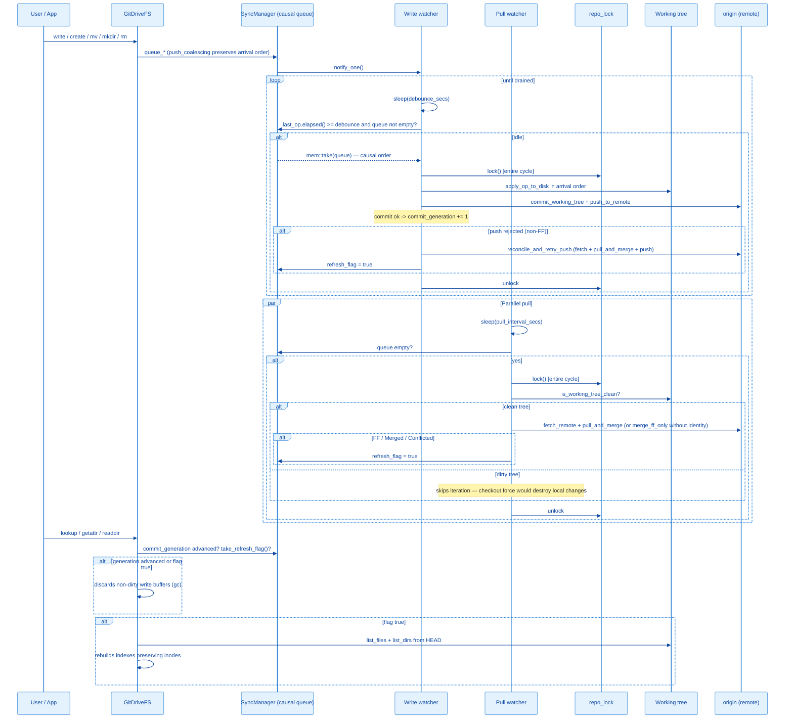

# Architecture: Sync Flow

> Portuguese version: [pt-br/fluxo-de-sincronizacao.md](./pt-br/fluxo-de-sincronizacao.md)

## Overview

The `SyncManager` decouples three different cadences: (a) receiving operations from the FUSE kernel — fast, in memory; (b) persisting to the working tree + commit + push — expensive, runs at the end of an idle cycle (debounce); (c) pulling changes from the remote — also expensive, runs on an independent interval (pull watcher). Cycles (b) and (c) are serialized by a shared repository lock (`repo_lock`): drain and pull never run concurrently on the same repo.



---

## Components

### `SyncManager`

```rust
#[derive(Clone)]
pub struct SyncManager {
    inner: Arc<Mutex<Inner>>,
    notify: Arc<Notify>,
    debounce_secs: u64,
    repo_path: PathBuf,
    branch: String,
    user_name: Option<String>,
    user_email: Option<String>,
    remote_name: Option<String>,
    remote_token: Option<String>,
    refresh_flag: Arc<AtomicBool>,
    commit_generation: Arc<AtomicU64>,
    repo_lock: Arc<Mutex<()>>,
    status: Arc<StatusState>,
}
```

- `inner` — `Vec<SyncOp>` queue in arrival order + timestamp of the last `queue_*`.
- `notify` — signals the write watcher that there is work.
- `remote_name`/`remote_token` — optional credentials for push/pull. Absence disables push/pull respectively.
- `refresh_flag` — `AtomicBool` set when HEAD advances via pull or reconcile; consumed by `GitDriveFS::refresh_if_needed`.
- `commit_generation` — `AtomicU64` incremented on every commit created by the drain; `GitDriveFS` compares it with the last value it observed to discard write buffers whose content is already in HEAD.
- `repo_lock` — serializes the complete drain and pull cycles. The atomic unit is the cycle, not the individual git call: a commit landing between the pull's fetch and its checkout was the race window.
- `status` — observable state (`src/status.rs`): boot/drain/pull events and the session's conflicted copies, persisted atomically to `logs/status.json` when `enable_status_file` is called (main enables it at boot). Read by the `drive-sync status` subcommand.

### `SyncOp` and the causal queue

```rust
#[derive(Debug, Clone)]
pub enum SyncOp {
    Write { path: String, content: WriteContent },
    Delete { path: String },
    Mkdir { path: String },
    Rmdir { path: String },
    Rename { from: String, to: String },
    Symlink { path: String, target: String },
}
```

`WriteContent` has two forms: `Mem(Arc<Vec<u8>>)` — the SAME `Arc` as the inode's write buffer,
with no copy at flush time — and `Spooled(PathBuf)` — a snapshot in a spool file
(`.git/drive-sync-spool/`) for buffers above `large_file_threshold_mb`, applied at drain time with
a `rename` (never passing through RAM).

The queue preserves **arrival order** — the FUSE kernel's order is the causal order. The only coalescing allowed (`push_coalescing`): a `Write` replaces in-place the most recent `Write` for the same path, as long as no op after it touches a related path (equal or ancestor/descendant) — `Rename`, `Delete`, `Mkdir`, `Rmdir` and `Symlink` act as barriers. A replaced spooled snapshot has its file removed immediately. Correctness never depends on coalescing; it only avoids redundant content during write storms.

This structure replaced a `HashMap<String, SyncOp>` keyed by path with a sort by op type at drain time, which had two classes of bugs:

| Scenario in the same batch | Old behavior | Current behavior |
| --- | --- | --- |
| `rename d1 -> d2` followed by `rename d2 -> d3` | Arbitrary HashMap order: one of the renames failed with ENOENT | Applies in order: only `d3` exists at the end |
| `mkdir a`, `rename a -> b`, `write b/f.txt` | Write (lower priority) created a real `b` before the rename, which then failed with "destination exists" | mkdir, rename and write apply in order: `b/f.txt` exists, no leftover `a` |
| `rename a -> b` + `write b` | Write erased the Rename from the queue (same key) | Both survive, in order |
| `write tmp` + `delete tmp` | Delete replaced the Write | Both apply; a net-null state produces no commit |

---

## Write watcher

Flow, see `src/sync.rs::spawn_watcher`:

1. `notified().await` — sleeps until the first `queue_*`.
2. Inner loop sleeps for `debounce_secs`.
3. Under the `inner` lock: if `last_op.elapsed() >= debounce` and the queue is not empty, `mem::take` the queue; otherwise keeps waiting.
4. Acquires `repo_lock` (held for the entire cycle; there is no `.await` within the guard's scope).
5. Iterates the batch **in queue order**, calling `apply_op_to_disk` for each `SyncOp`. With encryption enabled, the plaintext->ciphertext path translation and content sealing happen at THIS materialization (the queue works 100% in plaintext). Then, with chunking enabled (`chunk_threshold_mb > 0`), the scan converts any raw file above the threshold into manifest + `.chunks/` (with encryption, each chunk is sealed and the hash is of the ciphertext); the migration scans conform the worktree to the config state (encrypt everything or decrypt everything, with a warning that history stays as it was); and the GC removes chunks that no manifest references (requires the key when manifests are sealed — never collects blindly).
6. If `user_name`/`user_email` are present, `commit_batch` builds the message `drive-sync: <N> changes (...)` and calls `git::commit_working_tree` (`add_all` with `IndexAddOption::DEFAULT` — files matching the mounted repo's `.gitignore` stay out of the commit by specification; in the mount they become visible local-only files). A created commit increments `commit_generation`.
7. If a commit happened and `remote_name` is configured, `push_batch` calls `git::push_to_remote`. A rejected push (typically non-FF) triggers `reconcile_and_retry_push`: fetch + `pull_and_merge` + one push retry. Recovery sets `refresh_flag`. The local commit is never reverted.
8. At the end of the cycle, `status.record_drain` records the applied ops, the commit oid, the push result and any ops still pending in the queue — and persists `status.json`.

The cycle body lives in `DrainCtx::run`, shared between the watcher and the clean shutdown's
`drain_now`: SIGTERM/SIGINT/eject trigger unmount (the kernel delivers the flushes of open fds),
then `drain_now` drains the final queue synchronously — nothing enqueued is lost on stop. A push
that still fails after reconcile and conflicted copies also trigger macOS notifications
(`notify.rs`).

### `SyncOp` -> working tree translation

| Op | Effect on disk |
| --- | --- |
| `Write` | `create_dir_all(parent)` + `fs::write`. |
| `Delete` | `fs::remove_file` (ENOENT is silent — the path may never have reached disk). |
| `Mkdir` | `create_dir_all(path)` + `fs::write(path/.gitkeep)`. Needed because Git does not track empty directories. |
| `Rmdir` | Removes `.gitkeep` (if present) + `fs::remove_dir` (silent ENOENT). |
| `Rename` | `create_dir_all(destination parent)` + `fs::rename`. |
| `Symlink` | Removes any pre-existing path + `std::os::unix::fs::symlink(target, path)` — `add_all` stages it as a `120000` entry. |

Errors are logged and the batch proceeds — the remaining files are still attempted. **No multi-file atomicity**: a crash mid-batch leaves partial state in the working tree (without a commit).

---

## Pull watcher

`src/sync.rs::spawn_pull_watcher`. Runs only if `pull_interval_secs > 0` **and** `remote_name` is configured.

1. Loop: `sleep(pull_interval_secs)`.
2. If the queue is not empty, skips the iteration (does not steal time from the local commit).
3. Acquires `repo_lock` — serializes with the drain.
4. **Working tree guard**: `git::is_working_tree_clean` (staged, unstaged and untracked; ignored files excluded). A dirty tree skips the iteration — the fast-forward's checkout force would destroy uncommitted local changes. In identity-less mode (commits skipped by design), the first local write blocks the pull until the user commits manually or configures an identity — accepted behavior, recorded in the Phase 0 (data integrity) decisions.
5. `git::fetch_remote` (`git fetch origin <branch>`).
6. With identity: `git::pull_and_merge` — FF if possible; otherwise 3-way merge; a conflict produces a conflicted copy (`<path>.conflict-<host>-<ts>`) with the remote version as canonical. Without identity: degrades to `git::merge_ff_only` (stalls on divergence).
7. Any outcome that touches the tree (`FastForwarded`/`Merged`/`Conflicted`) sets `refresh_flag = true`.
8. Every iteration records the outcome in `status.record_pull` — including the skips ("sync queue pending", "dirty working tree") and fetch/merge errors. Conflicted copies enter the status's `conflicts` list.

---

## Index and buffer invalidation (`refresh_if_needed`)

`src/fs.rs::refresh_if_needed`, called from `lookup`/`getattr`/`readdir`:

1. If there are pending ops in the queue (`has_pending_ops`), returns — a refresh with an undrained batch would drop freshly created paths from the indexes.
2. If `commit_generation` advanced since the last observation, discards **non-dirty** write buffers (gc): with the queue empty and a commit created, their content is already in HEAD, and keeping them would hide future remote changes from `read`.
3. `take_refresh_flag()`; if `false`, returns.
4. Discards non-dirty buffers again (HEAD advanced via pull/merge) and rebuilds the indexes: lists dirs and files from HEAD, preserves inodes of paths that still exist, allocates new inodes (lazily, via `unwrap_or_else`) only for new paths.

**Dirty** buffers (writes not yet enqueued) are never discarded.

**Tradeoff:** paths that disappear (deleted remotely) lose their inode; if the user had the file open, subsequent `read`s return `ENOENT`. Acceptable for the MVP.

---

## Concurrency Behavior

| Primitive | Use |
| --- | --- |
| `parking_lot::Mutex<Inner>` | Causal queue shared between the FUSE thread and the watchers. API without `Result` and no poisoning on panic. |
| `Arc<parking_lot::Mutex<()>>` (`repo_lock`) | Serializes drain (apply + commit + push + reconcile) and pull (fetch + merge + checkout). Never held across an `.await`. |
| `Arc<Notify>` | Lightweight signaling from `queue_*` to the write watcher. |
| `Arc<AtomicBool>` (`refresh_flag`) | One-way channel from the watchers to `GitDriveFS`. `SeqCst`. |
| `Arc<AtomicU64>` (`commit_generation`) | Monotonic counter of drain commits, basis for the buffer gc. |
| `Arc<AtomicU64>` (`next_inode`) | Monotonic inode allocator. |
| Synchronous `fs::*` | Disk writes happen outside the `Inner` lock (but inside `repo_lock`). |

---

## Commit message

`src/sync.rs::build_commit_message`:

- Format: `drive-sync: <N> changes (<p1>, <p2>, <p3>[, +M more])`
- Up to 3 paths inline; beyond that, `+<M> more` is appended.
- `<path>` comes from `SyncOp::primary_path`.

---

## Ephemeral path filter

`op_touches_ephemeral` discards at `enqueue` (before entering the queue):

- **Full filter** (`is_fully_ephemeral_path`, all ops): components `._*`, `.DS_Store`, `.Spotlight-V100`, `.Trashes`, `.TemporaryItems`, `.fseventsd`, `.DocumentRevisions-V100`, `.apdisk`, `.VolumeIcon.icns`.
- **Creation filter** (`is_textedit_scratch_path`, only Write/Mkdir and Rename destinations): components containing `.sb-` (TextEdit/NSDocument safe-save temp dirs). Delete/Rmdir pass through, to allow cleaning up residues that were already committed.

DIRECTORY renames with an ephemeral endpoint never reach the filter as a `Rename` (which would be
discarded whole, diverging disk and index): `apply_rename` expands the operation before enqueueing —
an ephemeral destination (e.g. moving a folder to the Trash) becomes a recursive Delete/Rmdir of the
real paths (bottom-up), with buffers preserving read and restore; an ephemeral source becoming real
materializes via Mkdir/Write top-down with the current content. FILE renames already resolve through
the Write+Delete translation (the ephemeral side is filtered individually).

---

## Limitations of the Current Flow

1. **Pull blocked in identity-less mode.** Without `user_name`/`user_email`, local writes never become commits; the working tree guard then blocks the pull indefinitely after the first write. Sync becomes effectively unidirectional until a manual commit or identity configuration.
2. **No multi-file atomicity.** A crash mid-batch leaves the working tree partially updated but without a commit.
3. **No cancellation.** Enqueued ops always run — there is no API to discard a `queue_write` before the debounce.
4. **FUSE TTL vs refresh.** The kernel's `TTL = 1s` can make a refresh take up to 1 extra second to become visible to the user.
5. **Persistent push failure only logs.** After the reconcile's single retry, the commit stays local until the next cycle with a successful push.

---

## How to add a post-flush action

Extension point in `src/sync.rs::spawn_watcher`, between `commit_batch` and `push_batch`:

```rust
if committed {
    commit_generation.fetch_add(1, Ordering::SeqCst);
    my_hook::on_flush(&ops, &repo_path);   // <- here
    if let Some(ref remote) = remote_name {
        // push_batch / reconcile_and_retry_push ...
    }
}
```

`ops` already contains a `Vec<&SyncOp>` with all the batch's paths/contents, in causal order.

## How to add a new coalescing rule

The only coalescing today is Write-over-Write (`push_coalescing` in `src/sync.rs`). To add another one (e.g. create+delete canceling out):

1. Write the unit test first, in `src/sync.rs::tests`, covering the barrier — what must NOT coalesce matters more than what may.
2. Change `push_coalescing` while keeping the invariant: drain correctness can never depend on coalescing, only the savings can.
3. Run the four batch regression scenarios in `tests/sync_flow.rs` (`batch_*`).

---

## References

| File | Responsibility |
| --- | --- |
| `src/sync.rs` | `SyncManager`, `SyncOp`, causal queue (`push_coalescing`), watchers, `commit_batch`, `push_batch`, `reconcile_and_retry_push` |
| `src/fs.rs` | `write_buffers` + dirty flags, `refresh_if_needed` (buffer gc + rebuild), `sync.queue_*` calls in the `apply_*` methods |
| `src/git.rs` | `commit_working_tree`, `push_to_remote`, `fetch_remote`, `merge_ff_only`, `pull_and_merge`, `is_working_tree_clean` |
| `src/status.rs` | `SyncStatus`/`StatusState`, atomic write of `status.json`, subcommand formatting |
| `src/notify.rs` | macOS notifications (osascript) with rate limiting for persistent events |
| `src/config.rs` | Source of `write_debounce_secs`, `pull_interval_secs`, `read_cache_mb`, `large_file_threshold_mb`, `chunk_threshold_mb`, `chunk_size_mb`, `encryption_enabled`, `encryption_key_file`, identity and token |

Related docs:

- [architecture.md](./architecture.md)
- [fuse-filesystem.md](./fuse-filesystem.md)
