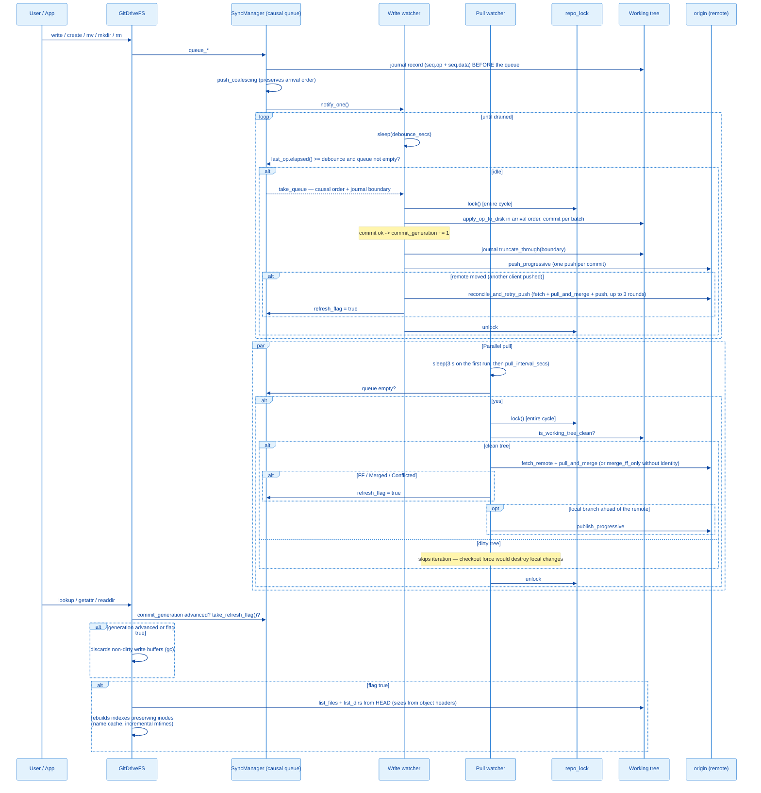

# Architecture: Sync Flow

> Portuguese version: [pt-br/fluxo-de-sincronizacao.md](./pt-br/fluxo-de-sincronizacao.md)

## Overview

The `SyncManager` decouples three different cadences: (a) receiving operations from the FUSE kernel — fast, journaled on disk and queued in memory; (b) persisting to the working tree + commit + push — expensive, runs at the end of an idle cycle (debounce); (c) pulling changes from the remote and publishing local commits the remote lacks — also expensive, runs on an independent interval (pull watcher). Cycles (b) and (c) are serialized by a shared repository lock (`repo_lock`): drain and pull never run concurrently on the same repo. Network operations (fetch/push) go through the process-wide transport chosen at boot (`git_transport`: the system `git` CLI by default, libgit2 as fallback).



At boot, before the mount, `enable_journal` replays whatever a crashed session left in the journal and `recover_at_boot` drains it synchronously (or commits a dirty working tree) — see [Write-ahead journal](#write-ahead-journal).

---

## Components

### `SyncManager`

```rust
#[derive(Clone)]
pub struct SyncManager {
    inner: Arc<Mutex<Inner>>,
    notify: Arc<Notify>,
    debounce_secs: u64,
    repo_path: PathBuf,
    branch: String,
    user_name: Option<String>,
    user_email: Option<String>,
    remote_name: Option<String>,
    remote_token: Option<String>,
    refresh_flag: Arc<AtomicBool>,
    commit_generation: Arc<AtomicU64>,
    repo_lock: Arc<Mutex<()>>,
    status: Arc<StatusState>,
    notifier: Arc<Notifier>,
    chunk_threshold_bytes: Arc<AtomicU64>,
    chunk_size_bytes: Arc<AtomicU64>,
    commit_batch_bytes: Arc<AtomicU64>,
    crypto: Arc<Mutex<Option<Arc<crate::crypt::Crypto>>>>,
    migration_crypto: Arc<Mutex<Option<Arc<crate::crypt::Crypto>>>>,
}

struct Inner {
    buffer: Vec<SyncOp>,
    last_op: Option<Instant>,
    journal: Option<Arc<crate::journal::Journal>>,
    next_seq: u64,
}
```

- `inner` — `Vec<SyncOp>` queue in arrival order, timestamp of the last `queue_*`, the optional write-ahead journal and the seq of its next record (assigned under this lock together with the push into the queue).
- `notify` — signals the write watcher that there is work.
- `remote_name`/`remote_token` — optional credentials for push/pull. Absence disables push/pull respectively.
- `refresh_flag` — `AtomicBool` set when HEAD advances via pull or reconcile; consumed by `GitDriveFS::refresh_if_needed`.
- `commit_generation` — `AtomicU64` incremented on every commit created by the drain; `GitDriveFS` compares it with the last value it observed to discard write buffers whose content is already in HEAD.
- `repo_lock` — serializes the complete drain and pull cycles. The atomic unit is the cycle, not the individual git call: a commit landing between the pull's fetch and its checkout was the race window.
- `status` — observable state (`src/status.rs`): boot/drain/pull events and the session's conflicted copies, persisted atomically to `logs/status.json` when `enable_status_file` is called (main enables it at boot). Read by the `git-drive status` subcommand.

### `SyncOp` and the causal queue

```rust
#[derive(Debug, Clone)]
pub enum SyncOp {
    Write { path: String, content: WriteContent },
    Delete { path: String },
    Mkdir { path: String },
    Rmdir { path: String },
    Rename { from: String, to: String },
    Symlink { path: String, target: String },
}
```

`WriteContent` has two forms: `Mem(Arc<Vec<u8>>)` — the SAME `Arc` as the inode's write buffer,
with no copy at flush time — and `Spooled(PathBuf)` — a snapshot in a spool file
(`.git/git-drive-spool/`) for buffers above `large_file_threshold_mb`, applied at drain time with
a `rename` (never passing through RAM).

The queue preserves **arrival order** — the FUSE kernel's order is the causal order. The only coalescing allowed (`push_coalescing`): a `Write` replaces in-place the most recent `Write` for the same path, as long as no op after it touches a related path (equal or ancestor/descendant) — `Rename`, `Delete`, `Mkdir`, `Rmdir` and `Symlink` act as barriers. A replaced spooled snapshot has its file removed immediately. Correctness never depends on coalescing; it only avoids redundant content during write storms.

This structure replaced a `HashMap<String, SyncOp>` keyed by path with a sort by op type at drain time, which had two classes of bugs:

| Scenario in the same batch | Old behavior | Current behavior |
| --- | --- | --- |
| `rename d1 -> d2` followed by `rename d2 -> d3` | Arbitrary HashMap order: one of the renames failed with ENOENT | Applies in order: only `d3` exists at the end |
| `mkdir a`, `rename a -> b`, `write b/f.txt` | Write (lower priority) created a real `b` before the rename, which then failed with "destination exists" | mkdir, rename and write apply in order: `b/f.txt` exists, no leftover `a` |
| `rename a -> b` + `write b` | Write erased the Rename from the queue (same key) | Both survive, in order |
| `write tmp` + `delete tmp` | Delete replaced the Write | Both apply; a net-null state produces no commit |

---

## Write-ahead journal

`src/journal.rs`, directory `.git/git-drive-journal/`. The queue lives in RAM until the drain, so
without a journal a crash (kill -9, panic, OOM) lost every op of the last few seconds — including
files whose `close(2)` had already returned success to the application.

| Step | Where | What happens |
| --- | --- | --- |
| Prepare | `enqueue`, outside the queue lock | `Journal::prepare` writes `tmp-<pid>-<n>.op` (JSON header, e.g. `["rename","a","b"]`) and, for a write, `tmp-<pid>-<n>.data` (the bytes of a `Mem` content, or a copy of the spool file — a copy, not a hard link, because the drain renames the spool into the working tree). |
| Commit | `enqueue`, under the queue lock | `seq = next_seq++`, the temp files are renamed to `<seq>.data` and then `<seq>.op` (the `.op` rename is what makes the record exist), and the op is pushed into the queue. |
| Take | `take_queue` | The drain takes the queue and the boundary `next_seq - 1`: exactly the records of the ops it took. |
| Truncate | `DrainCtx::run`, under `repo_lock` | After the last batch is applied and committed (or applied without a commit in identity-less mode), records `<= boundary` are deleted (`.op` first) — BEFORE the push, still under the lock, so no pull can land between the commit and the cleanup. |
| Replay | boot, `enable_journal` | Records are loaded in seq order (arrival order) and pushed into the queue with `push_coalescing`; leftover temp files (ops that never got a seq, so never reached the queue) are discarded; a write record whose content file is gone was already moved into the working tree by an interrupted drain and is dropped. |
| Recovery | boot, `recover_at_boot` | With replayed ops, `drain_now` runs synchronously before the mount, so the drive boots on a HEAD that already contains them (no window where the user edits the stale version). Without records, a dirty working tree (crash between apply and commit, or a pre-journal session) is committed as `git-drive: recover uncommitted changes`. |

Replaying ops that were already committed is harmless: re-applying the same causal sequence on top
of its own result yields the same final state for every path it touches. There is no fsync — the
records survive a process crash (page cache), not a power cut within the OS write-back window.

---

## Write watcher

Flow, see `src/sync.rs::spawn_watcher`:

1. `notified().await` — sleeps until the first `queue_*`.
2. Inner loop sleeps for `debounce_secs`.
3. If `last_op.elapsed() >= debounce` and the queue is not empty, `take_queue` takes the queue and its journal boundary; otherwise keeps waiting.
4. Acquires `repo_lock` (held for the entire cycle; there is no `.await` within the guard's scope).
5. Iterates the batch **in queue order**, calling `apply_op_to_disk` for each `SyncOp`. With encryption enabled, the plaintext->ciphertext path translation and content sealing happen at THIS materialization (the queue works 100% in plaintext). Then, with chunking enabled (`chunk_threshold_mb > 0`), the scan converts any raw file above the threshold into manifest + `.chunks/` (with encryption, each chunk is sealed and the hash is of the ciphertext); the migration scans conform the worktree to the config state (encrypt everything or decrypt everything, with a warning that history stays as it was); and the GC removes chunks that no manifest references (requires the key when manifests are sealed — never collects blindly). These sweeps are **incremental** (`SweepScope`): the first drain for a given state (key, encryption mode, chunk threshold) does a full pass and records the conforming HEAD in `.git/git-drive-sweep`; later drains only examine dirty files (`git status`, which includes this batch) plus paths changed since that HEAD (pulls, merges), and the GC runs only when one of those paths was a chunk manifest. A full pass on every drain opened every file of the drive — minutes per save on a 157k-file worktree.
6. If `user_name`/`user_email` are present, `commit_batch` builds the message `git-drive: <N> changes (...)` and calls `git::commit_working_tree` (`add_all` with `IndexAddOption::DEFAULT` — files matching the mounted repo's `.gitignore` stay out of the commit by specification; in the mount they become visible local-only files). The queue is split into size-bounded batches (`commit_batch_mb`), one commit each. A created commit increments `commit_generation`. After the last batch, the journal records covered by the drain are truncated.
7. If a commit happened and `remote_name` is configured, `publish_progressive` pushes one commit at a time (`git::push_progressive`). A push refused because the remote moved (`Publish::RemoteMoved`: non-FF, "fetch first", "cannot lock ref") triggers `reconcile_and_retry_push`: fetch + `pull_and_merge` + push, repeated up to 3 rounds while another client keeps pushing in between. That expected divergence logs a WARN; only a real failure logs an ERROR and notifies (rate-limited, key `push_failed`). Recovery sets `refresh_flag`. The local commit is never reverted — if publishing still fails, the next pull cycle retries.
8. At the end of the cycle, `status.record_drain` records the applied ops, the commit oid, the push result and any ops still pending in the queue — and persists `status.json`.

The cycle body lives in `DrainCtx::run`, shared between the watcher and the clean shutdown's
`drain_now`: SIGTERM/SIGINT/eject trigger unmount (the kernel delivers the flushes of open fds),
then `drain_now` drains the final queue synchronously — nothing enqueued is lost on stop. A push
that still fails after reconcile and conflicted copies also trigger macOS notifications
(`notify.rs`).

### `SyncOp` -> working tree translation

| Op | Effect on disk |
| --- | --- |
| `Write` | `create_dir_all(parent)` + `fs::write`. |
| `Delete` | `fs::remove_file` (ENOENT is silent — the path may never have reached disk). |
| `Mkdir` | `create_dir_all(path)` + `fs::write(path/.gitkeep)`. Needed because Git does not track empty directories. |
| `Rmdir` | Removes `.gitkeep` (if present) + `fs::remove_dir` (silent ENOENT). |
| `Rename` | `create_dir_all(destination parent)` + `fs::rename`. |
| `Symlink` | Removes any pre-existing path + `std::os::unix::fs::symlink(target, path)` — `add_all` stages it as a `120000` entry. |

Errors are logged and the batch proceeds — the remaining files are still attempted. **No multi-file atomicity**: a crash mid-batch leaves partial state in the working tree (without a commit) — the next boot replays the journal and commits it (see above).

---

## Pull watcher

`src/sync.rs::spawn_pull_watcher`. Runs only if `pull_interval_secs > 0` **and** `remote_name` is configured.

1. Loop: the first iteration sleeps `min(pull_interval_secs, 3)` seconds — a machine waking up or relaunching catches up within seconds — and every later one `pull_interval_secs`.
2. If the queue is not empty, skips the iteration (does not steal time from the local commit).
3. Acquires `repo_lock` — serializes with the drain.
4. **Working tree guard**: `git::is_working_tree_clean` (staged, unstaged and untracked; ignored files excluded). A dirty tree skips the iteration — the fast-forward's checkout force would destroy uncommitted local changes. In identity-less mode (commits skipped by design), the first local write blocks the pull until the user commits manually or configures an identity — accepted behavior, recorded in the Phase 0 (data integrity) decisions.
5. `git::fetch_remote` (`git fetch origin <branch>`).
6. With identity: `git::pull_and_merge` (see [Merge policy](#merge-policy)). Without identity: degrades to `git::merge_ff_only` (stalls on divergence).
7. Any outcome that touches the tree (`FastForwarded`/`Merged`/`Conflicted`) sets `refresh_flag = true`.
8. If the local branch has commits that `refs/remotes/origin/<branch>` lacks and the remote tip is an ancestor (`local_ahead_of_remote`) — a push that failed while offline, a previous session that died before publishing, or the merge commit just created — `publish_progressive` publishes them in this same cycle. Before, they waited for the next local write, so a machine that went quiet after an offline write never synced.
9. Every iteration records the outcome in `status.record_pull` — including the skips ("sync queue pending", "dirty working tree") and fetch/merge errors. Conflicted copies enter the status's `conflicts` list by their clear name (in encrypted mode the merge sees base32/`dslong_` disk names; `conflict_copies_for_display` decodes them, resolving sidecars).

---

## Merge policy

`git::pull_and_merge`, used by the pull watcher and by the reconcile:

| Situation | Result |
| --- | --- |
| Remote only advanced | Fast-forward (`checkout force`, behind the clean-tree guard). |
| Both sides changed different files | 3-way merge, merge commit with 2 parents. |
| Both sides changed (or created) the same file | Remote version canonical at the path; local version preserved as `<path>.conflict-<host>-<ts>`. |
| One side edited, the other deleted | The edit wins and stays at its own path — only one version survives, so there is nothing to conflict. (A conflicted copy here left the original name gone and, in encrypted mode, an orphan copy without its long-name sidecar.) |
| Hashed long-name entry lost its sidecar (the deleting side removed `dslong_<h>.name`) | `restore_missing_long_name_sidecars` restores it from the local HEAD or the remote tree, so the name stays decodable. |

In encrypted mode the conflicted copy is named `<encrypted name>.conflict-...` on disk; the
migration sweep treats that shape as conforming (it used to encrypt the base32 name a second time,
so the copy showed up under the encrypted name of the original) and repairs copies already damaged
that way (`repair_double_encrypted_conflicts`).

---

## Index and buffer invalidation (`refresh_if_needed`)

`src/fs.rs::refresh_if_needed`, called from `lookup`/`getattr`/`readdir`:

1. If there are pending ops in the queue (`has_pending_ops`), returns — a refresh with an undrained batch would drop freshly created paths from the indexes.
2. If `commit_generation` advanced since the last observation, discards **non-dirty** write buffers (gc): with the queue empty and a commit created, their content is already in HEAD, and keeping them would hide future remote changes from `read`.
3. `take_refresh_flag()`; if `false`, returns.
4. Discards non-dirty buffers again (HEAD advanced via pull/merge) and rebuilds the indexes: lists dirs and files from HEAD (blob sizes from the object header via `odb.read_header`, never loading content), preserves inodes of paths that still exist, allocates new inodes (lazily, via `unwrap_or_else`) only for new paths. In encrypted mode, clear names come from `name_cache` (disk path -> clear path; only new paths are decoded and read their sidecars). mtimes are recomputed only for the paths touched by `indexed_head..new_head` (`git::commit_times_between`), falling back to the full walk past 4096 commits.

The refresh runs on the FUSE thread, so its duration is time the drive is frozen. Measured on a
96,878-file encrypted drive: 8.1 s before these optimizations, 1.1 s after. Every refresh logs
`refresh: index rebuilt in <t> (<n> files)`.

**Dirty** buffers (writes not yet enqueued) are never discarded.

**Tradeoff:** paths that disappear (deleted remotely) lose their inode; if the user had the file open, subsequent `read`s return `ENOENT`. Acceptable for the MVP.

---

## Concurrency Behavior

| Primitive | Use |
| --- | --- |
| `parking_lot::Mutex<Inner>` | Causal queue shared between the FUSE thread and the watchers. API without `Result` and no poisoning on panic. |
| `Arc<parking_lot::Mutex<()>>` (`repo_lock`) | Serializes drain (apply + commit + push + reconcile) and pull (fetch + merge + checkout). Never held across an `.await`. |
| `Arc<Notify>` | Lightweight signaling from `queue_*` to the write watcher. |
| `Arc<AtomicBool>` (`refresh_flag`) | One-way channel from the watchers to `GitDriveFS`. `SeqCst`. |
| `Arc<AtomicU64>` (`commit_generation`) | Monotonic counter of drain commits, basis for the buffer gc. |
| `Arc<AtomicU64>` (`next_inode`) | Monotonic inode allocator. |
| Synchronous `fs::*` | Disk writes happen outside the `Inner` lock (but inside `repo_lock`). The exception is the journal: record content is written outside the `Inner` lock, but the two renames that give it a seq happen under it, together with the push into the queue. |
| Child `git` processes (CLI transport) | Run inside `repo_lock`; stdin closed, no prompts, killed after 300 s without output so a hung connection cannot hold the lock forever. |

---

## Commit message

`src/sync.rs::build_commit_message`:

- Format: `git-drive: <N> changes (<p1>, <p2>, <p3>[, +M more])`
- Up to 3 paths inline; beyond that, `+<M> more` is appended.
- `<path>` comes from `SyncOp::primary_path`.
- Encrypted mode: count only (`git-drive: <N> changes`) — clear paths would leak names into the history.
- Boot recovery of a dirty tree with no queued op: `git-drive: recover uncommitted changes`.

---

## Ephemeral path filter

`op_touches_ephemeral` discards at `enqueue` (before entering the queue):

- **Full filter** (`is_fully_ephemeral_path`, all ops): components `._*`, `.DS_Store`, `.Spotlight-V100`, `.Trashes`, `.TemporaryItems`, `.fseventsd`, `.DocumentRevisions-V100`, `.apdisk`, `.VolumeIcon.icns`.
- **Creation filter** (`is_textedit_scratch_path`, only Write/Mkdir and Rename destinations): components containing `.sb-` (TextEdit/NSDocument safe-save temp dirs). Delete/Rmdir pass through, to allow cleaning up residues that were already committed.

DIRECTORY renames with an ephemeral endpoint never reach the filter as a `Rename` (which would be
discarded whole, diverging disk and index): `apply_rename` expands the operation before enqueueing —
an ephemeral destination (e.g. moving a folder to the Trash) becomes a recursive Delete/Rmdir of the
real paths (bottom-up), with buffers preserving read and restore; an ephemeral source becoming real
materializes via Mkdir/Write top-down with the current content. FILE renames already resolve through
the Write+Delete translation (the ephemeral side is filtered individually).

---

## Limitations of the Current Flow

1. **Pull blocked in identity-less mode.** Without `user_name`/`user_email`, local writes never become commits; the working tree guard then blocks the pull indefinitely after the first write. Sync becomes effectively unidirectional until a manual commit or identity configuration.
2. **No multi-file atomicity.** A crash mid-batch leaves the working tree partially updated but without a commit; the journal replay at the next boot completes and commits it. The journal is not fsynced: a power cut can still lose the last seconds.
3. **No cancellation.** Enqueued ops always run — there is no API to discard a `queue_write` before the debounce.
4. **FUSE TTL vs refresh.** The kernel's `TTL = 1s` can make a refresh take up to 1 extra second to become visible to the user.
5. **Persistent push failure keeps commits local.** After the reconcile rounds, the commits stay local; every pull cycle retries the publish as soon as the remote is reachable again.

---

## How to add a post-flush action

Extension point in `src/sync.rs::DrainCtx::run`, right after a batch commit (Phase A), before the
journal truncation and the publish (Phase B):

```rust
if let Some(oid) = commit_oid {
    commits_created += 1;
    last_commit = Some(oid);
    self.commit_generation.fetch_add(1, Ordering::SeqCst);
    my_hook::on_commit(&ops, &self.repo_path);   // <- here
}
```

`ops` already contains a `Vec<&SyncOp>` with all the batch's paths/contents, in causal order. Keep
the hook out of the journal truncation: records may only go after their drain committed.

## How to add a new coalescing rule

The only coalescing today is Write-over-Write (`push_coalescing` in `src/sync.rs`). To add another one (e.g. create+delete canceling out):

1. Write the unit test first, in `src/sync.rs::tests`, covering the barrier — what must NOT coalesce matters more than what may.
2. Change `push_coalescing` while keeping the invariant: drain correctness can never depend on coalescing, only the savings can.
3. Run the four batch regression scenarios in `tests/sync_flow.rs` (`batch_*`).

---

## References

| File | Responsibility |
| --- | --- |
| `src/sync.rs` | `SyncManager`, `SyncOp`, causal queue (`push_coalescing`), `take_queue`, `enable_journal`, `recover_at_boot`, watchers, `commit_batch`, `publish_progressive`, `reconcile_and_retry_push`, `local_ahead_of_remote` |
| `src/journal.rs` | Write-ahead journal: `prepare`/`commit`/`truncate_through`/`open` (replay) |
| `src/fs.rs` | `write_buffers` + dirty flags, `refresh_if_needed` (buffer gc + rebuild), `sync.queue_*` calls in the `apply_*` methods |
| `src/git.rs` | `commit_working_tree`, transport (`Transport`, `run_git_net`, `CredAttempts`), `push_progressive`, `fetch_remote`, `merge_ff_only`, `pull_and_merge`, `is_working_tree_clean`, `commit_times_between` |
| `src/status.rs` | `SyncStatus`/`StatusState`, atomic write of `status.json`, subcommand formatting |
| `src/notify.rs` | Notifications (osascript on macOS, notify-send on Linux) with rate limiting for persistent events |
| `src/config.rs` | Source of `write_debounce_secs`, `pull_interval_secs`, `read_cache_mb`, `large_file_threshold_mb`, `chunk_threshold_mb`, `chunk_size_mb`, `commit_batch_mb`, `encryption_enabled`, `encryption_key_file`, identity, token and `git_transport` |

Related docs:

- [architecture.md](./architecture.md)
- [fuse-filesystem.md](./fuse-filesystem.md)
