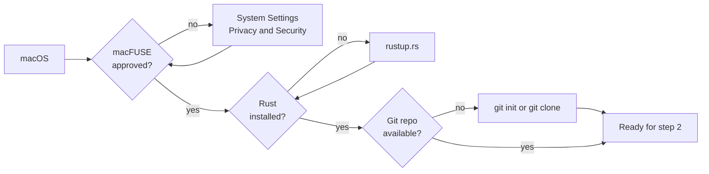
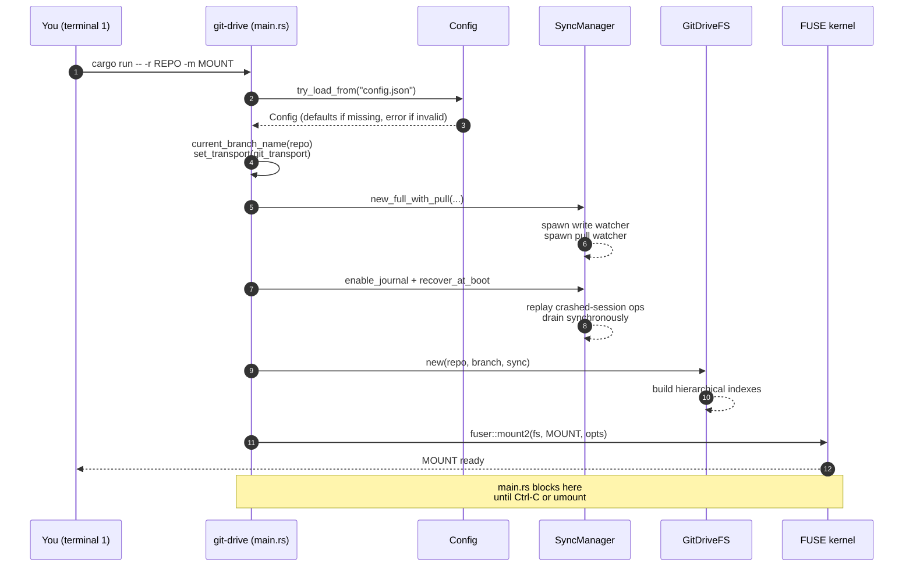

# Usage guide: git-drive step by step

> Portuguese version: [pt-br/uso.md](./pt-br/uso.md)

This guide shows, in the order you should run them, how to prepare the environment, configure credentials, mount a Git repository as a FUSE filesystem, and use git-drive day to day. For the architectural view, see [architecture.md](./architecture.md). For the internal sync mechanics, [sync-flow.md](./sync-flow.md).

## Table of contents

- [1. Prerequisites](#1-prerequisites)
- [2. Prepare the project](#2-prepare-the-project)
- [3. Choose the repository to mount](#3-choose-the-repository-to-mount)
- [4. Create the mount point](#4-create-the-mount-point)
- [5. Configure remote credentials](#5-configure-remote-credentials)
- [6. Adjust `config.json`](#6-adjust-configjson)
- [7. Mount the drive](#7-mount-the-drive)
- [8. Use the filesystem day to day](#8-use-the-filesystem-day-to-day)
- [9. Observe the sync cycle](#9-observe-the-sync-cycle)
- [10. Mount automatically at login (launchd / systemd)](#10-mount-automatically-at-login-launchd--systemd)
- [11. Finder Trash](#11-finder-trash)
- [12. Unmount](#12-unmount)
- [13. Complete scenarios](#13-complete-scenarios)
- [14. Troubleshooting](#14-troubleshooting)
- [How to extend this guide](#how-to-extend-this-guide)

---

## 1. Prerequisites

Before anything else, make sure your system has:

| Dependency | How to install | Check |
| --- | --- | --- |
| macOS or Linux | — | `uname` returns `Darwin` or `Linux` |
| [macFUSE](https://osxfuse.github.io/) (macOS) | `brew install --cask macfuse` | `kextstat \| grep -i fuse` lists the loaded module |
| fuse3 (Linux) | distro package (`fuse3`; e.g. `pacman -S fuse3`, `apt install fuse3`) | `fusermount3 --version` |
| Rust 1.85+ (edition 2021) | `curl --proto '=https' --tlsv1.2 -sSf https://sh.rustup.rs \| sh` | `rustc --version` |
| Git 2.31+ | `brew install git` (or Xcode CLT) / distro package | `git --version` — also used by the daemon for fetch/push (see step 5) |
| A local Git repository | see step 3 | `git -C <path> rev-parse --abbrev-ref HEAD` |

> **macFUSE caveat:** after installing via Homebrew, macOS requires manual approval of the extension under **System Settings → Privacy & Security**. Without it, `fuser::mount2` fails with a generic I/O error.



---

## 2. Prepare the project

Clone and build once before first use.

```bash
git clone <url-of-this-repo> git-drive
cd git-drive
cargo build                    # first build downloads deps (fuser, git2, tokio...)
cargo test                     # optional, validates the toolchain (~315 tests)
```

The binary lands in `target/debug/git-drive`. For an optimized build (recommended once your workflow stabilizes):

```bash
cargo build --release          # binary in target/release/git-drive
```

The rest of this guide uses `cargo run -- ...`, which works for both debug and release. If you prefer calling the binary directly, replace `cargo run --` with `./target/release/git-drive`.

---

## 3. Choose the repository to mount

git-drive mounts **one checked-out branch** of a regular Git repo. Three typical situations:

### 3.1. Repo already cloned

Nothing to do beyond checking the branch:

```bash
cd ~/Projects/my-repo
git rev-parse --abbrev-ref HEAD   # must be a named branch, not "HEAD"
```

If the result is literally `HEAD`, you are in **detached HEAD** state and git-drive aborts at boot. Run `git checkout <branch>` first.

### 3.2. Clone now

```bash
git clone https://github.com/youruser/my-drive.git ~/Projects/my-drive
cd ~/Projects/my-drive
git checkout main              # or the branch you want
```

### 3.3. Create a repository from scratch (local use, no remote)

```bash
mkdir -p ~/Projects/my-drive-local
cd ~/Projects/my-drive-local
git init -b main
echo "# drive" > README.md
git add README.md
git -c user.email=you@example.com -c user.name="You" commit -m "init"
```

Without an `origin`, git-drive still works: local commits are created; only `push` and the pull watcher have nowhere to point (the logs warn about it).

---

## 4. Create the mount point

FUSE requires the mount directory to **already exist** and be **empty**. git-drive does not create it for you.

```bash
mkdir -p /tmp/gitmount
ls -la /tmp/gitmount           # must be empty
```

> Avoid mounting inside the very repo you are going to mount — that creates I/O loops with external watchers.

---

## 5. Configure remote credentials

By default (`"git_transport": "auto"`) git-drive runs fetch and push through the **system `git`
binary**, so it authenticates exactly like a `git fetch` you type in the repo: OpenSSH with your
`~/.ssh/config` (Host aliases, `IdentityFile`, ports), the ssh-agent, the macOS Keychain
(`UseKeychain`) and every key type; HTTPS goes through your credential helper. The daemon never
prompts: it runs with `GIT_TERMINAL_PROMPT=0` and, unless you configured your own
`core.sshCommand`, `ssh -o BatchMode=yes`. A network command that produces no output for 300 s is
killed, so a hung connection never blocks the drive.

| Credential source | When it is used |
| --- | --- |
| `remote_token` in `config.json` | HTTPS remotes. Sent as an `http.extraHeader` (Basic, user `x-access-token`) through the environment — it never appears in the process list. |
| Your normal git/ssh setup | Everything else (SSH remotes, HTTPS without a token). |

**Rule of thumb:** if `git -C <repo> fetch` works in a terminal on that machine (as the same user,
without typing anything), the daemon works too.

`"git_transport": "libgit2"` forces the in-process transport (also the fallback when no `git`
binary exists). It only knows the ssh-agent and the default keys `~/.ssh/id_ed25519`,
`id_ecdsa` and `id_rsa` (without passphrase) — it ignores `~/.ssh/config` and the Keychain.

### 5.1. Using SSH (recommended for personal use)

```bash
ssh -T git@github.com          # should reply "Hi <username>! You've successfully..."
git -C ~/Projects/my-drive fetch --dry-run origin   # must succeed without prompting
```

If the remote URL is already `git@github.com:...` and that works, leave `remote_token: null` in
`config.json`. A key protected by a passphrase must be available non-interactively: in the agent,
or in the macOS Keychain with `UseKeychain yes` for that host in `~/.ssh/config`.

### 5.2. Using an HTTPS token (e.g. GitHub PAT)

1. Generate a PAT at [github.com/settings/tokens](https://github.com/settings/tokens) with the `repo` scope (or a fine-grained one with write access to that repository).
2. Make sure the remote URL is HTTPS:

   ```bash
   git -C ~/Projects/my-drive remote -v
   # origin  https://github.com/youruser/my-drive.git (fetch)
   ```

3. Put the token in `config.json` (step 6). **Never** commit that file — git-drive's `.gitignore` already covers it.

### 5.3. No remote

If the repo is local-only (`git init` without `git remote add`), skip this entire step. The logs will report a push failure on every cycle, but local commits keep working.

---

## 6. Adjust `config.json`

`config.json` lives at **`~/.config/git-drive/config.json`** (next to the encryption key; a
`./config.json` in the CWD takes precedence in the dev flow). Missing → defaults; **present but
invalid → the daemon refuses to start** (a silent fallback would boot with encryption off and
without an identity). Old installations (`~/.config/drive-sync/`, Application Support) are migrated
by `install`.

### 6.1. Complete annotated template

```json
{
  "write_debounce_secs": 5,
  "pull_interval_secs": 60,
  "read_cache_mb": 64,
  "large_file_threshold_mb": 64,
  "chunk_threshold_mb": 95,
  "chunk_size_mb": 80,
  "encryption_enabled": false,
  "encryption_key_file": null,
  "user_name": "Juliano",
  "user_email": "juliano@example.com",
  "remote_token": null,
  "git_transport": "auto"
}
```

| Field | When to adjust |
| --- | --- |
| `write_debounce_secs` | Lower it (`1`–`2`) to see commits faster in dev; raise it (`30`) if you do many bursts of writes and want fewer, larger commits. |
| `pull_interval_secs` | `0` turns off the pull watcher (useful for local-only repos). Raise it if the remote rarely changes, to reduce network calls. |
| `read_cache_mb` | Read cache budget in MiB (default `64`). Raise it for repos with large, frequently read files; `0` disables it (every read goes to the repo, via a persistent handle). |
| `large_file_threshold_mb` | Threshold in MiB above which write buffers go to a spool file on disk instead of RAM (default `64`). Copying a 4 GiB video to the drive does not require 4 GiB of RAM. `0` disables the spool. |
| `chunk_threshold_mb` | A file above this (default `95`) is synced as a manifest + chunks of up to `chunk_size_mb` in `.chunks/` — under GitHub's 100 MB per-file limit. `0` disables it (pushes of large files go back to being rejected by GitHub). |
| `chunk_size_mb` | Maximum size of each chunk (default `80`). |
| `encryption_enabled` | Encryption at rest (see section 8.10). Default `false`. |
| `encryption_key_file` | Path to the key file. Default: `~/.config/git-drive/drive.key`. |
| `user_name` / `user_email` | If either is `null`, git-drive **applies the changes to the working tree but does not commit**. Fill in both to get history. |
| `remote_token` | PAT for HTTPS. `null` falls back to your git/ssh setup. |
| `git_transport` | `auto` (default: system `git` when available), `cli` or `libgit2`. Only change it if `git` is missing or misbehaves on that machine. |

### 6.2. Quick recipe per scenario

**Local-only repo, no remote:**

```json
{
  "write_debounce_secs": 3,
  "pull_interval_secs": 0,
  "user_name": "You",
  "user_email": "you@example.com",
  "remote_token": null
}
```

**GitHub via SSH (ssh-agent active):**

```json
{
  "write_debounce_secs": 5,
  "pull_interval_secs": 60,
  "user_name": "You",
  "user_email": "you@example.com",
  "remote_token": null
}
```

**GitHub via HTTPS with a PAT:**

```json
{
  "write_debounce_secs": 5,
  "pull_interval_secs": 60,
  "user_name": "You",
  "user_email": "you@example.com",
  "remote_token": "github_pat_xxxxxxxxxxxxxxxxxxxxxxxx"
}
```

---

## 7. Mount the drive

With the repo chosen, an empty mount point, and `config.json` saved:

```bash
cargo run -- -r ~/Projects/my-drive -m /tmp/gitmount
```

Expected output in the first seconds:

```text
[12:04:01.100] boot: debounce=5s
[12:04:01.101] boot: repo=/Users/you/Projects/my-drive
[12:04:01.101] boot: mount=/tmp/gitmount
[12:04:01.102] boot: branch=main
```

The process stays **in the foreground** — the `fuser::mount2` call blocks. Open another terminal to interact with the drive. Ctrl-C in the mount terminal shuts the filesystem down.



---

## 8. Use the filesystem day to day

With `/tmp/gitmount` mounted, treat it like any directory. Below, the supported operations (v0.2.0).

### 8.1. Create a file

```bash
echo "hello" > /tmp/gitmount/hello.txt
```

Internal flow: `create` → write buffer → `flush` → `queue_write` → debounce of `write_debounce_secs` → `apply_op_to_disk` in the repo → `commit_working_tree` → `push_to_remote`.

### 8.2. Edit a file

```bash
echo "one more line" >> /tmp/gitmount/hello.txt
```

Edits take the same path. The final commit message is:

```text
git-drive: 1 changes (hello.txt)
```

### 8.3. Create a directory

```bash
mkdir /tmp/gitmount/notes
```

Since Git does not track empty directories, git-drive creates a `.gitkeep` inside. When the first real file arrives, the `.gitkeep` is removed automatically.

### 8.4. Files in subdirectories

```bash
mkdir -p /tmp/gitmount/notes/2026
echo "apr/24" > /tmp/gitmount/notes/2026/entry.md
```

### 8.5. Rename / move

```bash
mv /tmp/gitmount/hello.txt /tmp/gitmount/notes/hello.txt
```

The kernel emits `rename`; git-drive enqueues a `SyncOp::Rename` which, in the working tree, becomes delete + create (Git detects the rename heuristically at commit time).

### 8.6. Remove a file or directory

```bash
rm /tmp/gitmount/notes/hello.txt
rmdir /tmp/gitmount/notes/2026   # must be empty
```

### 8.7. Symlinks

`ln -s target link` works: the symlink is committed as a `120000` entry (the same representation as
plain Git) and reaches the remote. The target is opaque text — git-drive never resolves or
validates it; a symlink with an absolute target created on one machine is broken on another,
exactly as in a regular clone.

### 8.8. Ignored files (`.gitignore`)

Files matching the mounted repo's `.gitignore` are **visible local-only**: they show up in the
drive and persist in the working tree across remounts, but **never enter a commit or a push**. This
is the drive's exclusion mechanism — there is no separate allowlist. For a local policy without
touching the repo's `.gitignore`, use `.git/info/exclude`. Note: local-only files do not sync
across machines.

### 8.9. Large files (chunking)

A file above `chunk_threshold_mb` (default 95 MiB) is synced in pieces: in the repo, the path
becomes a small text **manifest** and the content goes to `.chunks/<2 hex>/<sha256>`, each chunk
below GitHub's 100 MB per-file limit. **In the drive you notice nothing** — the file appears
whole, with its real size, and reads are reassembled with integrity verification.

What a plain Git clone (without git-drive) sees: the manifest and the `.chunks/` directory.
Manual recovery of a file:

```bash
# the manifest lists the hashes in order; concatenate the chunks:
grep '^sha256 ' file.zip | awk '{print ".chunks/" substr($2,1,2) "/" $2}' | xargs cat > recovered-file.zip
```

Do not create your own content inside `.chunks/` — the directory is reserved and git-drive's GC
removes anything no manifest references.

### 8.10. Encryption at rest (a public repo as a drive)

With encryption enabled, the repo — including the local working tree — stores **everything
encrypted** (content and names, XChaCha20-Poly1305); only the mounted drive presents the files in
the clear. You can even use a public GitHub repo as a drive: without the key, it is just a tree of
opaque blobs.

Step by step:

```bash
# 1. Generate the key (once; back it up OUTSIDE the repo — without it the data is unrecoverable)
git-drive key generate

# 2. Enable it in config.json
#    "encryption_enabled": true

# 3. Restart the daemon. The next drain migrates all existing content to encrypted form.
```

| What to know | Detail |
| --- | --- |
| Migration | Changing `encryption_enabled` migrates the worktree automatically on the next drain, in both directions. |
| Old history | Enabling it later does NOT protect the past: old commits remain readable on the remote. For a public repo, start from a fresh repo. |
| Multi-machine | Copy the key file (`~/.config/git-drive/drive.key`) to the other machine, with 0600 permissions. |
| Lost key | Data is unrecoverable — there is no backdoor. |
| What remains visible | Approximate sizes, file/folder counts, tree depth, and commit cadence. Anyone who already has an identical file can confirm it is in the repo (convergent encryption, required for Git). |
| `.gitignore`/local-only | Disabled in encrypted mode (rules would match against encrypted names). |
| Long names | A name component longer than ~119 bytes cannot be created in encrypted mode (the filesystem's 255-byte limit after encryption). |

### 8.11. What does **not** work

| Operation | Reason |
| --- | --- |
| Hardlinks (`ln`) | Simulated as a copy (1 inode = 1 path model). |
| `chmod` / `chown` | `chmod` is accepted in memory only (does not persist across mounts); `chown` is ignored; `uid`/`gid` are those of the mounting process. |
| FIFOs, sockets, device files | Only `RegularFile`, `Directory`, and `Symlink`. |
| Modifying `.git/` | The mounted repo's own `.git` is not exposed via FUSE. |
| Git LFS | Repos with LFS show the text pointer, not the content (libgit2 without smudge/clean filters). |

---

## 9. Observe the sync cycle

### 9.1. Process logs

Session logs live in `logs/git-drive-<timestamp>.log` (the path is announced at boot; use `-v` to mirror them to the terminal). Each drain cycle prints:

```text
[14:32:07.101] drain: syncing changes
[14:32:07.104] disk: write hello.txt
[14:32:07.130] commit: created ab12cd3...
[14:32:07.512] push: origin ok
```

When the pull watcher runs:

```text
[14:33:05.220] pull: fast-forward applied
[14:33:06.341] refresh: index rebuilt in 1.1s (70981 files)
```

At boot the daemon reports how long the index took (`boot: index of N files built in ...`, with the
listing/names/mtimes breakdown) and which network transport it uses (`boot: git transport=Cli`).
A `push: origin moved (another client pushed) — reconciling` warning is the normal concurrent case
(another machine pushed first); it is followed by a merge and a new push.

### 9.1.1. `git-drive status`

A summary of the state without reading the raw log — run it from the same directory the daemon was launched from (or point at the file with `--file`):

```bash
git-drive status
git-drive status --file /other/path/status.json
```

Typical output:

```text
git-drive — branch main
  repo: /Users/you/Projects/my-drive
  daemon: running (pid 4242)
  started 2 h 10 min ago | updated 12 s ago
  pending ops: 0
  last drain: 1 min ago — 3 op(s), commit ab12cd3f, push ok
  last pull: 12 s ago — up to date
  conflicts this session: none
```

The daemon writes `status.json` (atomic write) on every boot, drain, pull, and stop event. If `updated_at` is old and the pid does not respond, the subcommand flags "POSSIBLY STOPPED". A recurring pull "skipped: dirty working tree" in identity-less mode indicates local writes that were never committed are blocking the pull (see the limitations).

### 9.1.2. Menu bar tray

```bash
git-drive tray
```

A circular icon with the drive state: green (synced), orange (pending ops), red (conflict or
failed push), gray (daemon stopped or stale status). The menu offers the status summary,
"Open drive in Finder", "View live log" (Terminal with `tail -f`), "Detailed status", and
"Quit tray". Install it together with the daemon via `git-drive install ... --with-tray` to start it at login.

### 9.1.3. Notifications

The daemon notifies via Notification Center on macOS (attributed to "Script Editor") and via
`notify-send` on Linux: merge conflict (with the clear names of the conflicted copies), failing
push and pull blocked by a dirty working tree (both at most once per hour while they persist), and
drive mounted/unmounted.

## 10. Mount automatically at login (launchd / systemd)

```bash
git-drive install -r ~/Projects/my-drive -m ~/GitDrive --with-tray
```

The same command works on both platforms. In both cases it first copies the running binary to
**`~/.local/bin/git-drive`** and points the service there — the service never references a build
tree, so moving or rebuilding the project cannot break it. It also migrates config/key from legacy
locations to `~/.config/git-drive/` and, if no config exists yet, copies `./config.json` from the
current directory.

| | macOS (LaunchAgent) | Linux (systemd user units) |
| --- | --- | --- |
| Service files | `~/Library/LaunchAgents/dev.giacomeli.git-drive.plist` (+ `.tray.plist`) | `~/.config/systemd/user/git-drive.service` (+ `git-drive-tray.service`) |
| Restart policy | KeepAlive `{SuccessfulExit=false}` | `Restart=on-failure`, `TimeoutStopSec=90` |
| Logs | `~/Library/Logs/git-drive/` | `~/.local/state/git-drive/logs/` (`$XDG_STATE_HOME` honored) |
| Status | `~/Library/Application Support/git-drive/status.json` | `~/.local/state/git-drive/status.json` |
| Legacy (`drive-sync`) services | taken down, plists removed | stopped, unit files kept as `<unit>.bak` |

`git-drive status` finds the status file on its own from any directory. On Linux, without
`loginctl enable-linger $USER` the drive only runs while you are logged in (the install prints the
hint); the tray needs a graphical session (on GNOME, the AppIndicator extension).

- **Clean stop:** SIGTERM (launchctl/systemctl, logout) or an eject drains the pending queue
  (commit + push) before exiting — nothing is lost. A clean stop is not restarted.
- **Crash:** the service manager restarts the daemon, which recovers the zombie mount left by the
  dead process. Writes the dead process had already acknowledged are not lost either: every queued
  operation is journaled in `.git/git-drive-journal/` before it is acknowledged, and the next boot
  replays and commits them **before** the volume appears (the log shows
  `journal: N op(s) from an interrupted session replayed`). The journal survives process crashes
  (kill -9, panic, OOM), not a power cut within the OS write-back window.
- **Remove:** `git-drive uninstall` (stops the daemon, unmounts, and removes the service, including the tray).

## 11. Finder Trash

Moving items from the drive to the Trash removes them from the repository (it becomes a commit) but
keeps them visible and recoverable in the Finder Trash for as long as the mount lives — restoring
rematerializes them in the repo. Emptying the Trash (or unmounting/remounting) frees the memory and
makes the removal final on the volume.

### 9.2. Check the real repo

In a third terminal (not the mount one, nor the usage one):

```bash
cd ~/Projects/my-drive
git log --oneline -5
git status
git log origin/main..main      # unpushed commits (should be empty after push)
```

### 9.3. Check the remote

```bash
git fetch origin
git log origin/main --oneline -5
```

---

## 12. Unmount

Any of the forms below performs a **clean stop**: the volume unmounts, the pending queue is drained
(commit + push, even for what was mid-debounce), and the status records the shutdown.

### 12.1. Ctrl-C (or SIGTERM) on the mount process

```bash
# in the mount terminal: Ctrl-C
# or from outside:
pkill -TERM -f 'git-drive -r'
```

### 12.2. Eject in Finder / external `umount`

```bash
umount ~/GitDrive              # or: diskutil unmount ~/GitDrive
```

The daemon detects the end of the session, drains the queue, and exits. On "device busy", close the
processes holding open file descriptors on the mount (`lsof ~/GitDrive`).

### 12.3. Via launchd

```bash
git-drive uninstall           # stops it for good (removes the agents)
launchctl kill TERM gui/$UID/dev.giacomeli.git-drive   # stops just this instance (KeepAlive does NOT restart exit 0)
```

Confirm with `git-drive status` — it should show "stopped cleanly".

---

## 13. Complete scenarios

### 11.1. Scenario A — local drive with commits, no remote

```bash
# 1. Local repo
mkdir -p ~/drives/notes && cd ~/drives/notes
git init -b main
git -c user.email=eu@ex.com -c user.name=Eu commit --allow-empty -m "init"
cd -

# 2. config.json (git-drive root)
cat > config.json <<'EOF'
{
  "write_debounce_secs": 2,
  "pull_interval_secs": 0,
  "user_name": "Me",
  "user_email": "eu@ex.com",
  "remote_token": null
}
EOF

# 3. Mount
mkdir -p /tmp/notes-mount
cargo run -- -r ~/drives/notes -m /tmp/notes-mount

# (another terminal)
echo "ola" > /tmp/notes-mount/first.md
# ...wait ~2s...
git -C ~/drives/notes log --oneline
# git-drive: 1 changes (first.md)
# init
```

### 11.2. Scenario B — drive connected to a GitHub repo via SSH

```bash
# 1. Clone and branch
git clone git@github.com:usuario/drive.git ~/drives/drive
cd ~/drives/drive
git checkout main
cd -

# 2. config.json — ssh-agent handles the credentials
cat > config.json <<'EOF'
{
  "write_debounce_secs": 5,
  "pull_interval_secs": 30,
  "user_name": "Usuario",
  "user_email": "usuario@example.com",
  "remote_token": null
}
EOF

# 3. Mount
mkdir -p /tmp/drive-mount
cargo run -- -r ~/drives/drive -m /tmp/drive-mount

# (another terminal)
mkdir /tmp/drive-mount/folder
echo "content" > /tmp/drive-mount/folder/file.md
# after ~5s: commit + push to github

# On another machine (or a manual pull on github)
# ... remote changes arrive in ~30s via the pull watcher
```

### 11.3. Scenario C — collaborative drive via HTTPS + PAT

```bash
# 1. Repo already existing over HTTPS
git clone https://github.com/equipe/drive-compartilhado.git ~/drives/compartilhado

# 2. PAT in config.json
cat > config.json <<'EOF'
{
  "write_debounce_secs": 10,
  "pull_interval_secs": 15,
  "user_name": "You",
  "user_email": "voce@empresa.com",
  "remote_token": "github_pat_xxxxxxxxxxxxxxxxxxxxxxxx"
}
EOF
# git-drive's .gitignore already protects config.json

# 3. Mount
mkdir -p /tmp/compartilhado
cargo run -- -r ~/drives/compartilhado -m /tmp/compartilhado
```

---

## 14. Troubleshooting

| Symptom | Likely cause | Action |
| --- | --- | --- |
| `mount2` fails with "No such file or directory" | The mount directory does not exist. | `mkdir -p <mount_path>` before the command. |
| `mount2` fails with a generic error on macOS | macFUSE not approved in **Privacy & Security**. | Approve it in the UI; reboot the Mac if needed. |
| `current_branch_name` returns a "HEAD detached" error | Repo in detached HEAD. | `git checkout <branch>` in the real repo. |
| Writes show up in the drive but there is no commit | `user_name` or `user_email` is `null` in `config.json`. | Fill in both. |
| Daemon exits at boot with `invalid config ...` | `config.json` exists but is not valid JSON (or a field has the wrong type). | Fix the file; the daemon refuses to guess. |
| `pull: fetch error` / `push failed` in the log | The machine cannot reach or authenticate to the remote non-interactively. | Run `git -C <repo> fetch origin` as the same user, in a plain shell: it must work without prompting. The log line carries git's own error message. |
| Commit OK but push fails with `authentication required` | HTTPS without `remote_token` and without a credential helper, or a passphrase-protected SSH key that is not in the agent/Keychain. | Set `remote_token`, configure a credential helper, or make the key available non-interactively. |
| Commits stay unpublished while offline | Expected: they are kept locally. | Nothing to do — the next successful pull cycle publishes them (`push: origin ok` in the log). |
| Push fails with `403` / `404` | PAT without the `repo` scope, or wrong URL. | Regenerate the PAT with the right scope; check `git remote -v`. |
| Pull watcher logs `not fast-forward` | Identity-less mode (no `user_name`/`user_email`) and history diverged — FF-only cannot merge. | Configure an identity (3-way merge with conflicted copies), or resolve manually in the real repo. |
| A remote change takes up to ~1s to appear | Kernel `getattr` cache (TTL ~1s). | Wait, or re-list (`ls`) the parent directory. |
| "device busy" on `umount` | A process with an open FD on the mount. | `lsof /tmp/gitmount` to find and close it. |
| `cargo run` hangs after Ctrl-C | The kernel did not release the mount. | Manual `umount /tmp/gitmount`; as a last resort, `diskutil unmount force`. |
| Large-file buffers seem to "disappear" | The debounce has not drained yet. | Wait `write_debounce_secs` before checking `git log`. |

---

## How to extend this guide

- If you add a new FUSE operation in `src/fs.rs`, list it in [8.1–8.6](#8-use-the-filesystem-day-to-day) or [8.11](#811-what-does-not-work), as appropriate.
- If a new field appears in `config.json`, update the table in [6.1](#61-complete-annotated-template) and, when relevant, add a recipe in [6.2](#62-quick-recipe-per-scenario).
- When changing the credential strategy or the transport in `src/git.rs`, revisit [5](#5-configure-remote-credentials).
- When changing the process logs (messages, format), update [9.1](#91-process-logs) to reflect the real text.

---

## References

- [README.md](../README.md) — overview and quick start
- [architecture.md](./architecture.md) — layers, data structures, limitations
- [sync-flow.md](./sync-flow.md) — watchers, debounce, pull
- [fuse-filesystem.md](./fuse-filesystem.md) — inode model and FUSE operations
- [AGENTS.md](../AGENTS.md) — guidance for contributors and agents
