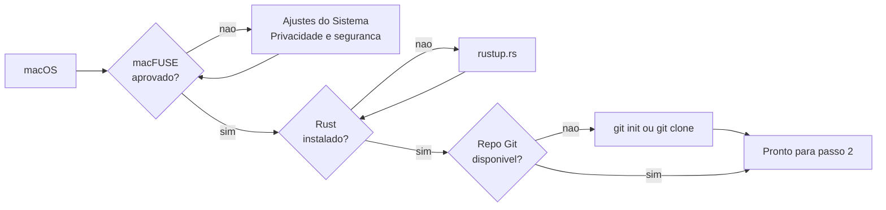
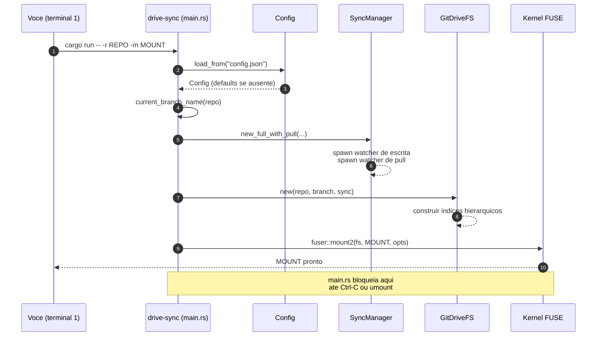

# Guia de uso: drive-sync passo a passo

Este guia mostra, na ordem em que você deve executar, como preparar o ambiente, configurar credenciais, montar um repositório Git como filesystem FUSE e usar o drive-sync no dia a dia. Para a visão arquitetural, consulte [arquitetura.md](./arquitetura.md). Para mecânica interna de sincronização, [fluxo-de-sincronizacao.md](./fluxo-de-sincronizacao.md).

## Sumário

- [1. Pré-requisitos](#1-pré-requisitos)
- [2. Preparar o projeto](#2-preparar-o-projeto)
- [3. Escolher o repositório a montar](#3-escolher-o-repositório-a-montar)
- [4. Criar o ponto de montagem](#4-criar-o-ponto-de-montagem)
- [5. Configurar credenciais do remote](#5-configurar-credenciais-do-remote)
- [6. Ajustar `config.json`](#6-ajustar-configjson)
- [7. Montar o drive](#7-montar-o-drive)
- [8. Usar o filesystem no dia a dia](#8-usar-o-filesystem-no-dia-a-dia)
- [9. Observar o ciclo de sincronização](#9-observar-o-ciclo-de-sincronização)
- [10. Desmontar](#10-desmontar)
- [11. Cenários completos](#11-cenários-completos)
- [12. Troubleshooting](#12-troubleshooting)
- [Como estender este guia](#como-estender-este-guia)

---

## 1. Pré-requisitos

Antes de qualquer coisa, garanta que seu sistema tem:

| Dependência | Como instalar | Verificação |
| --- | --- | --- |
| macOS (Darwin) | — | `uname` deve retornar `Darwin` |
| [macFUSE](https://osxfuse.github.io/) | `brew install --cask macfuse` | `kextstat \| grep -i fuse` lista módulo carregado |
| Rust 1.70+ (edition 2021) | `curl --proto '=https' --tlsv1.2 -sSf https://sh.rustup.rs \| sh` | `rustc --version` |
| Git 2.x | `brew install git` (ou Xcode CLT) | `git --version` |
| Um repositório Git local | ver passo 3 | `git -C <path> rev-parse --abbrev-ref HEAD` |

> **Atenção macFUSE:** após instalar via Homebrew, o macOS exige aprovação manual da extensão em **Ajustes do Sistema → Privacidade e segurança**. Sem isso, `fuser::mount2` falha com erro genérico de I/O.



---

## 2. Preparar o projeto

Clone e compile uma vez antes do primeiro uso.

```bash
git clone <url-deste-repo> drive-sync
cd drive-sync
cargo build                    # primeiro build baixa deps (fuser, git2, tokio...)
cargo test                     # opcional, valida toolchain (~78 testes)
```

O binário fica em `target/debug/drive-sync`. Para build otimizada (recomendado após estabilizar seu fluxo):

```bash
cargo build --release          # binario em target/release/drive-sync
```

O restante deste guia usa `cargo run -- ...`, que funciona para debug e release. Se preferir chamar o binário diretamente, substitua `cargo run --` por `./target/release/drive-sync`.

---

## 3. Escolher o repositório a montar

drive-sync monta **um branch checked-out** de um repo Git comum. Três situações típicas:

### 3.1. Repo já clonado

Nada a fazer além de checar o branch:

```bash
cd ~/Projects/meu-repo
git rev-parse --abbrev-ref HEAD   # precisa ser um branch nomeado, nao "HEAD"
```

Se o resultado for literalmente `HEAD`, você está em **detached HEAD** e o drive-sync aborta no boot. Faça `git checkout <branch>` antes.

### 3.2. Clonar agora

```bash
git clone https://github.com/usuario/meu-drive.git ~/Projects/meu-drive
cd ~/Projects/meu-drive
git checkout main              # ou o branch desejado
```

### 3.3. Criar repositório do zero (uso local, sem remote)

```bash
mkdir -p ~/Projects/meu-drive-local
cd ~/Projects/meu-drive-local
git init -b main
echo "# drive" > README.md
git add README.md
git -c user.email=voce@example.com -c user.name="Voce" commit -m "init"
```

Sem `origin`, o drive-sync ainda funciona: commits locais são criados, apenas `push` e o pull watcher não têm para onde apontar (logs avisam).

---

## 4. Criar o ponto de montagem

FUSE exige que o diretório de montagem **já exista** e esteja **vazio**. O drive-sync não cria por você.

```bash
mkdir -p /tmp/gitmount
ls -la /tmp/gitmount           # tem que estar vazio
```

> Evite montar dentro do próprio repo que você vai montar — isso gera loops de I/O com watchers externos.

---

## 5. Configurar credenciais do remote

drive-sync usa a seguinte ordem de preferência para autenticar `git push` / `git fetch`:

1. **`remote_token` do `config.json`** (HTTPS, PAT plain-text) — se presente, vira `Cred::userpass_plaintext("git", <token>)`.
2. **ssh-agent / credential helper do sistema** — fallback quando `remote_token` é `null`.

### 5.1. Usando SSH (recomendado para uso pessoal)

```bash
ssh-add -l                     # lista chaves carregadas no agent
ssh -T git@github.com          # deve responder "Hi <usuario>! You've successfully..."
```

Se a URL do remote já é `git@github.com:...` e o agent tem a chave, deixe `remote_token: null` no `config.json`.

### 5.2. Usando token HTTPS (ex.: GitHub PAT)

1. Gere um PAT em [github.com/settings/tokens](https://github.com/settings/tokens) com escopo `repo` (ou fine-grained com write nesse repositório).
2. Garanta que a URL do remote é HTTPS:

   ```bash
   git -C ~/Projects/meu-drive remote -v
   # origin  https://github.com/usuario/meu-drive.git (fetch)
   ```

3. Coloque o token em `config.json` (passo 6). **Nunca** comite esse arquivo — `.gitignore` do drive-sync já cobre.

### 5.3. Sem remote

Se o repo é local-only (`git init` sem `git remote add`), ignore esta etapa inteira. Os logs vão reportar falha de push a cada ciclo, mas commits locais continuam funcionando.

---

## 6. Ajustar `config.json`

`config.json` fica na **raiz do projeto drive-sync** (não do repo montado). Ausente → defaults silenciosos; inválido → defaults com log de aviso.

### 6.1. Template completo comentado

```json
{
  "write_debounce_secs": 5,
  "pull_interval_secs": 60,
  "read_cache_mb": 64,
  "user_name": "Juliano",
  "user_email": "juliano@example.com",
  "remote_token": null
}
```

| Campo | Quando ajustar |
| --- | --- |
| `write_debounce_secs` | Diminua (`1`–`2`) para ver commits mais rápido em dev; aumente (`30`) se fizer muitas escritas em rajada para agrupar em menos commits. |
| `pull_interval_secs` | `0` desliga o pull watcher (útil em repos locais-only). Aumente se o remote muda pouco para reduzir chamadas de rede. |
| `read_cache_mb` | Orçamento do cache de leitura em MiB (default `64`). Aumente para repos com arquivos grandes lidos com frequência; `0` desativa (cada leitura reabre o repo). |
| `user_name` / `user_email` | Se qualquer um for `null`, drive-sync **aplica as mudanças no working tree mas não commita**. Deixe ambos preenchidos para ter histórico. |
| `remote_token` | PAT para HTTPS. `null` cai para ssh-agent / credential helper. |

### 6.2. Receita rápida por cenário

**Repo local-only, sem remote:**

```json
{
  "write_debounce_secs": 3,
  "pull_interval_secs": 0,
  "user_name": "Voce",
  "user_email": "voce@example.com",
  "remote_token": null
}
```

**GitHub via SSH (ssh-agent ativo):**

```json
{
  "write_debounce_secs": 5,
  "pull_interval_secs": 60,
  "user_name": "Voce",
  "user_email": "voce@example.com",
  "remote_token": null
}
```

**GitHub via HTTPS com PAT:**

```json
{
  "write_debounce_secs": 5,
  "pull_interval_secs": 60,
  "user_name": "Voce",
  "user_email": "voce@example.com",
  "remote_token": "github_pat_xxxxxxxxxxxxxxxxxxxxxxxx"
}
```

---

## 7. Montar o drive

Com repo escolhido, ponto de montagem vazio e `config.json` salvo:

```bash
cargo run -- -r ~/Projects/meu-drive -m /tmp/gitmount
```

Saída esperada nos primeiros segundos:

```text
🛠️ Debounce: 5s
🔗 Repositório Git: /Users/voce/Projects/meu-drive
📂 Montando em: /tmp/gitmount
🌿 Branch ativo: main
```

O processo fica **em primeiro plano** — a chamada a `fuser::mount2` é bloqueante. Abra outro terminal para interagir com o drive. Ctrl-C no terminal da montagem desliga o filesystem.



---

## 8. Usar o filesystem no dia a dia

Com `/tmp/gitmount` montado, trate-o como qualquer diretório. Abaixo, as operações suportadas (v0.1.0).

### 8.1. Criar arquivo

```bash
echo "hello" > /tmp/gitmount/hello.txt
```

Fluxo interno: `create` → buffer de escrita → `flush` → `queue_write` → debounce de `write_debounce_secs` → `apply_op_to_disk` no repo → `commit_working_tree` → `push_to_remote`.

### 8.2. Editar arquivo

```bash
echo "mais uma linha" >> /tmp/gitmount/hello.txt
```

Edições usam o mesmo caminho. O commit final tem mensagem:

```text
drive-sync: 1 changes (hello.txt)
```

### 8.3. Criar diretório

```bash
mkdir /tmp/gitmount/notas
```

Como Git não rastreia diretórios vazios, drive-sync cria um `.gitkeep` dentro. Quando o primeiro arquivo real chega, o `.gitkeep` é removido automaticamente.

### 8.4. Arquivos em subdiretórios

```bash
mkdir -p /tmp/gitmount/notas/2026
echo "abr/24" > /tmp/gitmount/notas/2026/entrada.md
```

### 8.5. Renomear / mover

```bash
mv /tmp/gitmount/hello.txt /tmp/gitmount/notas/hello.txt
```

O kernel emite `rename`; drive-sync enfileira `SyncOp::Rename` que, no working tree, vira delete + create (Git detecta rename por heurística no commit).

### 8.6. Remover arquivo ou diretório

```bash
rm /tmp/gitmount/notas/hello.txt
rmdir /tmp/gitmount/notas/2026   # precisa estar vazio
```

### 8.7. O que **não** funciona (v0.1.0)

| Operação | Motivo |
| --- | --- |
| Symlinks (`ln -s`) | `FileType::Symlink` fora do escopo. |
| Hardlinks (`ln`) | idem. |
| `chmod` / `chown` | `perm` fixo `0o644`/`0o755`, `uid`/`gid` = 1000. |
| FIFOs, sockets, device files | Só `RegularFile` e `Directory`. |
| Modificar `.git/` | O próprio `.git` do repo montado não é exposto via FUSE. |

---

## 9. Observar o ciclo de sincronização

### 9.1. Logs do processo

Os logs da sessão ficam em `logs/drive-sync-<timestamp>.log` (o path é anunciado no boot; use `-v` para espelhar no terminal). Cada ciclo de drain imprime:

```text
[14:32:07.101] drain: sincronizando alterações
[14:32:07.104] disk: write hello.txt
[14:32:07.130] commit: criado ab12cd3...
[14:32:07.512] push: origin ok
```

Quando o pull watcher roda:

```text
[14:33:05.220] pull: fast-forward aplicado
```

### 9.1.1. `drive-sync status`

Resumo do estado sem ler log cru — rode do mesmo diretório de onde o daemon foi lançado (ou aponte com `--file`):

```bash
drive-sync status
drive-sync status --file /outro/caminho/status.json
```

Saída típica:

```text
drive-sync — branch main
  repo: /Users/voce/Projects/meu-drive
  daemon: rodando (pid 4242)
  iniciado há 2 h 10 min | atualizado há 12 s
  ops pendentes: 0
  último drain: há 1 min — 3 op(s), commit ab12cd3f, push ok
  último pull: há 12 s — sem novidades
  conflitos na sessão: nenhum
```

O daemon grava `logs/status.json` (escrita atômica) a cada evento de boot, drain e pull. Se `updated_at` estiver velho e o pid não responder, o subcomando sinaliza "POSSIVELMENTE PARADO". Um pull com "pulado: working tree sujo" recorrente no modo sem identidade indica escritas locais nunca commitadas bloqueando o pull (ver limitações).

### 9.2. Verificar no repo real

Em terceiro terminal (não é o do mount, nem o de uso):

```bash
cd ~/Projects/meu-drive
git log --oneline -5
git status
git log origin/main..main      # commits nao-enviados (deve ficar vazio apos push)
```

### 9.3. Verificar remote

```bash
git fetch origin
git log origin/main --oneline -5
```

---

## 10. Desmontar

Duas formas, nesta ordem de preferência:

### 10.1. Ctrl-C no terminal do mount

Mais limpo. `fuser::mount2` captura o sinal e libera o ponto de montagem. Qualquer lote pendente **não é drenado** — fique de olho no último log para confirmar que o debounce já rodou antes de sair.

### 10.2. `umount` externo

```bash
umount /tmp/gitmount           # ou: diskutil unmount /tmp/gitmount
```

Útil se o terminal original foi perdido. Em caso de "device busy", feche processos que ainda têm file descriptors no mount (`lsof /tmp/gitmount`).

### 10.3. Boas práticas antes de desmontar

1. Aguardar pelo menos `write_debounce_secs` segundos após a última escrita.
2. Confirmar no log que o último lote fez commit + push.
3. Conferir `git log` no repo real.

---

## 11. Cenários completos

### 11.1. Cenário A — drive local com commits, sem remote

```bash
# 1. Repo local
mkdir -p ~/drives/notas && cd ~/drives/notas
git init -b main
git -c user.email=eu@ex.com -c user.name=Eu commit --allow-empty -m "init"
cd -

# 2. config.json (raiz do drive-sync)
cat > config.json <<'EOF'
{
  "write_debounce_secs": 2,
  "pull_interval_secs": 0,
  "user_name": "Eu",
  "user_email": "eu@ex.com",
  "remote_token": null
}
EOF

# 3. Montar
mkdir -p /tmp/notas-mount
cargo run -- -r ~/drives/notas -m /tmp/notas-mount

# (outro terminal)
echo "ola" > /tmp/notas-mount/primeira.md
# ...aguardar ~2s...
git -C ~/drives/notas log --oneline
# drive-sync: 1 changes (primeira.md)
# init
```

### 11.2. Cenário B — drive conectado a repo GitHub via SSH

```bash
# 1. Clone e branch
git clone git@github.com:usuario/drive.git ~/drives/drive
cd ~/drives/drive
git checkout main
cd -

# 2. config.json — ssh-agent cuida das credenciais
cat > config.json <<'EOF'
{
  "write_debounce_secs": 5,
  "pull_interval_secs": 30,
  "user_name": "Usuario",
  "user_email": "usuario@example.com",
  "remote_token": null
}
EOF

# 3. Montar
mkdir -p /tmp/drive-mount
cargo run -- -r ~/drives/drive -m /tmp/drive-mount

# (outro terminal)
mkdir /tmp/drive-mount/pasta
echo "conteudo" > /tmp/drive-mount/pasta/arq.md
# apos ~5s: commit + push para github

# Em outra maquina (ou pull manual no github)
# ... mudancas remotas chegam em ~30s via pull watcher
```

### 11.3. Cenário C — drive colaborativo via HTTPS + PAT

```bash
# 1. Repo ja existente em HTTPS
git clone https://github.com/equipe/drive-compartilhado.git ~/drives/compartilhado

# 2. PAT no config.json
cat > config.json <<'EOF'
{
  "write_debounce_secs": 10,
  "pull_interval_secs": 15,
  "user_name": "Voce",
  "user_email": "voce@empresa.com",
  "remote_token": "github_pat_xxxxxxxxxxxxxxxxxxxxxxxx"
}
EOF
# .gitignore do drive-sync ja protege config.json

# 3. Montar
mkdir -p /tmp/compartilhado
cargo run -- -r ~/drives/compartilhado -m /tmp/compartilhado
```

---

## 12. Troubleshooting

| Sintoma | Causa provável | Ação |
| --- | --- | --- |
| `mount2` falha com "No such file or directory" | Diretório de montagem não existe. | `mkdir -p <mount_path>` antes do comando. |
| `mount2` falha com erro genérico no macOS | macFUSE não aprovado em **Privacidade e segurança**. | Aprovar na UI, reiniciar o mac se necessário. |
| `current_branch_name` retorna erro "HEAD detached" | Repo em detached HEAD. | `git checkout <branch>` no repo real. |
| Escritas aparecem no drive mas não há commit | `user_name` ou `user_email` `null` no `config.json`. | Preencher ambos. |
| Commit OK mas push falha com `authentication required` | `remote_token` ausente e ssh-agent sem chave. | Carregar chave (`ssh-add`) ou preencher `remote_token`. |
| Push falha com `403` / `404` | PAT sem escopo `repo` ou URL errada. | Regerar PAT com escopo certo, conferir `git remote -v`. |
| Pull watcher loga `not fast-forward` | Histórico divergiu (commit local + commit remoto paralelo). | Ctrl-C o drive-sync, resolver no repo real (`git pull --rebase`), remontar. |
| Mudança no remote demora até ~1s para aparecer | Cache de `getattr` do kernel (TTL ~1s). | Aguardar, ou re-listar (`ls`) o diretório pai. |
| "device busy" no `umount` | Processo com FD aberto no mount. | `lsof /tmp/gitmount` para achar e fechar. |
| `cargo run` trava depois de Ctrl-C | Kernel não liberou o mount. | `umount /tmp/gitmount` manual; em último caso `diskutil unmount force`. |
| Buffers de arquivos grandes parecem "sumir" | Debounce ainda não drenou. | Aguardar `write_debounce_secs` antes de checar `git log`. |

---

## Como estender este guia

- Se você adicionar uma nova operação FUSE em `src/fs.rs`, liste em [8.1–8.6](#8-usar-o-filesystem-no-dia-a-dia) ou [8.7](#87-o-que-não-funciona-v010) conforme o caso.
- Se surgir novo campo em `config.json`, atualize a tabela de [6.1](#61-template-completo-comentado) e, quando for relevante, adicione receita em [6.2](#62-receita-rápida-por-cenário).
- Ao mudar a estratégia de credenciais em `src/git.rs`, revisite [5](#5-configurar-credenciais-do-remote).
- Ao mudar logs do processo (mensagens, emojis), atualize [9.1](#91-logs-do-processo) para refletir o texto real.

---

## Referências

- [README.md](../README.md) — visão geral e quick start
- [arquitetura.md](./arquitetura.md) — camadas, estruturas de dados, limitações
- [fluxo-de-sincronizacao.md](./fluxo-de-sincronizacao.md) — watchers, debounce, pull
- [filesystem-fuse.md](./filesystem-fuse.md) — modelo inode e operações FUSE
- [CLAUDE.md](../CLAUDE.md) — orientações para contribuidores e agentes
